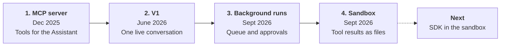
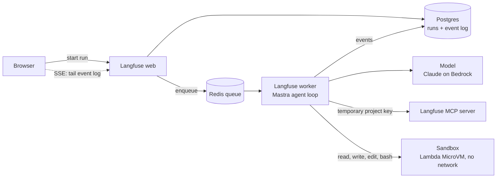

import { BlogHeader } from "@/components/blog/BlogHeader";

<BlogHeader
  title="How we built the Langfuse Assistant"
  description="todo"
  authors={["benbachem"]}
  date="October 21, 2026"
/>

Back in June we [launched](/changelog/2026-06-19-langfuse-assistant-public-beta) Halo, the [Langfuse Assistant](/docs/langfuse-assistant). You can ask it to do anything from interpreting your traces to building a dataset or setting up evals.

<Video src="https://static.langfuse.com/docs-videos/in-app-agent.mp4" />

We have been giving agents access to Langfuse for a long time: through the [MCP server](/docs/api-and-data-platform/features/mcp-server), the [CLI](/docs/api-and-data-platform/features/cli), the [API](/docs/api-and-data-platform/features/public-api), and the [Langfuse skill](/docs/api-and-data-platform/features/agent-skill). That works well for many users who bring their own agent, but we still wanted an agent that works inside the Langfuse UI.

Our main goal was getting a first version out fast, in a secure way. This post covers how we set up Halo and the trade-offs we made. If you're interested in reading how to set up an assistant-like agent inside an existing product in relatively little time, with good security, this post is for you.

<p><mark>*Ben: how many engineers worked on this, and how long did V1 and the background/sandbox work take? One sentence here.*</mark></p>

<p><mark>*Ben: was self-hosting a reason to skip Temporal and keep the sandbox optional? If yes, add one sentence here, e.g. "Langfuse is open source, and whatever we run, self-hosters have to run too."*</mark></p>

## How the Assistant is put together

The Assistant evolved gradually into where it is now:



<p><mark>*Ben: when did the skill get exposed to the agent?*</mark></p>

We improved the [MCP server](/blog/2025-12-09-building-langfuse-mcp-server) first and extended it to traces, observations, and metrics, because we knew the Assistant would use it. V1 was a [Mastra](https://mastra.ai) agent behind an HTTP endpoint that streamed one live conversation to the browser. Then we [moved runs to the background](/changelog/2026-09-03-langfuse-assistant), added approvals for actions that change data, and added the sandbox.

This is how it is put together now:



<p><mark>*Ben: this diagram was generated with AI from the code. Please confirm it is correct, or edit it.*</mark></p>

<p><mark>*TODO Ben: describe the diagram above.*</mark></p>

## All data access goes through the MCP server

Halo uses the same MCP server you can connect to Claude Code or Cursor, so its requests go through the authentication and permission checks we had already built, and there is no second path to customer data that we have to secure. The agent also has no web fetch and no network access.

For each run, the worker creates a temporary API key scoped to the project. By default that key can only call MCP tools annotated as read-only. Before a tool is exposed to the model at all, we check it against the signed-in user's role, so the agent never sees a tool the user could not use in the UI or API. Tools that change data need the user's approval. An approval lets the server add that one tool to the key for that one call, or for the rest of the conversation if the user chooses **Always approve**. It never gives the agent more permissions than the user has.
Halo receives hacking attempts every day. A common pattern is links to executables. Because Halo does not have web search access and can only use the Langfuse MCP, this is not a problem.

<p><mark>*Placeholder: screenshots of hacking attempts.*</mark></p>

The trade-off is that Halo can only do what MCP tools expose. Every new capability means a new MCP tool first. This is a good thing: every tool we add for the Assistant is also available to everyone who uses the MCP server directly.

## The agent does not run in a sandbox

The common pattern for coding agents is to run the agent inside a container with a shell and a file system. In the case of Halo, the agent loop runs in our normal worker process, and on its own it has no shell, file system, or network.

A shell and a file system need memory and disk reserved for each agent, which makes them expensive to scale. Most questions to Halo do not need either: answering a docs question or querying yesterday's traces only takes a few MCP calls. So by default, Halo reserves no memory or disk, and those runs scale with the backend workers we already operate.

When a task does need a file system, the agent has `read`, `write`, `edit`, and `bash` tools that look like normal file system tools. They are backed by a sandbox for that conversation, an [AWS Lambda MicroVM](https://docs.aws.amazon.com/lambda/latest/dg/microvms-networking.html) that only exists once the agent starts using them. The MicroVM has no egress, and its code runs as an unprivileged user. It suspends after 60 seconds idle and is gone after four hours. If the agent comes back to a conversation after that, it gets a fresh VM and a note that its earlier files are gone.

<Callout type="info">
  On self-hosted deployments the sandbox is optional. Without it, the Assistant
  works with MCP tools only.
</Callout>

The cost is that the sandbox can do very little. It has no network, so there is no way to use the Langfuse SDK or CLI from inside it: we decided on this for security and speed of getting Halo live, and adding this functionality is something we'll do later. It means enforcing the same checks outside MCP, something we have not built yet.

## Tool results become files the agent can process with code

If you ask the Assistant to group the errors in a few hundred failed observations, a normal tool call loads every observation into the model's context. That is slow and expensive, and quality drops as the context fills up. Instead, when a sandbox is available, every MCP tool gets an extra optional `silent` parameter:

```ts
// Simplified: when a sandbox is available, every MCP tool gets an optional `silent` flag.
tool.execute = async ({ silent, ...input }, context) => {
  const result = await execute(input, context);
  persistToolCall({ toolName, toolCallId, result }); // stored with the run

  if (!silent || isError(result)) return result; // failures are never silenced
  return `Output saved to /workspace/tool_calls/${toolName}_${toolCallId}.json`;
};
```

When the agent sets `silent: true`, the MCP result does not go into the model's context. The worker saves it as a JSON file in the sandbox, and the model only sees the file path. The agent can then fetch the observations in ten MCP calls, write a script that groups the errors across all the files, and read only the script's output.

<p><mark>*Placeholder: trace screenshot of a run that uses silent MCP calls and a script to group errors.*</mark></p>

<Callout type="info">
This pattern does the same as programmatic tool calling, sometimes called code mode, where the agent writes a script whose functions are MCP calls. OpenCode does this, and Mastra released [Code Mode](https://mastra.ai/blog/introducing-code-mode) in June 2026. When we designed this, Mastra did not support Code Mode yet. The `silent` flag is a good workaround that gets you most of the way with very little code.
</Callout>

## Background runs without Temporal

We discussed using a durable execution engine like Temporal and decided against it. A run is interactive and usually short. If it fails, the user can retry it. That did not justify new infrastructure for us, or for anyone self-hosting Langfuse.

Instead, each run is a job on our existing [BullMQ](https://docs.bullmq.io) queue in Redis, and its state lives in Postgres. While a worker runs it, the worker sends a heartbeat every five seconds. If the heartbeat stops for a minute, the run is marked as failed and the user can retry. When the agent needs approval for a tool, the run stops, so no worker is held while the user decides. Their decision starts a new job that continues the conversation from the event log.

The cost is that a failed run starts over, and there is one case we cannot recover from cleanly. If a run fails after an approved action started but before its result was saved, we do not know whether the action went through. We never retry that run automatically, and the user gets this message: "The approved action may have completed. Verify before retrying." For a run that takes minutes, we accept that.

If your runs take hours, cost a lot, or have side effects you cannot check afterwards, you should use something like Temporal.

## Halo uses the same Langfuse skill as your coding agent

Halo's system prompt only covers what is specific to working inside the Langfuse UI: how to handle approvals, how to link to Langfuse pages, which internal environments to leave out of answers, and how to keep answers short.

Everything else about working with Langfuse and following best practices, for example setting up evals or migrating prompts, comes from the open source [Langfuse skill](/docs/api-and-data-platform/features/agent-skill), the same one you can install in Claude Code or Cursor. We load it into Halo as a Mastra skill.

This means we maintain one set of best-practice instructions for both external coding agents and Halo.

## What's next

- SDK access in the sandbox

The Assistant is live on [Langfuse Cloud](https://cloud.langfuse.com) and in public beta for [self-hosted deployments](/self-hosting/configuration/langfuse-assistant). If one of these decisions gets in your way, tell us in the [feedback discussion](https://github.com/orgs/langfuse/discussions/14196).

If you like working on this kind of problem, [we are hiring](/careers).
