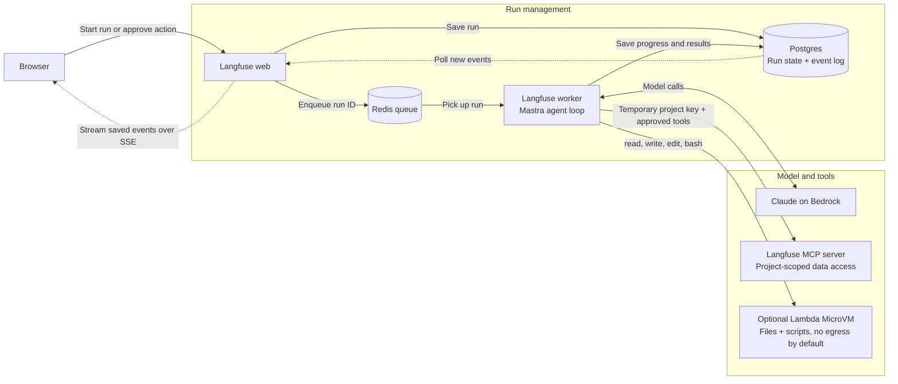
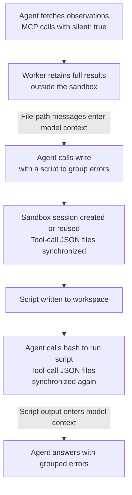

import { BlogHeader } from "@/components/blog/BlogHeader";
import { AssistantMilestones } from "@/components/blog/AssistantMilestones";
import { AssistantAccessDiagram } from "@/components/blog/AssistantAccessDiagram";

<BlogHeader
  title="How we built the Langfuse Assistant"
  description="How we built the Langfuse Assistant on our existing MCP server, why the agent runs outside its sandbox, and how we handle background runs."
  authors={["lotteverheyden", "benbachem"]}
  date="October 21, 2026"
/>

Back in June we [launched](/changelog/2026-06-19-langfuse-assistant-public-beta) Halo, the [Langfuse Assistant](/docs/langfuse-assistant). You can ask it to interpret your traces, build a dashboard or dataset, or help set up evals without leaving the Langfuse UI.

It's somewhat ironic: as a company focused on helping others build agents, we didn't have an in-product agent of our own. We've invested in building the infrastructure and tools for agent integration, such as the [Langfuse skill](/docs/api-and-data-platform/features/agent-skill), [MCP server](/docs/api-and-data-platform/features/mcp-server), and [CLI](/docs/api-and-data-platform/features/cli), for using Langfuse with agents like Claude Code or Cursor. Now we wanted to bring those capabilities into Langfuse itself.

<Video src="https://static.langfuse.com/docs-videos/in-app-agent.mp4" />

When we first discussed whether we should write this post, I wasn't sure there was much to write about. The first version was simply a Mastra agent, an MCP server, and some code to glue them together. We didn't invent some super-efficient algorithm for agent execution, and we didn't rewrite anything in Rust (although there might be some other posts here coming soon). Building the in-product agent was mostly about integrating existing pieces and making them work smoothly together, as well as creating the foundations for future agentic features.

From the start, we knew we wanted to reuse as much as possible and share the tools and instructions behind Halo with people using Langfuse through Claude Code or Codex. We didn't want a second set of things to maintain just for the in-product agent. If we improved a tool or fixed some guidance for Halo, that should help people using their own agents too. That meant building on our existing MCP server as well as bringing the shared Langfuse skill into the Assistant.

<AssistantAccessDiagram />

## How the Assistant is put together

The first step was expanding the [MCP server](/blog/2025-12-09-building-langfuse-mcp-server). The [May 29 release](/changelog/2026-05-29-mcp-update) added tools for observations, metrics, scores, comments, datasets, and annotation queues, making most Langfuse project data available to agents. We needed these tools for Halo, but they were also useful to anyone connecting their own agent.

In June, we launched the first beta version of the Assistant: a [Mastra](https://mastra.ai) agent that ran behind an HTTP endpoint, streaming responses to the browser. It handled one conversation at a time, with no parallel work or background execution. In early July, we gave it write access with human-in-the-loop approvals, and later that month added a sandbox. We added background execution in August. We [announced all these capabilities together in September](/changelog/2026-09-03-langfuse-assistant).

<AssistantMilestones />

Here's the high-level architecture that we ended up with:



Users can ask Halo to investigate something, close the tab, and come back to its progress and results. The worker keeps going independently of the browser, while the saved event log lets the UI catch up when you return. MCP tools let Halo work with user's project data. The optional sandbox lets Halo process larger results with scripts instead of reading everything into the model's context. Neither gives it more access than you have, and actions that change data still need approval.

## Reusing the MCP server and skill

Halo uses our public MCP server, the same one you can connect to. The only tools it gets besides MCP are for interacting with the Langfuse UI, such as proposing a redirect to another page, or working in the sandbox. Almost all customer-data access goes through MCP, though we also give it some context about the user and the page they're on: their name, timezone, browser languages, and the current URL. By relying on MCP and tools, we can control which tools the Assistant gets to call without having to secure arbitrary network requests.

For each run, the worker creates a temporary API key scoped to the project. By default, it can only call read-only MCP tools. We maintain our own mapping of tool permissions rather than trusting the MCP server's read-only annotations. We also filter tools by the signed-in user's role before exposing them to the model. If the user's role doesn't allow an action, the agent doesn't get the tool for it.

Tools that change data require approval. The worker adds the approved tool to an allowlist in the MCP request headers, then removes that permission before continuing the agent loop. Choosing **Always approve** saves the approval for that conversation. We still recheck it against the user's current role on each run, so an approval can't give the agent permissions the user doesn't have.

If Halo needs another way to access project data, we have to add an MCP tool first. I actually like that constraint, though, because the same tool is then available to people using their own agents.

We do the same with instructions. Halo's system prompt explains how to handle approvals, link to Langfuse pages, and keep answers short. For guidance on using Langfuse, such as setting up evals or migrating prompts, we load the open source [Langfuse skill](/docs/api-and-data-platform/features/agent-skill) as a Mastra skill. It's the same one you can install in Claude Code or Cursor.

---

TODO: I think the text below does not belong in this section. Separate section on observability?

When an organization opts into [AI feature telemetry](/docs/langfuse-assistant#data-privacy-and-security), we can use traces of Assistant runs to see where it struggles. We also see people trying to break it. These attempts started as soon as we announced Halo and still turn up regularly. One example is asking it to download an executable from a link. With no web-fetch tool and no sandbox network access configured, it can't make that request.

When we see Halo struggle with a tool or give poor guidance, we want to fix the MCP tool or the shared skill. Maintaining a separate set of fixes just for Halo would defeat much of the point of sharing them.

Some of those fixes are fairly small. Agents kept asking to sort metrics by `totalCost_sum` when the tool expected `sum_totalCost`, so we [made the MCP adapter accept both](https://github.com/langfuse/langfuse/pull/15623). When dashboard creation failed validation, the error told the agent which field was wrong but not what it could use instead. We [added the allowed values and guidance on looking up the schema](https://github.com/langfuse/langfuse/pull/15630), so it had enough information to correct the call. Both changes help anyone using the MCP server, not just Halo.

---

## The agent does not run in a sandbox

We added the sandbox because we knew some tasks could be handled more efficiently by writing scripts for processing data than by putting raw tool outputs into the model's context. But giving the agent bash and file system tools didn't mean the agent itself had to move into a sandbox.

Many conversations don't need a sandbox at all. Answering a docs question or looking up yesterday's traces might only take a few MCP calls. Starting a VM for those conversations would cost us memory and disk, but not actually provide value in these cases.

There's also self-hosting. Langfuse is open source, and I don't think setting up an external sandbox provider should be a requirement for using the Assistant. Without one, it still works with MCP tools.

The downside is that each sandbox operation has to cross that process boundary, adding latency. For interacting with the sandbox, we give the agent tools: `read`, `write`, `edit`, and `bash`, backed by an [AWS Lambda MicroVM](https://docs.aws.amazon.com/lambda/latest/dg/microvms-networking.html). These are created when the agent first uses a sandbox tool. It runs as an unprivileged user, with no network egress configured by default. We configure it to suspend after 60 seconds idle and expire after four hours.

---

TODO: the things below should either be removed or put under a separate section

If the session has expired, the next sandbox operation creates a new one. Files the agent wrote are gone, and we tell it that. Saved MCP results survive because we store them outside the sandbox.

Without network access, scripts can't use the Langfuse SDK or CLI. That's a fairly large limitation, but they can still process data the agent fetched through MCP. Keeping data access in MCP meant we could add the sandbox without also having to secure arbitrary network calls from scripts.

## Processing tool results with code

Some Langfuse projects have traces containing large JSON structures, so we had to provide a way to access this data without blowing up Halo's context window.

With a sandbox, the agent can use tools like `grep`, `head`, `jq`, or a short Python script to work through the data itself. Say you ask it to group the errors in a few hundred failed observations. It doesn't need to read every field of every observation to do that. It can inspect the files, group the errors, and read only the output it needs.

When a sandbox is available, we add an optional `silent` parameter to every MCP tool so the agent can fetch data without putting the full result into the model's context:

```ts
// Simplified: when a sandbox is available, every MCP tool gets an optional `silent` flag.
tool.execute = async ({ silent, ...input }, context) => {
  const result = await execute(input, context);
  persistToolCall({ toolName, toolCallId, result }); // stored with the run

  if (!silent || isError(result)) return result; // failures are never silenced
  return `Output available at /workspace/tool_calls/${toolName}_${toolCallId}.json`;
};
```

With `silent: true`, the model gets a file path instead of the full result. The worker saves the result outside the VM. Before the next sandbox operation, we write the saved calls into the sandbox as JSON files containing the request and response. This also lets us restore them if the sandbox expires.

---

Looking through runs for this post, I saw Halo use short Python scripts to count observations, combine results from several files, and count errors by environment or model. Sometimes it just printed part of a file to see what was there. The agent decides what to inspect rather than having to read the whole response. Failed tool calls still return their errors to the model, even with `silent: true`.

Our first implementation of `silent` also hid some tool errors from the model. Some tool failures came back as structured responses rather than exceptions, so our wrapper saved them to a file just like successful results. The model got a file path instead of the validation error it needed to correct its call. We [fixed the failure detection](https://github.com/langfuse/langfuse/pull/16082) so those errors go straight back to the model instead.



You might have heard of code mode, or programmatic tool calling, where the model writes a script that calls tools and processes their results without sending everything back through the model. Mastra has [Code Mode](https://mastra.ai/blog/introducing-code-mode) for this. The tools still run on the host, but the script decides which ones to call and what to do with the results.

Our setup is more limited. The worker sends operations and data into the sandbox and gets results back, but scripts can't ask the worker to execute tools. They can only process the data we've supplied. Code mode would require adding that reverse path so a script could fetch another page of observations or request an action while running. Keeping MCP calls in the agent loop is less flexible, but lets us keep the sandbox interface narrow and use our existing permissions and approval flow. We also don't have to preserve a running script while waiting for someone to approve a write.

## Background runs

When we added background execution, we wanted runs to continue when someone closed the browser, but didn't need to resume every interrupted model call or tool execution. For an interactive chat, we were comfortable showing a failure and letting the user retry. Writes make that decision less straightforward, though.

We already use [BullMQ](https://docs.bullmq.io), so we use it to deliver run IDs to workers. Postgres stores the run state. A worker claims a queued run and sends a heartbeat every five seconds. When someone reads or watches the conversation, we check that heartbeat. If it's more than a minute old, we consider the worker lost and mark the run as failed.

Waiting for approval doesn't tie up a worker. The run stops, and the user's decision creates a child run that continues from the saved conversation. An approval wait can therefore survive a restart, even though we don't checkpoint active execution.

A worker can die after completing an approved write but before saving the result. The data has changed, but the conversation doesn't show it. That's why we don't automatically retry failed runs. If we catch the failure, we can save a warning telling the user to check the action before retrying. If the worker disappears entirely, we can only show a generic interruption. In either case, we may not know whether the write completed.

If your runs take hours, cost a lot, or have side effects you can't check afterwards, I'd probably make a different choice and use a durable workflow engine.

## What's next

We're exploring giving sandbox scripts access to the Langfuse SDK and the project's configured LLM connections. Evaluator calibration is one possible use case: testing an evaluator against human-labeled examples, changing its prompt, and checking whether the results improve.

We'd need to restrict scripts to the requests the user is allowed to make and has approved. We're still exploring how to do that, so neither SDK access nor LLM connections are available to sandbox scripts today.

The Assistant is live on [Langfuse Cloud](https://cloud.langfuse.com) and in public beta for [self-hosted deployments](/self-hosting/configuration/langfuse-assistant). If one of these decisions gets in your way, tell us in the [feedback discussion](https://github.com/orgs/langfuse/discussions/14196).

If you like working on this kind of problem, [we are hiring](/careers).
