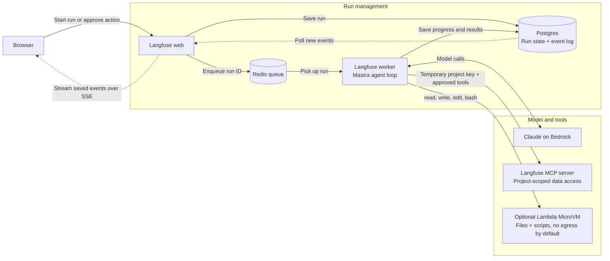

import { BlogHeader } from "@/components/blog/BlogHeader";
import { AssistantMilestones } from "@/components/blog/AssistantMilestones";
import { AssistantAccessDiagram } from "@/components/blog/AssistantAccessDiagram";
import { SilentToolCallsDiagram } from "@/components/blog/SilentToolCallsDiagram";
import { BackgroundRunDiagram } from "@/components/blog/BackgroundRunDiagram";

<BlogHeader
  title="How we built the Langfuse Assistant"
  description="How we built the Langfuse Assistant on our existing MCP server, why the agent runs outside its sandbox, and how we handle background runs."
  authors={["lotteverheyden", "benbachem"]}
  date="October 21, 2026"
/>

In June, we [launched](/changelog/2026-06-19-langfuse-assistant-public-beta) Halo, the [Langfuse Assistant](/docs/langfuse-assistant). You can ask it to interpret your traces, build a dashboard or dataset, or help set up evals without leaving the Langfuse UI.

It's somewhat ironic: as a company focused on helping others build agents, we didn't have an in-product agent of our own. We've invested in building the infrastructure and tools for agent integration, such as the [Langfuse skill](/docs/api-and-data-platform/features/agent-skill), [MCP server](/docs/api-and-data-platform/features/mcp-server), and [CLI](/docs/api-and-data-platform/features/cli), for using Langfuse with agents like Claude Code or Cursor. Now we wanted to bring those capabilities into Langfuse itself.

<Video src="https://static.langfuse.com/docs-videos/in-app-agent.mp4" />

When we first discussed whether we should write this post, I wasn't sure there was much to write about. The first version was simply a Mastra agent, an MCP server, and some code to glue them together. We didn't invent some super-efficient algorithm for agent execution, and we didn't rewrite anything in Rust (although there might be some other posts here coming soon). Building the in-product agent was mostly about integrating existing pieces and making them work smoothly together while laying the foundations for future agentic features.

From the start, we knew we wanted to reuse as much as possible and share the tools and instructions behind Halo with people using Langfuse through Claude Code or Codex. We didn't want a second set of things to maintain just for the in-product agent. If we improved a tool or fixed some guidance for Halo, that should help people using their own agents too. That meant building on our existing MCP server as well as bringing the shared Langfuse skill into the Assistant.

<AssistantAccessDiagram />

## How the Assistant is put together

The first step of building Halo was expanding the [MCP server](/blog/2025-12-09-building-langfuse-mcp-server). The [May 29 release](/changelog/2026-05-29-mcp-update) added tools for observations, metrics, scores, comments, datasets, and annotation queues, making most Langfuse project data available to agents. We needed these tools for Halo, but they were also useful to anyone connecting their own agent.

In June, we launched the first beta version of the Assistant: a [Mastra](https://mastra.ai) agent that ran behind an HTTP endpoint, streaming responses to the browser. It handled one conversation at a time, with no parallel work or background execution. In early July, we gave it write access with human-in-the-loop approvals, and later that month added a sandbox. We added background execution in August. We [announced all these capabilities together in September](/changelog/2026-09-03-langfuse-assistant).

<AssistantMilestones />

Here's the high-level architecture that we ended up with:



Users can ask Halo to investigate something, close the tab, and come back to its progress and results. The worker keeps going independently of the browser, while the saved event log lets the UI catch up when you return. MCP tools let Halo work with the user's project data. The optional sandbox lets Halo process larger results with scripts instead of reading everything into the model's context. Neither gives it more access than you have, and actions that change data still need approval.

## Reusing the MCP server and skill

Halo uses our public MCP servers, the same ones you can connect to. The only tools it gets besides our MCP servers are for functionality that your coding agent already has built in or that is specific to the Langfuse UI, such as proposing a redirect to another page or working in the sandbox. All customer-data access goes through MCP. In addition to the tools and MCP, we also give the agent some context about the user and the page they're on: the user's name, time zone, browser languages, and the current URL. By relying on MCP and tools, we can control which tools the Assistant gets to call without having to secure arbitrary network requests.

For each run, the worker creates a temporary API key scoped to the project. By default, it can only call read-only MCP tools. We maintain our own mapping of tool permissions in the in-app agent's code rather than trusting the MCP server's read-only annotations. We also filter tools by the signed-in user's role before exposing them to the model. If the user's role doesn't allow an action, the agent won't even see the tool for it at all and it won't be able to attempt the action.

Tools that change data require approval. Choosing **Always approve** saves the approval for that conversation only. We still recheck it against the user's current role on each run, so an approval can't give the agent permissions the user doesn't have.

If Halo needs another way to access project data, we have to add an MCP tool first. This might seem restrictive at first, but I actually like that constraint, because the same tool is then available to people using their own agents.

We do the same with instructions. Halo's system prompt explains how to handle approvals, link to Langfuse pages, and keep answers short. For guidance on using Langfuse, such as setting up evals or migrating prompts, we load the open-source [Langfuse skill](/docs/api-and-data-platform/features/agent-skill) as a Mastra skill and rely on the [Docs MCP](/docs/docs-mcp). You can also use both of these with external agents like Claude Code or Cursor.

## Using Langfuse for the Langfuse Assistant

Of course, we're using Langfuse itself to observe and analyze the behavior of the Assistant.

When an organization opts into [AI feature telemetry](/docs/langfuse-assistant#data-privacy-and-security), we can use traces of Assistant runs to see where it struggles. When we see Halo struggle with a tool or give poor guidance, we fix the MCP tool or shared skill, or improve our documentation. This way, improvements driven by Halo's interactions benefit all users.

Some of those fixes can be very straightforward. Agents kept asking to sort metrics by `totalCost_sum` when the tool expected `sum_totalCost`, so we [made the MCP adapter accept both](https://github.com/langfuse/langfuse/pull/15623). When dashboard creation failed validation, the error told the agent which field was wrong but not what it could use instead. We [added the allowed values and guidance on looking up the schema](https://github.com/langfuse/langfuse/pull/15630), so it had enough information to correct the call.

We also see a lot of people trying to break Halo or exploit it in unexpected ways. These attempts started as soon as we announced Halo and still turn up regularly. Security was a major consideration in the design of both the agent and the sandbox. Some of the design decisions might seem restrictive at first, but given the number of malicious attempts we see, they are necessary to keep the system secure and protect user data.

## The agent does not run in a sandbox

We added the sandbox because we knew some tasks could be handled more efficiently by writing scripts for processing data than by putting raw tool outputs into the model's context. But giving the agent bash and file system tools didn't mean the agent itself had to move into a sandbox.

For interacting with the sandbox, we give the agent four tools: `read`, `write`, `edit`, and `bash`. When the agent first uses one of these tools in a conversation, we create a new sandbox instance that is limited to that conversation. The sandbox instance is isolated and ephemeral, with no network egress configured by default. Code the agent writes is executed as an unprivileged user within the sandbox. After some period of inactivity, the sandbox is suspended and eventually terminated and cleaned up.

From within the sandbox, no process can make additional requests to Langfuse or the wider internet directly. Only the agent will push data that has been previously fetched through authorized MCP calls into the sandbox. Keeping data access in MCP meant we could add the sandbox without also having to secure arbitrary network calls from within it.

Many conversations don't need a sandbox at all. Answering a docs question or looking up yesterday's traces might only take a few MCP-based lookups. Starting a VM for those conversations would cost us memory and disk, but not actually provide value in these cases, so having the agent loop run outside of it is more efficient.

There's also self-hosting. Langfuse is proudly open-source, and we have lots of users self-hosting it. For Langfuse Cloud, we use [AWS Lambda MicroVMs](https://docs.aws.amazon.com/lambda/latest/dg/microvms-networking.html) for the sandbox, but the sandbox interface the agent interacts with is built to be adaptable to different providers. Ultimately though, self-hosters can also choose to not use a sandbox at all. Without one, Halo still works.

## Processing tool results with code

Some of the work Halo does consists of reading large amounts of traces, and some Langfuse projects have large amounts of data stored in their traces, such as large JSON structures. We had to provide a way to access this data without blowing up Halo's context window.

Halo can scan through large amounts of data using the sandbox and tools like `grep`, `head`, `jq`, or a short Python script. Say you ask it to group the errors in a few hundred failed observations. It doesn't need to read every field of every observation to do that. It can inspect the files, group the errors, and read only the output it needs. To allow for this, we add an optional `silent` parameter to every MCP tool when a sandbox is available. This allows the agent to fetch data without putting the full result into the model's context:

```ts
// Simplified: when a sandbox is available, every MCP tool gets an optional `silent` flag.
tool.execute = async ({ silent, ...input }, context) => {
  const result = await execute(input, context);
  persistToolCall({ toolName, toolCallId, result }); // stored with the run

  if (!silent || isError(result)) return result; // failures are never silenced
  return `Output available at /workspace/tool_calls/${toolName}_${toolCallId}.json`;
};
```

With `silent: true`, the model gets a file path instead of the full result. Before the next sandbox operation, we then write the saved calls into the sandbox as JSON files containing the request and response.

<SilentToolCallsDiagram />

When looking through runs for this post to find examples, I saw Halo use short Python scripts to count observations, combine results from several files, and count errors by environment or model. Sometimes it just printed part of a file to see what was there. The agent decides what to inspect rather than having to read the whole response.

<Callout type="info">

You might have heard of code mode, or programmatic tool calling, where the model writes a script that calls tools and processes their results without sending everything back through the model. Mastra has [Code Mode](https://mastra.ai/blog/introducing-code-mode) for this. The tools still run on the host, but the script decides which ones to call and what to do with the results. Our setup is more limited: because we currently prevent requests from the sandbox back to Langfuse, scripts can't ask the worker to execute tools, which keeps the sandbox interface very narrow and controlled. We're exploring ways to allow this in the future but only if it doesn't compromise security.

</Callout>

## Background runs

In the initial implementation of Halo, the agent loop ran in an HTTP handler. If a user closed the browser, the network request would be interrupted and the agent would stop processing actions. To enable longer-running operations as well as headless invocation, we needed a way to decouple the agent loop from the HTTP request lifecycle.

The architecture of Langfuse already included a web server and worker split, so we moved the agent loop from the HTTP handler to the worker. We use Postgres to store Halo's run state. New runs are created by the web server, persisted to Postgres and then scheduled through BullMQ. While a user is actively watching a conversation, the web server continuously monitors the Postgres-backed conversation and streams back events to the user's browser through Server-Sent Events.

When an approval step is presented to the user, the run completes with a pending approval status. When the user approves or denies a proposed step, it creates a new run that continues from the saved conversation in Postgres.

<BackgroundRunDiagram />

**We decided not to automatically retry failed runs.** This was a trade-off between keeping it simple and user experience. Because today Halo's runs are relatively short, this was an acceptable decision to make. If your runs take hours, cost a lot, or have side effects you can't check afterward, I'd probably make a different choice and use a durable workflow engine. Should we see similar requirements in the future, we might revisit this decision.

## What's next

We're exploring giving sandbox scripts access to the Langfuse SDK and the project's configured LLM connections. The SDK would unlock new capabilities for Halo such as evaluator calibration: testing an evaluator against human-labeled examples, changing its prompt, and checking whether the results improve. We'd need to restrict scripts to the requests the user is allowed to make and has approved. Given security concerns, this is non-trivial and we're still exploring how to do that.

The Assistant is live on [Langfuse Cloud](https://cloud.langfuse.com) and in public beta for [self-hosted deployments](/self-hosting/configuration/langfuse-assistant). If one of these decisions gets in your way, tell us in the [feedback discussion](https://github.com/orgs/langfuse/discussions/14196).

If you like working on this kind of problem, [we are hiring](/careers).
