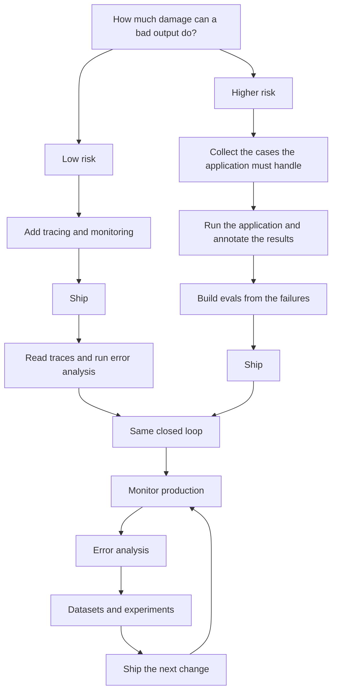

import { BlogHeader } from "@/components/blog/BlogHeader";

<BlogHeader
  title="How do I get started with evals?"
  description="Three kinds of evals, how to decide what to measure, and which entry point fits the risk of your application."
  date="October 22, 2026"
  authors={["annabellschafer"]}
/>

<Callout type="info">
  This post is a map. For the hands-on depth on tracing, monitoring, datasets,
  experiments, and evaluators, head over to the [Langfuse Academy](/academy).
</Callout>

"How do I get started with evals?" is the question we hear more than any other. Here is how we answer it: there are three kinds of evals, you first need to figure out what is worth measuring, and where you start depends on how risky your use case is. Whichever way you start, you end up in the same loop of continuous improvement.

## Three kinds of evals [#three-kinds-of-evals]

When teams say "evals", they usually mean one of three things.

**1. Signal detection on production data.** Here you look for the traces that deserve a closer look, for example when a user disagrees or asks for a human, or when an agent calls the same tool over and over. [Signals](/academy/monitoring#metrics-and-signals) point you to the exact trace to open, and [user signals](/academy/monitoring/capturing-signals#four-kinds) are cheap because your users react to every output anyway. For chat applications, we like to start with user disagreement or frustration, as described in [high-signal production monitoring](/blog/2026-04-01-llm-as-a-judge-production-monitoring) and [catching conversation signals](/blog/2026-09-23-catching-conversation-signals-in-langfuse).

**2. Measuring quality in production.** Here you score live traffic, usually a sample of it, against criteria that matter for your application. Did the answer stay within the retrieved policy? Did the agent pick the right tool? Does the reply follow the required format? The setup is described in [online evaluation](/docs/evaluation/get-started/online).

**3. Offline evals on datasets.** Before you ship a new version, you run it against a dataset and check whether it is better, or cheaper, than the one in production. [Offline evaluation](/academy/evaluate) sits between running an experiment and deciding to ship. To set one up, follow [evaluate with datasets](/docs/evaluation/get-started/offline).

The three feed into each other: production surfaces the cases your dataset missed, and those cases go back into the dataset for the next experiment. Our [evaluation guide](/blog/2025-11-12-evals) describes this in more detail, and the Academy sorts individual scores into [goal metrics, guardrails, and operational metrics](/academy/evaluate/choosing-what-to-evaluate#the-three-roles).

## First, figure out what to measure [#decide-what-to-measure]

Before you pick any of the three, you need to know what is worth measuring, and the best way to find out is to read your own traces. Generic criteria like helpfulness are tempting, but they rarely match how your application fails, so [write evaluators for the errors you discover](/academy/evaluate/choosing-what-to-evaluate). Hamel Husain calls skipping error analysis the most common mistake in his [field guide](https://hamel.dev/blog/posts/field-guide/), and in the [evals FAQ](https://hamel.dev/blog/posts/evals-faq/) he and Shreya Shankar describe spending 60 to 80 percent of development time on error analysis and evaluation.

[Error analysis](/academy/monitoring/error-analysis) gives this reading a structure. Pick 30 to 50 traces, note what went wrong in each, and mark it pass or fail. Then cluster the notes into failure categories and create one score per category you want to act on. The [error analysis guide](/guides/cookbook/error-analysis-llm-applications) walks you through it step by step. For our own docs chatbot, most of the value early on, somewhere around 80 percent, came from a person actually looking at the data. [Our full setup](/blog/2026-07-16-steal-our-eval-setup) is there for you to copy.

A few rules of thumb help you keep your set of evals small:

- **Start from failures you have seen.** The exceptions are hard requirements like [compliance, safety, and format rules](/academy/evaluate/choosing-what-to-evaluate#goals-and-hard-constraints), which deserve an evaluator from day one.
- **Fix what you can fix.** If a prompt change solves the problem, make the change and move on. Only keep a metric for [failures that keep coming back](/academy/evaluate/choosing-what-to-evaluate#fix-first).
- **Tie every score to a decision.** A score should tell you when to block a release, roll back a prompt, or start an investigation.
- **Start with one evaluator.** Use a [code evaluator](/docs/evaluation/evaluation-methods/code-evaluators) for deterministic checks like valid JSON, and an [LLM-as-a-judge](/docs/evaluation/evaluation-methods/llm-as-a-judge) when the check needs language understanding. Add more as error analysis surfaces new failure modes.

You can do all of this before going live, too: a small set of representative inputs is enough to [run error analysis locally](/academy/monitoring/error-analysis#when-to-run-it).

## The entry point depends on risk [#entry-point-depends-on-risk]

You don't have to close the full loop on day one. The [AI engineering loop](/academy/ai-engineering-loop#you-dont-have-to-close-the-full-loop-on-day-one) describes two common starting points: tracing or an early dataset. Which one fits depends on how much damage a bad output can do.

**Low-risk use cases: trace, ship, then review.** If a bad output is cheap and you have no historical data to learn from, add tracing and monitoring, go to production, and learn from real usage. In the Academy's [music streaming DJ](/academy/examples/music-streaming-dj) example, the worst case is a skipped song or an awkward comment, so the team goes live early and learns from listener behavior. Datasets and experiments follow once you know what is worth measuring.

**Higher-risk use cases: dataset first, then ship.** If a single bad answer can hurt your users or your brand, start with a dataset of the cases your application must handle. Run your application against it, annotate the results, build evals from what you find, and ship once you are confident. Teams in regulated industries often need exactly this. The [customer support chatbot](/academy/examples/customer-support-chatbot) example rolls out in three phases: offline on historical tickets, then as internal drafts the support team edits, and finally answering customers directly.

On both paths, add tracing early: it shows which step failed, and once you are live, traces become the source for your next dataset.

## Where the golden dataset comes from [#where-a-golden-dataset-comes-from]

A common follow-up question is where the expected outputs for a dataset come from. First of all, you might not need them: if every item can be judged with the same rule, like tone or format, a [reference-free evaluator](/academy/evaluate#reference-based-vs-reference-free) works on the input alone. When you do need a reference, it can be a label, a required fact, an expected tool call, or something the reply must not do, as shown in [common expected output patterns](/academy/datasets#common-expected-output-patterns).

Good sources, covered in [designing datasets](/academy/datasets/designing-great-datasets), are reviewed production traces, resolved support tickets and FAQs, and expert-written or synthetic cases for the gaps. Start small. About 15 to 30 rows is enough for a first version, and [Anthropic's guide to agent evals](https://www.anthropic.com/engineering/demystifying-evals-for-ai-agents) suggests a similar start of 20 to 50 tasks drawn from real failures.

For agents that depend on live tools or state, build the dataset around the step that fails and store the state that step sees, such as conversation history and tool results. Later, you can reuse the same dataset to [compare a new model](/academy/experiments) or [bring costs down](/academy/experiments/cost-optimization).

## Both paths end in the same loop [#both-paths-join-the-same-loop]

After the first release, both paths look the same: you monitor production, run error analysis, pull interesting cases into datasets, test changes in experiments, and ship the version that holds up. This is the [AI engineering loop](/academy/ai-engineering-loop). A few tips we share with teams at this stage:

**Fix your traces before building evals.** Evaluators read the input and output of specific observations, so fragmented traces leave them nothing solid to work with. [What does a good trace look like?](/docs/observability/best-practices) is a good checklist.

**Sample your online evals.** A typical [LLM-as-a-judge](/docs/evaluation/evaluation-methods/llm-as-a-judge) evaluation costs around $0.01 to $0.10. When you set up an [evaluation rule](/docs/evaluation/get-started/online), check the estimated cost and lower the sampling rate until the spend fits what the score is worth to you. Cheaper code checks can run on more traffic.

**Validate your LLM judge with humans.** Label some cases yourself, run the judge on them, and compare. Our [calibration guide](/guides/llm-as-a-judge-calibration-skill) walks through the workflow, and [score analytics](/docs/evaluation/scores/score-analytics#human-vs-ai-annotation-agreement) shows the agreement. Repeat this whenever you change the judge prompt, your application, or the model.

**Gate your releases.** Once your dataset is stable, run it in [CI](/docs/evaluation/experiments/experiments-ci-cd) so a prompt or model change gets checked against known failures before it ships.

## Common mistakes [#common-mistakes]

These are the patterns we see most often when teams get started:

- **Starting with generic criteria.** Helpfulness or hallucination scores added before anyone has read a trace are hard to act on. Read 30 to 50 traces first.
- **Building evals on messy traces.** If spans are unnamed or tool results are missing, every evaluator built on top inherits the problem.
- **Building datasets without error analysis.** Base your dataset on failures you have seen and on cases your product must handle.
- **Treating monitoring as evaluation.** Latency, cost, and error rates tell you that something changed. Whether the answers are good, you only learn by reading or scoring traces.
- **Trying an LLM judge once and giving up.** The first judge prompt often disagrees with your own labels. Keep a small labeled set and iterate.
- **Relying only on thumbs up or down.** [Explicit feedback](/academy/monitoring#user-feedback) is clear but rare, and unhappy users respond more often. Add [conversation signals](/academy/monitoring/capturing-signals#conversation-signals) to catch more.
- **Using an evaluator where a guardrail belongs.** An evaluator scores what already happened. If a failure must never reach the user, add a [runtime guardrail](/docs/security-and-guardrails) and use evals to check that it works.

## Where to go next [#where-to-go-next]

Pick the entry point that matches your risk, read your traces, and start with one evaluator you will actually act on. From there, the Academy has the details:

- [Langfuse Academy](/academy) and the [AI engineering loop](/academy/ai-engineering-loop)
- [Choosing what to evaluate](/academy/evaluate/choosing-what-to-evaluate) and [error analysis](/academy/monitoring/error-analysis)
- [Online evaluation](/docs/evaluation/get-started/online) and [offline evaluation](/docs/evaluation/get-started/offline)
- [Worked examples](/academy/examples): the [music streaming DJ](/academy/examples/music-streaming-dj) and the [customer support chatbot](/academy/examples/customer-support-chatbot)
