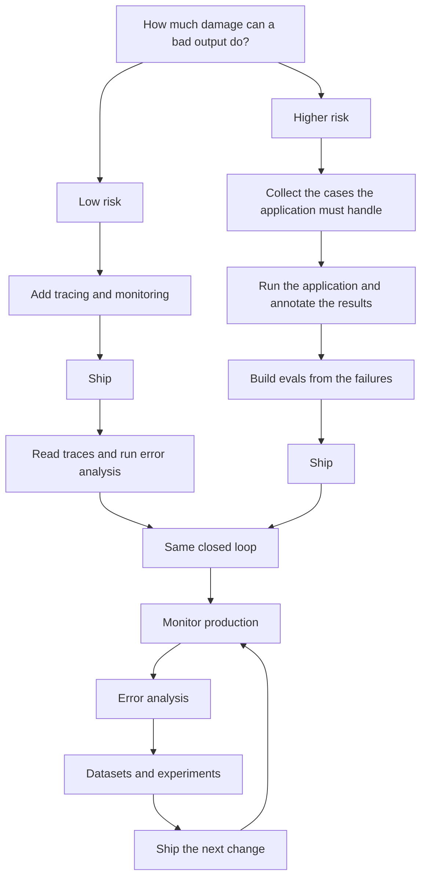

import { BlogHeader } from "@/components/blog/BlogHeader";

<BlogHeader
  title="How do I get started with evals?"
  description="Three kinds of evals, how to decide what to measure, and which entry point fits the risk of your application."
  date="October 22, 2026"
  authors={["annabellschafer"]}
/>

<Callout type="info">
  The [Langfuse Academy](/academy) is the how-to for tracing, monitoring,
  datasets, experiments, and evaluators. This post is the map in front of those
  pages.
</Callout>

"How do I get started with evals?" is the question teams ask us most often. The Academy meets it once traces exist: the data is there, and the next step is unclear. There are three kinds of evals. Before you pick one, decide what is worth measuring. Risk chooses the entry point. Both paths end in the same closed loop.

## There are three kinds of evals [#three-kinds-of-evals]

**Signal detection on production data.** You look for traces that deserve a person: a user who leaves, disagrees, or asks for a human; an agent that retries, calls the same tool in a loop, or sits in a slow tail. [Monitoring](/academy/monitoring#metrics-and-signals) keeps this separate from trend lines such as cost, latency, and scores. [Capturing signals](/academy/monitoring/capturing-signals#four-kinds) is the cheap quality judgment, because the user already reacted. For chat, start with disagreement or frustration, as in [high-signal production monitoring](/blog/2026-04-01-llm-as-a-judge-production-monitoring) and [catching conversation signals](/blog/2026-09-23-catching-conversation-signals-in-langfuse).

**Measuring quality in production.** You score live traffic, usually a sample, against criteria for this application: the answer stayed inside the retrieved policy, the agent called the right tool, the reply matched a required format. Setup is [online evaluation](/docs/evaluation/get-started/online).

**Offline evals before a ship.** You run a candidate on a dataset and check that it is better, or cheaper, than the version you run now. [Offline evaluation](/academy/evaluate) sits between an experiment and the ship decision. See [evaluate with datasets](/docs/evaluation/get-started/offline). An experiment checks a change before it goes out, production catches cases the dataset missed, and those cases go back into the dataset. The [evaluation guide](/blog/2025-11-12-evals) and the [evaluation overview](/docs/evaluation/overview) describe that loop.

The Academy also sorts metrics into three roles. [Goal metrics](/academy/evaluate/choosing-what-to-evaluate#the-three-roles) are the ones you push up. Guardrail metrics watch failures that have to stay rare. Operational metrics, such as cost and latency, come from the trace. Use the jobs to pick a motion, and the roles to pick which scores to keep.

## Decide what to measure [#decide-what-to-measure]

Read traces before you name a metric. [Choosing what to evaluate](/academy/evaluate/choosing-what-to-evaluate) states the rule: write evaluators for errors you discover. Helpfulness and hallucination rarely match how your application fails. [Hamel Husain's field guide](https://hamel.dev/blog/posts/field-guide/) names skipping error analysis as the central mistake. His [evals FAQ](https://hamel.dev/blog/posts/evals-faq/), with Shreya Shankar, describes projects where about 60 to 80 percent of development time goes to error analysis and evaluation.

[Error analysis](/academy/monitoring/error-analysis) is the method. Pull 30 to 50 traces, note what happened, and mark pass or fail. Cluster the notes, then add one boolean score per category you will act on. The [choosing page](/academy/evaluate/choosing-what-to-evaluate#starting-from-zero) and the [cookbook](/guides/cookbook/error-analysis-llm-applications) walk through it. In our docs-chatbot writeup, most of the early value, somewhere around 80 percent, came from a person looking at the data. [You can copy that setup](/blog/2026-07-16-steal-our-eval-setup).

Seen failures get evaluators. [Compliance, safety, and format contracts](/academy/evaluate/choosing-what-to-evaluate#goals-and-hard-constraints) get one from the start. A prompt change that removes a failure can ship on its own. Keep a metric when the failure will return. See [one-time fixes](/academy/evaluate/choosing-what-to-evaluate#fix-first). Every score needs a decision behind it: block a deploy, roll back a prompt, or open an investigation. Start with one evaluator, a [code check](/docs/evaluation/evaluation-methods/code-evaluators) for a deterministic failure and an [LLM judge](/docs/evaluation/evaluation-methods/llm-as-a-judge) when the failure is about meaning. [When to run error analysis](/academy/monitoring/error-analysis#when-to-run-it) includes a small local set.

## Where a golden dataset comes from [#where-a-golden-dataset-comes-from]

A dataset item is one case the application should handle. Expected output is optional. Use it for a known target: a label, a required fact, an expected tool call, or an action the reply must avoid. [Common patterns](/academy/datasets#common-expected-output-patterns) shows the shapes. A shared rubric, such as tone or format, can leave expected output empty and use a [reference-free evaluator](/academy/evaluate#reference-based-vs-reference-free).

[Designing datasets](/academy/datasets/designing-great-datasets) names three sources. Production traces are seeds: a person reviews the trace and writes the expected behavior. Existing assets, such as resolved tickets, FAQs, policies, and old spreadsheets, cover many cases before anyone writes a row. Expert-written and synthetic cases fill named gaps, including behavior that has to work before it has appeared in production.

Choose the evaluator first, and put notes in metadata. About 15 to 30 rows is a complete first set: common scenarios, a few high-risk cases, and one or two known failures. Run it, then expand. [Anthropic's agent-evals guide](https://www.anthropic.com/engineering/demystifying-evals-for-ai-agents) describes 20 to 50 tasks drawn from real failures as a workable start, and treats early evals as the place a team writes down what success means.

Live tools and live state are awkward to replay end to end. Scope the dataset to the failing step, and store the state that step sees: conversation history, retrieved context, tool results. Reuse those rows for a model swap or a cost cut. [Experiments](/academy/experiments) compare the candidate with the current version, and [optimizing agent cost](/academy/experiments/cost-optimization) covers the cost side. Anthropic's guide notes that a team with evals can judge a new model in days.

## The entry point depends on risk [#entry-point-depends-on-risk]

Closing the full loop on day one is optional. [The loop page](/academy/ai-engineering-loop#you-dont-have-to-close-the-full-loop-on-day-one) names two starts: tracing, or an early dataset. Risk chooses.

Low risk goes through tracing. Higher risk goes through a dataset.

**Low risk.** Trace, ship, then read traces and run error analysis. This fits a cheap failure and a feature with no history. The [music streaming DJ](/academy/examples/music-streaming-dj) is that case: a skipped song or an awkward line, labeled beta, with listener behavior as the teacher. Datasets come after you know what to measure. The [monitoring page](/academy/monitoring) starts from that same reading.

**Higher risk.** Collect the cases the application must handle, run them, annotate, build evals, then ship. One bad answer from a support bot can damage trust. Some customers, including teams in regulated environments, expect that confidence first. The [support chatbot](/academy/examples/customer-support-chatbot) uses three phases: offline on historical tickets, internal drafts a person edits, then customer-facing, often limited at first to categories that already passed.

Traces on a dataset run show which step failed. A later dataset gives the next change a fixed set to run against.

## Both paths join the same loop [#both-paths-join-the-same-loop]

After the first ship, the work is shared. Traces, monitoring, and error analysis show what happened and which cases matter. Datasets and experiments compare a change with the current version. A person, a code evaluator, or an LLM judge turns that comparison into a ship decision, and the cycle starts again. The picture is the [AI engineering loop](/academy/ai-engineering-loop). Keep it closed: monitor, read traces, and pull cases back into the dataset.

**Fix the trace before the eval.** Judges and code checks read named observations and their input and output. A fragmented trace gives them nothing stable. [What does a good trace look like?](/docs/observability/best-practices) is the checklist.

**Sample online judges.** A typical [LLM-as-a-judge](/docs/evaluation/evaluation-methods/llm-as-a-judge) assessment costs about $0.01 to $0.10, depending on the model and the input size. When you attach a [rule](/docs/evaluation/get-started/online), check the last seven days of matching volume and the estimated cost, then lower the rate until the spend fits the decision the score supports. Code checks and conversation signals can run more widely. Point the judge at the traces those signals flag, plus a sample of the rest.

**Check the judge against people.** Label cases yourself, run the judge, and compare. [Calibration](/guides/llm-as-a-judge-calibration-skill) is the workflow, [score analytics](/docs/evaluation/scores/score-analytics#human-vs-ai-annotation-agreement) shows agreement, and [annotation queues](/docs/evaluation/evaluation-methods/annotation-queues) hold the labels. Compare again after the judge, the application, or the model changes. [Writing evaluators](/academy/evaluate/writing-evaluators#validate-the-judge) puts the labels ahead of trusting the prompt.

**Reuse the dataset.** The same rows serve a model swap or a cost cut. [Experiments in CI](/docs/evaluation/experiments/experiments-ci-cd) can block a release when a required case fails or an approved case regresses.

## Common mistakes [#common-mistakes]

- **Generic criteria first.** Read 30 to 50 traces before you add helpfulness or hallucination scores. An early evaluator still belongs on a constraint you already know, such as a compliance rule.
- **Unreadable traces.** Unnamed spans and hidden tool results stall the reading, and later evals inherit the mess.
- **A dataset with no error analysis behind it.** Build rows from failures you have read and from cases the product must handle.
- **Treating monitoring as evaluation.** Latency, cost, and error rate show movement. Answer quality comes from reading the trace or scoring a criterion you chose.
- **One pass of an LLM judge.** Keep a small labeled set and compare again after the judge, the application, or the model changes.
- **Thumbs alone.** Ratings are clear and sparse, and dissatisfied users respond more often, as the [monitoring page](/academy/monitoring#user-feedback) describes. Add [conversation signals](/academy/monitoring/capturing-signals#conversation-signals).
- **A score on a failure the user should never see.** Block or rewrite that response in the request path, then use the eval to see whether the check held. Runtime checks are in the [guardrails guide](/docs/security-and-guardrails). An Academy guardrail metric is the score you watch so the failure stays rare.

## Where to go next [#where-to-go-next]

- [Langfuse Academy](/academy) and the [AI engineering loop](/academy/ai-engineering-loop)
- [Choosing what to evaluate](/academy/evaluate/choosing-what-to-evaluate) and [error analysis](/academy/monitoring/error-analysis)
- [Online evaluation](/docs/evaluation/get-started/online) and [offline evaluation](/docs/evaluation/get-started/offline)
- Worked examples on the [examples index](/academy/examples): [music streaming DJ](/academy/examples/music-streaming-dj) and [customer support chatbot](/academy/examples/customer-support-chatbot)
