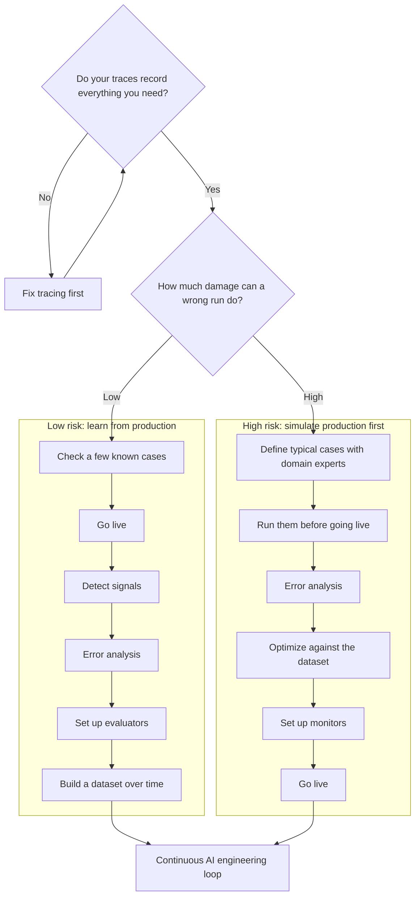

import { BlogHeader } from "@/components/blog/BlogHeader";

<BlogHeader
  title="How do I get started with evals?"
  description="Three kinds of evals and a path map for where to start, depending on how much damage a wrong run can do."
  date="October 22, 2026"
  authors={["annabellschafer"]}
/>

<Callout type="info">
  This post is a map. For the hands-on depth on tracing, monitoring, datasets,
  experiments, and evaluators, head over to the [Langfuse Academy](/academy).
</Callout>

"How do I get started with evals?" is the question we hear more than any other. Our answer is a short path map with two questions: do your traces record what you need, and how much damage can a wrong run do? The second question decides whether you learn from production right away or simulate production first. Both paths end in the same loop of continuous improvement.

## Three kinds of evals [#three-kinds-of-evals]

When teams say "evals", they usually mean one of three things.

**1. Signal detection on production data.** Here you look for the traces that deserve a closer look, for example when a user disagrees or asks for a human, or when an agent calls the same tool over and over. [Signals](/academy/monitoring#metrics-and-signals) point you to the exact trace to open, and [user signals](/academy/monitoring/capturing-signals#four-kinds) are cheap because your users react to every output anyway.

**2. Measuring quality in production.** Here you score a sample of live traffic against criteria that matter for your application. Did the answer stay within the retrieved policy? Did the agent pick the right tool? The setup is described in [online evaluation](/docs/evaluation/get-started/online).

**3. Offline evals on datasets.** Before you ship a new version, you run it against a dataset and check whether it is better, or cheaper, than the one in production. Put cost per successful task and p95 latency next to the quality scores, so a version that keeps quality flat while cutting cost counts as a win. To set one up, follow [evaluate with datasets](/docs/evaluation/get-started/offline).

You will end up using all three. The path map below shows the order in which they usually show up.

## The path map [#the-path-map]

### Do your traces record everything you need? [#check-your-traces]

Every eval reads from traces, so this comes first on both paths. Can you see the input, output, retrieved context, and every tool call with its result? If not, every evaluator you build on top inherits the gap. [What does a good trace look like?](/docs/observability/best-practices) is the checklist we use. Before launch, your traces come from running test cases, which works just as well.

### How much damage can a wrong run do? [#how-much-damage]

Think about the worst realistic outcome of a single bad run. A skipped song is annoying. A wrong refund policy or a bad answer to a medical question can hurt your users or your brand.

Risk often differs within one application. A support agent can be low risk when it answers FAQs and high risk when it issues refunds. In that case, put the risky flows and any [hard constraints](/academy/evaluate/choosing-what-to-evaluate#goals-and-hard-constraints), such as compliance or format rules, on the high-risk path, and let the rest learn from production.

### Low risk: learn from production [#low-risk]

1. **Check your agent on a few known cases**, so obvious breakage never reaches users.
2. **Go live** with tracing on.
3. **Detect signals.** For chat agents, start with generic user signals like disagreement or frustration, as described in [high-signal production monitoring](/blog/2026-04-01-llm-as-a-judge-production-monitoring) and [catching conversation signals](/blog/2026-09-23-catching-conversation-signals-in-langfuse). For other agents, watch operational signals like repeated tool calls or unusually long runs.
4. **Run error analysis** on the traces the signals point to.
5. **Set up evaluators** for the failure categories you want to act on.
6. **Build out a dataset over time** from the failures you find.

In the Academy's [music streaming DJ](/academy/examples/music-streaming-dj) example, the worst case is a skipped song, so the team goes live early and learns from listener behavior.

### High risk: simulate production first [#high-risk]

1. **Define typical cases with domain experts**, including how each one should be handled. About [15 to 30 rows](/academy/datasets/designing-great-datasets) is enough for a first version, and [Anthropic's guide to agent evals](https://www.anthropic.com/engineering/demystifying-evals-for-ai-agents) suggests a similar start of 20 to 50 tasks.
2. **Run them before going live**, with tracing on. Agents are non-deterministic, so run each case several times: at 80 percent success per run, all five of five runs succeed only about 33 percent of the time (0.8^5). Sierra's [τ-bench paper](https://arxiv.org/abs/2406.12045) measures this kind of consistency as pass^k.
3. **Run error analysis** on the results to find out what to evaluate for.
4. **Optimize your application** against this dataset.
5. **Set up monitors** that catch the same failures in production. If a failure must never reach a user, add a [runtime guardrail](/docs/security-and-guardrails) as well.
6. **Go live**, catch signals, and keep running error analysis.

The [customer support chatbot](/academy/examples/customer-support-chatbot) example follows this path: offline on historical tickets, then internal drafts, then answering customers directly.

## Same motion, different data [#same-motion-different-data]

Side by side, the two lanes follow the same motion. What changes is where the cases come from: live traffic on the low-risk path, and cases you define on the high-risk path.

| Step          | Low risk: live production data                    | High risk: simulated production                  |
| ------------- | ------------------------------------------------- | ------------------------------------------------ |
| Collect cases | A few known cases, then real user traffic         | Typical cases defined with domain experts        |
| Run           | Go live with tracing                              | Run the cases before going live                  |
| Find failures | Signals point you to traces for error analysis    | Error analysis on the run results                |
| Measure       | Online evaluators on sampled production traffic   | Offline evaluators on the dataset                |
| Improve       | Fix the top failures and grow a dataset from them | Optimize against the dataset until it holds up   |
| Watch         | Monitors on the evaluators you set up             | Monitors set up before launch, then live signals |

In both lanes, error analysis is the step that decides what you measure. Hamel Husain calls skipping it the most common mistake in his [field guide](https://hamel.dev/blog/posts/field-guide/), and in the [evals FAQ](https://hamel.dev/blog/posts/evals-faq/) he and Shreya Shankar describe spending 60 to 80 percent of development time on error analysis and evaluation. The Academy's [error analysis](/academy/monitoring/error-analysis) page walks you through the method.

When you write your first evaluators in either lane, start with the checks [code can verify](/docs/evaluation/evaluation-methods/code-evaluators): JSON schema, required fields, length limits, and whether generated SQL or code actually runs. These checks are cheap, fast, and deterministic. Use an LLM judge only for what code cannot check.

## Both paths end in the same loop [#both-paths-join-the-same-loop]

After the first release, the lanes merge into the [AI engineering loop](/academy/ai-engineering-loop): monitor, analyze, experiment, and ship. A few tips we share with teams at this stage:

**Keep your dataset fresh.** Once you optimize against a dataset, it only tells you about the failures it contains. Keep adding cases from production, especially on the high-risk path.

**Sample your online evals.** A typical [LLM-as-a-judge](/docs/evaluation/evaluation-methods/llm-as-a-judge) evaluation costs around $0.01 to $0.10. When you set up an [evaluation rule](/docs/evaluation/get-started/online), check the estimated cost and lower the sampling rate until the spend fits what the score is worth to you.

**Validate your LLM judge with humans.** Label some cases yourself, run the judge on them, and compare. Our [calibration guide](/guides/llm-as-a-judge-calibration-skill) walks through the workflow, and [score analytics](/docs/evaluation/scores/score-analytics#human-vs-ai-annotation-agreement) shows the agreement. Repeat this whenever the judge prompt or model changes.

**Gate your releases.** Once your dataset is stable, run it in [CI](/docs/evaluation/experiments/experiments-ci-cd) so a prompt or model change gets checked against known failures before it ships.

## Common mistakes [#common-mistakes]

These are the patterns we see most often when teams get started:

- **Starting with generic criteria.** Helpfulness or hallucination scores added before anyone has read a trace are hard to act on. [Write evaluators for the errors you discover](/academy/evaluate/choosing-what-to-evaluate).
- **Treating monitoring as evaluation.** Latency, cost, and error rates tell you that something changed. Whether the answers are good, you only learn by reading or scoring traces.
- **Trying an LLM judge once and giving up.** The first judge prompt often disagrees with your own labels. Keep a small labeled set and iterate.
- **Relying only on thumbs up or down.** [Explicit feedback](/academy/monitoring#user-feedback) is clear but rare, and unhappy users respond more often. Add [conversation signals](/academy/monitoring/capturing-signals#conversation-signals) to catch more.
- **Using an evaluator where a guardrail belongs.** An evaluator scores what already happened. If a failure must never reach the user, block it at runtime and use evals to check that the guardrail works.

## Where to go next [#where-to-go-next]

Check your traces, pick the lane that matches your risk, and start with one evaluator you will actually act on. From there, the Academy has the details:

- [Langfuse Academy](/academy) and the [AI engineering loop](/academy/ai-engineering-loop)
- [Choosing what to evaluate](/academy/evaluate/choosing-what-to-evaluate) and [error analysis](/academy/monitoring/error-analysis)
- [Designing datasets](/academy/datasets/designing-great-datasets)
- [Online evaluation](/docs/evaluation/get-started/online) and [offline evaluation](/docs/evaluation/get-started/offline)
- [Worked examples](/academy/examples): the [music streaming DJ](/academy/examples/music-streaming-dj) and the [customer support chatbot](/academy/examples/customer-support-chatbot)
