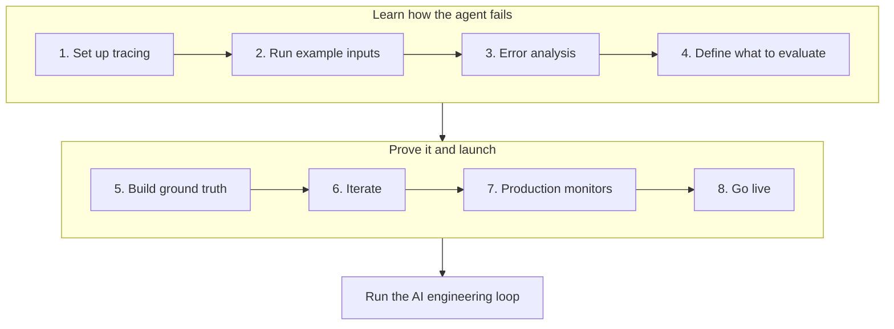

import { BlogHeader } from "@/components/blog/BlogHeader";
import { CustomerQuote } from "@/components/customers/CustomerQuote";

<BlogHeader
  title="V2: How Teams in Regulated Industries Get AI Agents into Production"
  description="Banks, insurers, and healthcare teams face stricter requirements to take an AI agent from an offline prototype to production. Learn how they use evidence, compliance checks, and human oversight at every step."
  date="October 22, 2026"
  authors={["annabellschafer"]}
/>

Many teams ship AI agents early and improve them in production. In banking, insurance, and healthcare, that rarely gets past the first review. A wrong answer can be a compliance incident, and someone has to sign off before the agent talks to a customer.

Most teams start with human in the loop, as regulators recommend: the agent proposes, and a person approves. This only saves time if the proposals are good from the start. The bigger payoff is the autonomy rate: the share of cases the agent handles on its own. Here is how teams get there.

## What makes regulated industries different [#the-challenge]

AI development teams in regulated industries usually face three requirements for their projects:

- **Evidence before launch.** Review boards ask for test results and sign-offs ([deployment gates for LLMs](/blog/2026-07-15-llm-certification-financial-services)).
- **Oversight after launch.** [FINRA](https://www.finra.org/rules-guidance/guidance/reports/2026-finra-annual-regulatory-oversight-report/gen-ai) and [Article 14 of the EU AI Act](https://artificialintelligenceact.eu/article/14/) expect people to oversee what the agent does.
- **Control over data.** Teams need to know where data is stored and what gets redacted. Healthcare also needs a [business associate agreement](/security/hipaa).

## The approach: start the loop offline [#the-approach]

The [AI engineering loop](/academy/ai-engineering-loop) is how teams improve AI applications: trace, monitor, build datasets, run experiments, and evaluate. Regulated teams run most of it before launch.

### 1. Set up tracing [#trace-offline]

Add [tracing](/docs/observability/get-started) before anyone outside the team uses the agent. Record the prompt version, model, tool calls, retrieved context, and any human approval on every run. Traces become your evidence for reviewers and the raw material for datasets and evaluators. Use [client-side masking](/docs/observability/features/masking) to redact account numbers or patient identifiers at the source. Many banks [self-host Langfuse](/self-hosting) so trace data never leaves their infrastructure. [DKB](/users/dkb), one of Germany's largest direct banks, made self-hosting a requirement before any production data could be touched. [Trade Republic](/users/trade-republic), a bank with over 10 million customers, went the same way.

### 2. Run example inputs through the agent [#example-inputs]

Run a set of examples that roughly matches what you expect in production. You do not need expected answers yet. Good sources are:

- **Synthetic examples.** Generate typical requests and their variations. Domain experts, such as a compliance officer or a clinician, add the cases they know are hard.
- **Historical data.** Run the agent on cases your team has already decided, such as resolved support tickets or reviewed insurance claims, and compare its output with the human decision. Clinical teams call this retrospective back-testing.
- **Shadow runs.** Let the agent process live cases next to the current workflow without acting on anything. Healthcare calls this silent evaluation.

### 3. Find failure modes with error analysis [#error-analysis]

Have your domain experts read a sample of traces, note the first thing that went wrong in each, and group the notes into named failure modes. Fix the ones caused by a missing instruction right away. The ones that keep coming back are worth evaluating. The Academy guide on [error analysis](/academy/monitoring/error-analysis) walks through the process. At DKB, customer service specialists review conversations in Langfuse and add typical examples to datasets that engineers use to adjust prompts.

### 4. Define what to evaluate, including compliance [#what-to-evaluate]

Recurring failure modes become quality evaluators. Next to them, agree with compliance on what the agent must never do. For a bank, that could be giving investment advice or quoting a rate that is not on the price list. For an insurer, it could be telling a customer a claim is approved before an adjuster has signed off. These limits get evaluators from day one, and a single failure blocks the release. Use [code evaluators](/docs/evaluation/evaluation-methods/code-evaluators) for simple checks and [LLM-as-a-judge](/docs/evaluation/evaluation-methods/llm-as-a-judge) for anything that needs judgment. The Academy guide on [choosing what to evaluate](/academy/evaluate/choosing-what-to-evaluate) shows how to keep the set small.

### 5. Build a ground truth dataset [#ground-truth]

Build a [dataset](/docs/evaluation/experiments/datasets) with your experts that covers typical inputs, risky cases, and cases that should trigger each compliance limit. Add normal cases that should pass those checks too, since a guardrail that fires too often gets ignored.

Experts disagree more often than teams expect. Have parts of the dataset labeled independently by several experts in [annotation queues](/docs/evaluation/evaluation-methods/annotation-queues), and talk through the cases where they differ, ideally in one room. Researchers call this inter-rater reliability, measure it as percent agreement or Cohen's kappa, and often treat 80% agreement as the minimum ([McHugh, 2012](https://pubmed.ncbi.nlm.nih.gov/23092060/)). [Score analytics](/docs/evaluation/scores/score-analytics) calculates both metrics between your experts.

### 6. Iterate until the agent passes [#iterate]

Run the dataset as an [experiment](/docs/evaluation/experiments/experiments-via-sdk), change the agent's context, tools, or prompts, and [compare each run](/docs/evaluation/experiments/compare-experiments) with the last. Repeat error analysis on new runs. When no new failure modes appear, your evaluators cover what matters. Trade Republic also keeps a second, held-out dataset as a final exam and only ships when the agent passes both.

When the agent passes, put together a short pack for your review board:

- The dataset version and what it covers, including the compliance cases.
- Scores per evaluator against the agreed thresholds, with zero compliance failures.
- Expert agreement on the ground truth.
- The comparison with the baseline run.
- Example traces of the failures you found and how you fixed them.
- The monitoring and review plan for launch.

### 7. Set up production monitors [#monitors]

Run compliance evaluators and the quality evaluators you care most about on live traces with [online evaluation](/docs/evaluation/get-started/online), and set [alerts](/docs/observability/features/alerts) for when flagged traces rise. DKB screens every answer its assistant gives and routes flagged conversations to annotation queues by service area, such as brokerage or credit, where specialists handle the critical cases first.

<CustomerQuote
  quote="If I disabled the screening tomorrow, we would have to stop all our agent activity."
  name="David Hinrichs"
  role="Senior Machine Learning Scientist"
  company="DKB"
/>

Compliance also decides what may be screened at all. DKB may not auto-review conversations of its own employees or of customers under 18, so it keeps those in a separate Langfuse instance.

At launch, let the agent escalate a little too often. A handoff costs a few minutes of staff time, and a wrong answer can cost much more. The [AWS Well-Architected Agentic AI Lens](https://docs.aws.amazon.com/wellarchitected/latest/agentic-ai-lens/agentops01-bp02.html) suggests three triggers for a handoff: low confidence, high stakes, and an exhausted retry budget.

### 8. Go live and reduce review over time [#go-live]

People stay in the process after launch, and the amount they review shrinks as the evidence grows. [Coinbase](https://ai.engineer/reading/nyc-2026/transcripts/oct14-evan-kormos-policy-workflows.md) describes three stages:

1. **Supervised.** Reviewers check every output.
2. **Sampled.** Once measured quality passes a threshold, reviewers check a sample.
3. **Exceptions.** Reviewers mainly handle flagged cases.

Match the review rate to the risk. The [Joint Commission and CHAI](https://assets.ctfassets.net/7s4afyr9pmov/5RX4XUbRg0l1JG0gwXGkTM/bea3c1949d6d8cdd8ec2ae2f82f737ad/JC-CHAI_RUAIH_Guidance.pdf) recommend checking tools that inform clinical decisions more often than administrative ones. In a bank, a credit decision deserves more review than a branch-hours question.

Reviewers who approve hundreds of routine cases a day stop looking closely. So automate one category at a time, starting with the ones that score well, such as a password reset, and keep sending the rest to a person. Keep a small random sample of each automated category in review to catch drift. The [customer support chatbot example](/academy/examples/customer-support-chatbot) shows how.

Track the autonomy rate per category next to sampled quality, flag and escalation rate, and weekly review time. The agent is paying off when autonomy goes up and review time goes down while quality and flags stay stable. Record these as [scores](/docs/evaluation/scores/overview) and chart them in a [custom dashboard](/docs/metrics/features/custom-dashboards) your review board can see.

From here, you are in the regular AI engineering loop. DKB runs it fully in Langfuse.

<CustomerQuote
  quote="The whole pipeline to improve our chat agent happens entirely in Langfuse. We screen conversations, review flagged sessions, turn clusters of unwanted behavior into datasets, and run those evals as regression tests before every release."
  name="Laurenz Hemmen"
  role="Machine Learning Scientist"
  company="DKB"
/>

## Where to start [#where-to-start]

Pick one workflow with clear rules and a team that already reviews the work by hand. Run the eight steps on it, show the results to your review board, and expand once the evidence supports it.

## How Langfuse supports each step [#in-langfuse]

| Step                        | Langfuse features                                                                                                                                                                                                 |
| --------------------------- | ----------------------------------------------------------------------------------------------------------------------------------------------------------------------------------------------------------------- |
| 1. Set up tracing           | [Tracing](/docs/observability/get-started), [masking](/docs/observability/features/masking), [self-hosting](/self-hosting)                                                                                        |
| 2. Run example inputs       | [Datasets](/docs/evaluation/experiments/datasets), [experiments](/docs/evaluation/experiments/experiments-via-sdk)                                                                                                |
| 3. Error analysis           | [Annotation queues](/docs/evaluation/evaluation-methods/annotation-queues), [scores](/docs/evaluation/scores/overview)                                                                                            |
| 4. Define what to evaluate  | [Code evaluators](/docs/evaluation/evaluation-methods/code-evaluators), [LLM-as-a-judge](/docs/evaluation/evaluation-methods/llm-as-a-judge)                                                                      |
| 5. Build ground truth       | [Datasets](/docs/evaluation/experiments/datasets), [annotation queues](/docs/evaluation/evaluation-methods/annotation-queues), [score analytics](/docs/evaluation/scores/score-analytics)                         |
| 6. Iterate                  | [Experiments](/docs/evaluation/experiments/experiments-via-sdk), [compare experiments](/docs/evaluation/experiments/compare-experiments)                                                                          |
| 7. Production monitors      | [Online evaluation](/docs/evaluation/get-started/online), [user feedback](/docs/observability/features/user-feedback), [alerts](/docs/observability/features/alerts)                                              |
| 8. Go live and run the loop | [Annotation queues](/docs/evaluation/evaluation-methods/annotation-queues), [custom dashboards](/docs/metrics/features/custom-dashboards), [experiments in CI/CD](/docs/evaluation/experiments/experiments-ci-cd) |

On the infrastructure side, regulated teams usually choose between two setups:

- **Self-hosted.** Run Langfuse in your own infrastructure with the [self-hosting guide](/self-hosting).
- **Langfuse Cloud.** Healthcare teams can use the [HIPAA-ready cloud region](/security/hipaa) after signing a business associate agreement. Other regulated companies use the cloud version whenever self-hosting is not a must-have.

The same need for visibility applies in life sciences. [Merck](/users/merckgroup) serves more than 80 AI project teams on Langfuse and uses it to keep an audit trail of every AI interaction.

<CustomerQuote
  quote="Generative AI will only earn enterprise trust when we can see what's happening under the hood. Langfuse enables us to track every prompt, response, cost, and latency in real time, turning black-box models into auditable, optimizable assets."
  name="Walid Mehanna"
  role="Chief Data & AI Officer"
  company="Merck"
  image="/images/customers/merck/walid.jpeg"
/>

## Further reading [#further-reading]

- [Langfuse for financial services](/financial-services): data protection, deployment options, and compliance documentation for banks and insurers.
- [Building deployment gates for LLMs and AI agents in financial services](/blog/2026-07-15-llm-certification-financial-services): how to turn datasets and evaluators into pass or fail checks that a review board can inspect.
- Customer stories from regulated industries: [DKB](/users/dkb), [Trade Republic](/users/trade-republic), and [Merck](/users/merckgroup).
