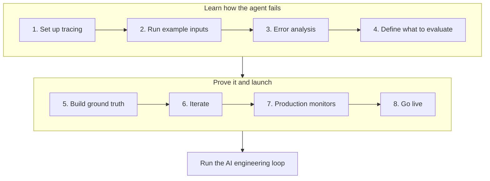

import { BlogHeader } from "@/components/blog/BlogHeader";
import { CustomerQuote } from "@/components/customers/CustomerQuote";

<BlogHeader
  title="V2: How Teams in Regulated Industries Get AI Agents into Production"
  description="Banks, insurers, and healthcare teams face stricter requirements to take an AI agent from an offline prototype to production. Learn how they use evidence, compliance checks, and human oversight at every step."
  date="October 22, 2026"
  authors={["annabellschafer"]}
/>

Many teams building AI agents ship early and improve in production. In banking, insurance, and healthcare, that approach rarely gets past the first review. A wrong answer can be a compliance incident, customer data cannot go to just any vendor, and someone has to sign off before the agent talks to a customer.

A common way to start is human in the loop: the agent proposes an answer or action, and a person approves it before anything reaches the customer. Regulators recommend this kind of oversight, and it is a sensible first step. For it to work, the agent's proposals need to be good from the start. If reviewers have to rewrite most drafts, the agent saves no time and people stop trusting it. The bigger payoff comes later, when a reliable share of cases can run without review and the team can measure and trust that autonomy rate.

We will show you how teams in regulated industries get there, from the first prototype to an agent that handles part of the work on its own.

## What makes regulated industries different [#the-challenge]

AI development teams in regulated industries usually face three requirements for their projects:

- **Evidence before launch.** Risk processes ask for test results, review sign-offs, and documentation before an application reaches production ([deployment gates for LLMs in financial services](/blog/2026-07-15-llm-certification-financial-services)).
- **Oversight after launch.** FINRA's [2026 oversight report](https://www.finra.org/rules-guidance/guidance/reports/2026-finra-annual-regulatory-oversight-report/gen-ai) asks firms to define where humans review agent actions. [Article 14 of the EU AI Act](https://artificialintelligenceact.eu/article/14/) requires that people can effectively oversee high-risk AI systems.
- **Control over data.** Teams need to know where conversation data is stored, what gets redacted, and who can see it. In healthcare, a [business associate agreement](/security/hipaa) has to be in place before any protected health information is processed.

## The approach: start the loop offline [#the-approach]

The [AI engineering loop](/academy/ai-engineering-loop) describes how teams improve AI applications: trace, monitor, build datasets, run experiments, and evaluate, then repeat. Regulated teams run most of this loop before launch. They learn how the agent fails, prove that it handles realistic cases, and only then go live.

### 1. Set up tracing [#trace-offline]

Add [tracing](/docs/observability/get-started) before anyone outside the team uses the agent. Record the prompt version, model, tool calls, retrieved context, and any human approval on every run. Traces become your evidence for reviewers and the raw material for datasets and evaluators. Use [client-side masking](/docs/observability/features/masking) to redact account numbers or patient identifiers at the source. Many banks [self-host Langfuse](/self-hosting) so trace data never leaves their infrastructure. [DKB](/users/dkb) and [Trade Republic](/users/trade-republic) both run it this way.

### 2. Run example inputs through the agent [#example-inputs]

Run a set of examples that roughly matches what you expect in production. Generate synthetic inputs with your domain experts, replay historical cases your team has already decided, or shadow-run the agent next to the current workflow without acting on anything. The [Coalition for Health AI](https://assets.ctfassets.net/7s4afyr9pmov/6e7PrdrsNTQ5FjZ4uyRjTW/c4070131c523d4e1db26105aa51f087d/CHAI_Responsible-AI-Guide.pdf) recommends this kind of silent evaluation before any AI output reaches clinical staff.

### 3. Find failure modes with error analysis [#error-analysis]

Have your domain experts read a sample of traces, note the first thing that went wrong in each, and group the notes into named failure modes. The [error analysis guide](/academy/monitoring/error-analysis) walks through the process. At DKB, customer service specialists review conversations in Langfuse and add typical examples to datasets that engineers use to adjust prompts.

<CustomerQuote
  quote="We have the AI expertise, but we don't necessarily have the banking customer service expertise. There's a lot of regulation, a lot of very specific things you need to get right. Langfuse really is a place where we bring the two halves together."
  name="Laurenz Hemmen"
  role="Machine Learning Scientist"
  company="DKB"
/>

### 4. Define what to evaluate, including compliance [#what-to-evaluate]

Recurring failure modes become quality evaluators. Next to them, agree with compliance on what the agent must never do, such as giving investment advice or quoting a rate that is not on the price list. These limits get evaluators from day one, and a single failure blocks the release. Use [code evaluators](/docs/evaluation/evaluation-methods/code-evaluators) for simple checks and [LLM-as-a-judge](/docs/evaluation/evaluation-methods/llm-as-a-judge) for anything that needs judgment. See [choosing what to evaluate](/academy/evaluate/choosing-what-to-evaluate) for more.

### 5. Build a ground truth dataset [#ground-truth]

Build a [dataset](/docs/evaluation/experiments/datasets) with your experts that covers typical inputs, risky cases, and cases that should trigger each compliance limit. Add normal cases that should pass those checks too, since a guardrail that fires too often gets ignored.

Experts disagree more often than teams expect. Have parts of the dataset labeled independently by several experts in [annotation queues](/docs/evaluation/evaluation-methods/annotation-queues), check their agreement in [score analytics](/docs/evaluation/scores/score-analytics), and talk through the cases where they differ. The guide on [designing datasets](/academy/datasets/designing-great-datasets) covers the rest.

### 6. Iterate until the agent passes [#iterate]

Run the dataset as an [experiment](/docs/evaluation/experiments/experiments-via-sdk), change the agent's context, tools, or prompts, and [compare each run](/docs/evaluation/experiments/compare-experiments) with the last. Repeat error analysis on new runs. When no new failure modes appear, your evaluators cover what matters. Trade Republic also keeps a held-out dataset as a final exam before it ships.

### 7. Set up production monitors [#monitors]

Run compliance evaluators and the quality evaluators you care most about on live traces with [online evaluation](/docs/evaluation/get-started/online), and set [alerts](/docs/observability/features/alerts) for when flagged traces rise. DKB screens every answer its assistant gives and routes flagged conversations to specialists by service area.

<CustomerQuote
  quote="If I disabled the screening tomorrow, we would have to stop all our agent activity."
  name="David Hinrichs"
  role="Senior Machine Learning Scientist"
  company="DKB"
/>

### 8. Go live and reduce review over time [#go-live]

At launch, reviewers check every output. Once measured quality passes a threshold, they check a sample, and later mainly the flagged cases ([Coinbase at AI Engineer NYC](https://ai.engineer/reading/nyc-2026/transcripts/oct14-evan-kormos-policy-workflows.md)). Automate one category of requests at a time, starting with the ones that score well, and keep a small random sample of each in review. The [customer support chatbot example](/academy/examples/customer-support-chatbot) shows how. From here, you are in the regular AI engineering loop.

## Where to start [#where-to-start]

Pick one workflow with clear rules and a team that already reviews the work by hand. Run the eight steps on it, show the results to your review board, and expand once the evidence supports it.

The same approach works beyond banking. [Merck](/users/merckgroup) serves more than 80 AI project teams on Langfuse and uses it to keep an audit trail of every AI interaction.

<CustomerQuote
  quote="Generative AI will only earn enterprise trust when we can see what's happening under the hood. Langfuse enables us to track every prompt, response, cost, and latency in real time, turning black-box models into auditable, optimizable assets."
  name="Walid Mehanna"
  role="Chief Data & AI Officer"
  company="Merck"
  image="/images/customers/merck/walid.jpeg"
/>

## Further reading [#further-reading]

- [Langfuse for financial services](/financial-services): data protection, deployment options, and compliance documentation for banks and insurers.
- [Building deployment gates for LLMs and AI agents in financial services](/blog/2026-07-15-llm-certification-financial-services): how to turn datasets and evaluators into pass or fail checks that a review board can inspect.
- Customer stories from regulated industries: [DKB](/users/dkb), [Trade Republic](/users/trade-republic), and [Merck](/users/merckgroup).
