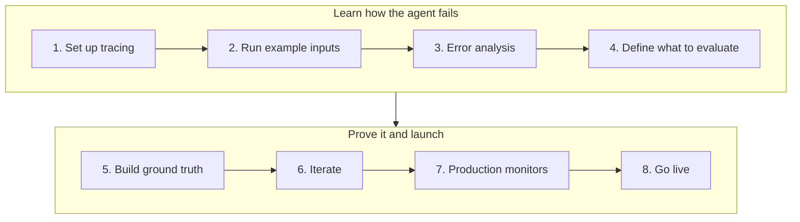

import { BlogHeader } from "@/components/blog/BlogHeader";
import { CustomerQuote } from "@/components/customers/CustomerQuote";

<BlogHeader
  title="How Teams in Regulated Industries Get AI Agents into Production"
  description="Banks, insurers, and healthcare teams face stricter requirements to take an AI agent from an offline prototype to production. Learn how they use evidence, compliance checks, and human oversight at every step."
  date="October 22, 2026"
  authors={["annabellschafer"]}
/>

Many teams building AI agents ship early and improve in production. In banking, insurance, and healthcare, that approach rarely gets past the first review. A wrong answer can be a compliance incident, customer data cannot go to just any vendor, and someone has to sign off before the agent talks to a customer.

A common way to start is human in the loop: the agent proposes an answer or action, and a person approves it before anything reaches the customer. Regulators recommend this kind of oversight, and it is a sensible first step. For it to work, the agent's proposals need to be good from the start. If reviewers have to rewrite most drafts, the agent saves no time and people stop trusting it. The bigger payoff comes later, when a reliable share of cases can run without review and the team can measure and trust that autonomy rate.

We will show you how teams in regulated industries get there, from the first prototype to an agent that handles part of the work on its own.

## What makes regulated industries different [#the-challenge]

AI development teams in regulated industries usually face three requirements for their projects.

**Evidence before launch.** Banks already run risk processes that ask for test results, review sign-offs, and documentation before an application reaches production ([deployment gates for LLMs in financial services](/blog/2026-07-15-llm-certification-financial-services)). The review board will want to see how the agent behaves on realistic cases.

**Oversight after launch.** Regulators expect people to stay in control. FINRA's [2026 oversight report](https://www.finra.org/rules-guidance/guidance/reports/2026-finra-annual-regulatory-oversight-report/gen-ai) asks firms to define where humans review agent actions and how they track agent decisions. [Article 14 of the EU AI Act](https://artificialintelligenceact.eu/article/14/) requires that people can effectively oversee high-risk AI systems.

**Control over data.** Conversations contain account details, transactions, and health information. Teams need to know where that data is stored, what gets redacted, and who can see it. In healthcare, a [business associate agreement](/security/hipaa) has to be in place before any protected health information is processed.

Teams still ship agents under these rules. They just need to take a different approach to successfully running the AI engineering loop.

## The approach: start the loop offline [#the-approach]

The [AI engineering loop](/academy/ai-engineering-loop) describes how teams improve AI applications: trace, monitor, build datasets, run experiments, and evaluate. And then repeat this process. Regulated teams need to evaluate and improve their application before going to production. They set up tracing, learn how the agent fails, define what to evaluate together with compliance, build a ground truth dataset, and iterate until the agent passes. Only then do they set up production monitors and go live.

## Step 1: Set up tracing [#trace-offline]

Add [tracing](/docs/observability/get-started) before anyone outside the team uses the agent. Traces provide you insight into what happened during a run and provide you with a way of showing evidence to whoever needs to review it. Beyond, the traces you collect help you build out the setup to continuously improve your agents: datasets are built from traces, evaluators score traces, and reviewers use traces as evidence of what the agent did.

Instrument your application to capture each step your agent is taking. Record the prompt version, model, tool calls, retrieved context, and any human approval on every run. Decide where to mask sensitive fields before they are stored. The SDKs support [client-side masking](/docs/observability/features/masking), so account numbers or patient identifiers can be redacted at the source.

Decide early where the traces will live. Many banks and healthcare providers [self-host Langfuse](/self-hosting) so that trace data never leaves their infrastructure. [DKB](/users/dkb), one of Germany's largest direct banks, made self-hosting a requirement before any production data could be touched. [Trade Republic](/users/trade-republic), a bank with over 10 million customers, went the same way. Its Ops Tools team runs self-hosted Langfuse and rolled it out across teams while meeting the bank's compliance requirements.

## Step 2: Run example inputs through the agent [#example-inputs]

Next, run a set of examples through the agent that roughly matches what you expect to hit your system in production. Each run produces a trace you can learn from. At this point, you do not need expected answers yet. Good sources are:

- **Synthetic examples.** Generate inputs that cover typical requests and their variations. Domain experts can add cases they know from experience are hard to handle. In a bank, that might be a compliance officer or a senior support agent. In a hospital, it is a clinician.
- **Historical data.** Run the agent on cases your team has already decided, such as resolved support tickets or reviewed claims, and compare the agent's output with the human decision. Clinical teams call this retrospective back-testing.
- **Shadow runs.** Let the agent process live cases next to the current workflow without acting on anything. This gives you traces from live data without bringing the agent into customer contact. Healthcare calls this silent evaluation, and the [Coalition for Health AI](https://assets.ctfassets.net/7s4afyr9pmov/6e7PrdrsNTQ5FjZ4uyRjTW/c4070131c523d4e1db26105aa51f087d/CHAI_Responsible-AI-Guide.pdf) recommends it before any AI output reaches clinical staff.

## Step 3: Find failure modes with error analysis [#error-analysis]

Now have your domain experts read a sample of those traces. For each one, they note the first thing that went wrong, then group the notes into named failure modes. Some failures show that the agent needs more specification, such as a missing rule in the prompt, and you can fix them right away. Others keep coming back, and those are the ones worth evaluating.

At DKB, customer service specialists work in Langfuse directly, review conversations, and add typical examples to datasets that engineers then use to adjust prompts.

<CustomerQuote
  quote="We have the AI expertise, but we don't necessarily have the banking customer service expertise. There's a lot of regulation, a lot of very specific things you need to get right. Langfuse really is a place where we bring the two halves together."
  name="Laurenz Hemmen"
  role="Machine Learning Scientist"
  company="DKB"
/>

## Step 4: Define what to evaluate, including compliance [#what-to-evaluate]

What you evaluate comes from two places:

- **Failure modes.** The recurring failures from error analysis become quality evaluators. Generic metrics such as helpfulness rarely match how your agent fails, and they can make it look better than it is.
- **Compliance requirements.** Agree with compliance on what the agent must never do. For a bank, that could be giving investment advice, quoting a rate that is not on the price list, or sending a customer message without approval. These hard limits get evaluators from day one, even before you have seen them break, and a single failure blocks the release.

A [code check](/docs/evaluation/evaluation-methods/code-evaluators), such as a regex for a missing disclaimer, is often enough. Use [LLM-as-a-judge](/docs/evaluation/evaluation-methods/llm-as-a-judge) for anything that needs judgment, such as a response that sounds like investment advice.

<Callout type="info">
  The Langfuse Academy covers both steps in detail. [Error analysis](/academy/monitoring/error-analysis) walks through reading traces and building a failure taxonomy, and [choosing what to evaluate](/academy/evaluate/choosing-what-to-evaluate) shows how to turn those failures and your compliance rules into a small set of metrics.
</Callout>

## Step 5: Build a ground truth dataset [#ground-truth]

With the evaluation criteria in place, build a ground truth [dataset](/docs/evaluation/experiments/datasets) together with your domain experts. It should contain your typical inputs, the cases that could go wrong, and cases that should trigger each compliance limit, along with how the agent should handle each one. This 'Golden Dataset' lets you show that the agent handles common cases the way your experts would, and that adversarial and edge cases are handled gracefully. Include normal cases that should pass the compliance checks as well. A guardrail that fires too often gets ignored, so measure both.

<Callout type="info">
  Want to go deeper on scoping a dataset? The Langfuse Academy guide on [designing datasets](/academy/datasets/designing-great-datasets) covers how to set the goal, choose the input distribution, and decide how each item will be evaluated.
</Callout>

### Check the ground truth [#check-the-ground-truth]

Experts disagree more often than teams expect. A case one expert marks as correct can look wrong to a colleague, so a dataset written by a single expert still needs a check before you treat it as ground truth.

To get there, let your experts review each other's work. Have parts of the dataset labeled independently by several experts and look at where they disagree. Ideally, bring the experts into one room to talk through those cases, agree on the right handling, and write the missing rule into your guidelines. Tejas Kumar from IBM described the pattern at AI Engineer World's Fair 2026: "When we don't agree, it's just usually because there's a knowledge gap." ([talk](https://www.youtube.com/watch?v=NdrSPm6NCdk))

<Callout type="info">
  The more humans disagree on a case, the harder it is for an agent to handle it. Research has a name for this: inter-rater reliability, the extent to which different raters assign the same score to the same item. It comes from qualitative and clinical research, where it is usually measured as percent agreement or with Cohen's kappa, and many texts recommend at least 80% agreement between raters ([McHugh, 2012](https://pubmed.ncbi.nlm.nih.gov/23092060/)).
</Callout>

In Langfuse, [annotation queues](/docs/evaluation/evaluation-methods/annotation-queues) let several experts label the same items without touching code. [Score analytics](/docs/evaluation/scores/score-analytics) then calculates percent agreement and Cohen's kappa between them, so you can see which cases need a discussion.

## Step 6: Iterate until the agent passes [#iterate]

Run the dataset as an [experiment](/docs/evaluation/experiments/experiments-via-sdk) and record the scores as your baseline. Then improve the agent by changing its context, tool calls, or prompts, rerun the experiment, and [compare it with the previous run](/docs/evaluation/experiments/compare-experiments). Repeat error analysis on new runs from time to time. When new runs stop producing new failure modes, your evaluators cover the failures that matter, and every improvement in those scores brings the agent closer to what your experts expect.

Trade Republic takes this a step further when migrating live workflows to new agent architectures. The team iterates on one dataset and keeps a second, held-out dataset as a final exam, and only ships when the new agent passes both.

## Step 7: Set up production monitors [#monitors]

Once you are happy with the results, decide which evaluators should also run in production with [online evaluation](/docs/evaluation/get-started/online). Compliance evaluators belong on every trace. Add the quality evaluators you want to keep watching live, for example whether answers are phrased the way your guidelines require. Turn the monitors on during shadow runs first, so you know what normal looks like, and set [alerts](/docs/observability/features/alerts) for when the share of flagged traces rises.

DKB screens every answer its assistant gives and sends flagged conversations to annotation queues sorted by service area, such as brokerage or credit. Specialists rank each case by severity and handle the critical ones first. For DKB, this screening is part of its license to operate.

<CustomerQuote
  quote="If I disabled the screening tomorrow, we would have to stop all our agent activity."
  name="David Hinrichs"
  role="Senior Machine Learning Scientist"
  company="DKB"
/>

Compliance also decides what may be screened at all. DKB is not allowed to auto-review conversations of its own employees or of customers under 18, so it keeps those conversations in a separate Langfuse instance outside automated screening.

For chat agents, also track [explicit feedback](/docs/observability/features/user-feedback) and signs of trouble, such as a user asking for a person or correcting the agent. The Academy page on [capturing signals](/academy/monitoring/capturing-signals) lists the most useful ones. At launch, let the agent escalate a little too often. A reply like "I can't help with that, I'll connect you to a person" costs a few minutes of staff time, and a wrong answer in a regulated setting can cost much more. The [AWS Well-Architected Agentic AI Lens](https://docs.aws.amazon.com/wellarchitected/latest/agentic-ai-lens/agentops01-bp02.html) suggests three triggers for a handoff: low confidence, high stakes, and an exhausted retry budget.

## Step 8: Go live and run the AI engineering loop [#go-live]

Now go live. From here on, you are in the regular AI engineering loop: trace production, watch the monitors, turn interesting traces into new dataset items, and rerun the dataset before every release.

### Keep humans on a subset [#humans-on-a-subset]

People stay in the process after launch, and the amount they review shrinks as the evidence grows. A common pattern, described by [Coinbase at AI Engineer NYC](https://ai.engineer/reading/nyc-2026/transcripts/oct14-evan-kormos-policy-workflows.md), has three steps:

1. **Supervised.** Reviewers check every output.
2. **Sampled.** Once measured quality passes a threshold set by policy, reviewers check a sample.
3. **Exceptions.** Reviewers mainly handle flagged cases and keep improving the datasets.

Match the review rate to the risk. Guidance from the [Joint Commission and CHAI](https://assets.ctfassets.net/7s4afyr9pmov/5RX4XUbRg0l1JG0gwXGkTM/bea3c1949d6d8cdd8ec2ae2f82f737ad/JC-CHAI_RUAIH_Guidance.pdf) recommends checking tools that inform clinical decisions more often than tools that help with administrative tasks. The same logic applies in a bank: a credit decision deserves more review than a branch-hours question.

### Automate the slices that work [#automate-slices]

Asking a person to approve everything does not scale, and reviewers who approve hundreds of routine cases a day stop looking closely. Classify incoming requests by category, let the agent handle categories that score well in your dataset and in production, such as a password reset, and keep sending the rest to a person. The Academy's [customer support chatbot example](/academy/examples/customer-support-chatbot) walks through this approach. Keep a small random sample of each automated category in an annotation queue, so you notice when quality drifts.

DKB runs this full loop in Langfuse today.

<CustomerQuote
  quote="The whole pipeline to improve our chat agent happens entirely in Langfuse. We screen conversations, review flagged sessions, turn clusters of unwanted behavior into datasets, and run those evals as regression tests before every release."
  name="Laurenz Hemmen"
  role="Machine Learning Scientist"
  company="DKB"
/>

## How Langfuse supports each step [#in-langfuse]

| Step                        | Langfuse features                                                                                                                                                                         |
| --------------------------- | ----------------------------------------------------------------------------------------------------------------------------------------------------------------------------------------- |
| 1. Set up tracing           | [Tracing](/docs/observability/get-started), [masking](/docs/observability/features/masking), [self-hosting](/self-hosting)                                                                |
| 2. Run example inputs       | [Datasets](/docs/evaluation/experiments/datasets), [experiments](/docs/evaluation/experiments/experiments-via-sdk)                                                                        |
| 3. Error analysis           | [Annotation queues](/docs/evaluation/evaluation-methods/annotation-queues), [scores](/docs/evaluation/scores/overview)                                                                    |
| 4. Define what to evaluate  | [Code evaluators](/docs/evaluation/evaluation-methods/code-evaluators), [LLM-as-a-judge](/docs/evaluation/evaluation-methods/llm-as-a-judge)                                              |
| 5. Build ground truth       | [Datasets](/docs/evaluation/experiments/datasets), [annotation queues](/docs/evaluation/evaluation-methods/annotation-queues), [score analytics](/docs/evaluation/scores/score-analytics) |
| 6. Iterate                  | [Experiments](/docs/evaluation/experiments/experiments-via-sdk), [compare experiments](/docs/evaluation/experiments/compare-experiments)                                                  |
| 7. Production monitors      | [Online evaluation](/docs/evaluation/get-started/online), [user feedback](/docs/observability/features/user-feedback), [alerts](/docs/observability/features/alerts)                      |
| 8. Go live and run the loop | [Annotation queues](/docs/evaluation/evaluation-methods/annotation-queues), [experiments in CI/CD](/docs/evaluation/experiments/experiments-ci-cd)                                        |

On the infrastructure side, regulated teams usually choose between two setups:

- **Self-hosted.** Run Langfuse in your own infrastructure with the [self-hosting guide](/self-hosting).
- **Langfuse Cloud.** Healthcare teams can use the [HIPAA-ready cloud region](/security/hipaa) after signing a business associate agreement. Other regulated companies opt for the cloud version whenever self-hosting is not a must-have.

The same need for visibility applies in life sciences. [Merck](/users/merckgroup) serves more than 80 AI project teams on Langfuse and uses it to keep an audit trail of every AI interaction.

<CustomerQuote
  quote="Generative AI will only earn enterprise trust when we can see what's happening under the hood. Langfuse enables us to track every prompt, response, cost, and latency in real time, turning black-box models into auditable, optimizable assets."
  name="Walid Mehanna"
  role="Chief Data & AI Officer"
  company="Merck"
  image="/images/customers/merck/walid.jpeg"
/>

## Further reading [#further-reading]

- [Langfuse for financial services](/financial-services): data protection, deployment options, and compliance documentation for banks and insurers.
- [Building deployment gates for LLMs and AI agents in financial services](/blog/2026-07-15-llm-certification-financial-services): how to turn datasets and evaluators into pass or fail checks that a review board can inspect.
- Customer stories from regulated industries: [DKB](/users/dkb), [Trade Republic](/users/trade-republic), and [Merck](/users/merckgroup).
