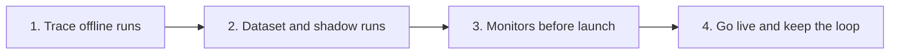

import { BlogHeader } from "@/components/blog/BlogHeader";

<BlogHeader
  title="How Teams in Regulated Industries Get AI Agents into Production"
  description="How financial services and healthcare teams trace an agent offline, prove the base case with a domain expert, add monitors, and go live with human sign-off in place."
  date="October 22, 2026"
  authors={["annabellschafer"]}
/>

A regulated team cannot go live and fix the agent later. Data handling, redaction, compliance checks, and a named sign-off have to be ready at launch.

Karthic Rao, CTO of Perpetual, said it at AI Engineer NYC in October 2026: "in a highly regulated industry, a policy violation isn't a bug report." ([transcript](https://ai.engineer/reading/nyc-2026/transcripts/karthic-rao-reliable-smart-workflows.md))

FINRA's 2026 Annual Regulatory Oversight Report flags "AI agents acting autonomously without human validation", asks firms "where to have 'human in the loop' agent oversight protocols or practices", and asks "how to track agent actions and decisions". ([FINRA](https://www.finra.org/rules-guidance/guidance/reports/2026-finra-annual-regulatory-oversight-report/gen-ai)) Article 14 of the EU AI Act says a high-risk system must be one that "can be effectively overseen by natural persons", including the ability "to intervene in the operation" and attention to "automation bias". ([Article 14](https://artificialintelligenceact.eu/article/14/))

Financial services is the main example below. Healthcare follows the same sequence, with a HIPAA business associate agreement in front of any patient data and with clinicians as the domain experts.

Banks already expect that evidence. A model risk process at one of the five largest banks "already required evidence before anything reached production: test results, review sign-offs, documentation." ([Building deployment gates for LLMs and AI agents in financial services](/blog/2026-07-15-llm-certification-financial-services))

## Run the same loop, starting offline [#the-loop]

The [AI engineering loop](/academy/ai-engineering-loop) is the work: trace, monitor, build datasets, experiment, evaluate. "Everything else in the loop runs on traces: evaluations score your real production traces, and datasets are built from them."

In a regulated setting you start that loop before launch. Trace the offline application, and go live once the base case works the way the domain expert expects. In production you run the same loop on live traffic.

The Academy states the reason: "you want to gain confidence in the quality before shipping to production. Your customers might even require this because they are in regulated environments with high quality bars." Anthropic's eval guide says production monitoring "Lacks ground truth for grading". ([Demystifying evals for AI agents](https://www.anthropic.com/engineering/demystifying-evals-for-ai-agents))

## Stage 1: Trace the offline application [#trace-offline]

Add [tracing](/docs/observability/get-started) while the agent is offline. Every prompt, retrieval step, tool call, and output needs a record a reviewer can open later.

The published [DKB story](/users/dkb) opens that operating model with four words: "It starts with tracing." David Hinrichs, a senior machine learning scientist at DKB, said there "would have been no way to send an unknown company all the data from our customers". Walid Mehanna at Merck Group makes the same demand from life sciences: "Generative AI will only earn enterprise trust when we can see what's happening under the hood." ([Merck Group story](/users/merckgroup))

Rao's rule for that record: "every judgment is typed and logged and the provisional ones are confirmed or rejected by a person." ([transcript](https://ai.engineer/reading/nyc-2026/transcripts/karthic-rao-reliable-smart-workflows.md)) Michele Grant, on an M&A finance reporting agent, keeps a decision log of "the raw data ingested, the tool calls executed, the prompt and the model versions" and the "human sign-off". ([transcript](https://ai.engineer/reading/nyc-2026/transcripts/oct14-michele-grant-trust.md))

## Stage 2: Prove the base case with a domain expert [#starting-dataset]

Build a starting [dataset](/docs/evaluation/experiments/datasets) with the domain expert. Use historical cases the firm already decided, and shadow runs where the agent works beside the current process and a person compares the two.

Qualified Health says: "Each deployment follows a staged approach that includes retrospective back-testing on historical data, automated evaluations, structured physician review, and controlled rollouts prior to broader use with partners." ([Qualified Health](https://claude.com/customers/qualified-health)) Justin Norden, MD, a co-founder, draws the clinical line: "There are no fully automated clinical decisions being made," and "Every output is reviewed by clinicians, with direct validation against source data."

Abridge does the historical pass on clinical notes. "Every system we build first undergoes "offline" pre-deployment evaluations." They add: "By back-testing on de-identified encounters we are able to evaluate our systems in realistic settings that publicly available and external data rarely reflect." ([Abridge](https://tech.abridge.com/blog/ai-evaluation-at-abridge))

Shadow mode is the second source. Grant names her first stage: "Stage one is shadow mode." The "agent runs right alongside them and the team compares the two." ([transcript](https://ai.engineer/reading/nyc-2026/transcripts/oct14-michele-grant-trust.md)) The Coalition for Health AI uses the clinical name, silent evaluation: "A silent evaluation involves generating AI system output using production data, but not displaying that output to personnel who would take action as part of the system workflow." ([CHAI Responsible AI Guide, PDF](https://assets.ctfassets.net/7s4afyr9pmov/6e7PrdrsNTQ5FjZ4uyRjTW/c4070131c523d4e1db26105aa51f087d/CHAI_Responsible-AI-Guide.pdf)) She also sets the bar for going further: "Every single metric requires a pre-deployment baseline."

Write the no-gos into that dataset: cases the agent must refuse, or hand to a person, with the behavior you expect. Rao's rule for outbound mail: "Nothing leaves the firm until a person approves that exact email." Run those cases as an [experiment](/docs/evaluation/experiments/experiments-via-sdk). The deployment gates post is the pattern: "documented testing before deployment, complete logs, documented human review, and monitoring that continues after release."

One expert label still needs a check. Tejas Kumar, in a workshop at AI Engineer World's Fair 2026, said that on a human support team "all the humans on that team will also agree about 80% of the time." He treats the miss as a writing problem: "When we don't agree, it's just usually because there's a knowledge gap." ([talk](https://www.youtube.com/watch?v=NdrSPm6NCdk), [transcript](https://ai.engineer/talks/NdrSPm6NCdk-evals-in-ai-deep-dive)) The 80% figure is his experience with a retail returns desk.

Anthropic states the test in one line: "A good task is one where two domain experts would independently reach the same pass/fail verdict." When two experts split, the task is still ambiguous, and the metric will be noisy. Abridge applies that check to judges: "These LLM judges are themselves first validated offline on clinician annotations to ensure that the results they give are consistent with clinician adjudications."

[Writing good evaluators](/academy/evaluate/writing-evaluators) and [Evaluation](/academy/evaluate) cover that labeling, and they treat the human labels as ground truth for a later judge. When a reviewer promotes a failure into the dataset, "The reviewer supplies the correct answer; the pipeline never copies the suspect output as ground truth."

## Stage 3: Add monitors before launch [#monitors-before-launch]

Turn compliance monitors on before the first live user. Score policy violations, missing sources, and refusals on the traces you already have. For a chat agent, also score user signals: explicit feedback, a request for a person, and a user who has to ask again. Start from [user feedback](/docs/observability/features/user-feedback) and [capturing signals](/academy/monitoring/capturing-signals), and read both on offline and shadow traffic before launch.

DKB treats screening as a condition of running the agent. "If I disabled the screening tomorrow," David Hinrichs says, "we would have to stop all our agent activity." A second Langfuse instance keeps employee conversations, and conversations with customers under 18, out of that screening. Specialists then work [annotation queues](/docs/evaluation/evaluation-methods/annotation-queues) "by service area (for example, brokerage or credit)" and rank cases "by severity".

Set the agent to hand off early. A line you can give it is plain: "I can't help with that, I'll connect you to a person." Extra handoffs are the safer default while you are still learning the traffic.

The AWS Well-Architected Agentic AI Lens names the triggers: "Agent-to-human escalation happens when confidence drops below a threshold, the stakes are high, or the retry budget has been exhausted." ([AGENTOPS01-BP02](https://docs.aws.amazon.com/wellarchitected/latest/agentic-ai-lens/agentops01-bp02.html)) Evan Kormos, on policy workflows at Coinbase, asks the matching question of each step: "Can we fall back to a human?"

## Stage 4: Go live and keep the loop running [#go-live]

Go live when the dataset passes, the shadow comparison is stable, and the monitors are already scoring. Then run the same loop on production traces.

Kormos described three steps at Coinbase. "So day one, we start supervised." "When measured confidence reaches a policy threshold," "we can move towards sampling." "And what that means is humans are looking at a slice of the output". After the next threshold, "once we clear the confidence threshold, humans handle more of the exceptions of the process, but still act as participants in refining the data sets and ensuring the quality outputs." Traces then cover "what the humans aren't seeing". ([transcript](https://ai.engineer/reading/nyc-2026/transcripts/oct14-evan-kormos-policy-workflows.md))

Grant's later stages match that shape. "Stage two is the supervised draft." "Stage 3 is the exception and sample". Then "stage 4, where it's exceptions only." She adds the warning for that last step: "once humans only look at exceptions, your biggest vulnerability is what the agent failed to flag." "A falling override rate does not automatically mean the agent is getting smarter." ([transcript](https://ai.engineer/reading/nyc-2026/transcripts/oct14-michele-grant-trust.md)) Keep an independent sample of any slice the agent now finishes alone.

Widen what the agent may finish by classifying the request. John Feminella, at Two Sigma, described blanket approval: "you succumb to review fatigue where you just see yes, yes, yes, yes, yes." "A better approach is to let these independent, conservative classifiers make decisions about routine calls, and then send a person only the requests that are most important". "If you're saying yes, 99.99999% of the time, then that's probably just a rule that the agent should follow, not a request you need to ask the human for permission for." ([transcript](https://ai.engineer/reading/nyc-2026/transcripts/john-feminella-agent-safety.md))

A password reset that already passes the dataset is that kind of routine call. The Academy's [customer support chatbot](/academy/examples/customer-support-chatbot) puts the gate on the category: "you could also automate only the request categories that cleared the phase 2 gate, while the rest keeps going through the support team for a little longer."

Klarna is the cautionary example. After an AI-first push in customer service, CEO Sebastian Siemiatkowski told Bloomberg, "As cost unfortunately seems to have been a too predominant evaluation factor when organizing this, what you end up having is lower quality," and, "I just think it's so critical that you are clear to your customer that there will be always a human if you want". The chatbot still handles two-thirds of inquiries. ([CX Dive](https://www.customerexperiencedive.com/news/klarna-reinvests-human-talent-customer-service-AI-chatbot/747586/))

Healthcare sets review depth by risk. Joint Commission and CHAI guidance says: "Tools that inform or drive clinical decisions should be checked more often; tools that simply help with administrative or documentation tasks can be checked periodically." ([guidance, PDF](https://assets.ctfassets.net/7s4afyr9pmov/5RX4XUbRg0l1JG0gwXGkTM/bea3c1949d6d8cdd8ec2ae2f82f737ad/JC-CHAI_RUAIH_Guidance.pdf))

Re-run the dataset when the system changes. Grant's regression triggers are "any updates to our prompt, base model, or source API that require full revalidation before running in production again." The deployment gates post names the same pressure: "By the time a manual approval lands, the system it tested has often already changed."

## What this looks like in Langfuse [#in-langfuse]

| Stage               | What you do                                                                  | Where it lives in Langfuse                                                                                                                                                                                                                                                             |
| ------------------- | ---------------------------------------------------------------------------- | -------------------------------------------------------------------------------------------------------------------------------------------------------------------------------------------------------------------------------------------------------------------------------------- |
| 1. Trace offline    | Prompts, retrieval, tool calls, and outputs on offline and shadow runs       | [Tracing](/docs/observability/get-started)                                                                                                                                                                                                                                             |
| 2. Starting dataset | Historical cases, shadow comparisons, no-gos, expert labels                  | [Datasets](/docs/evaluation/experiments/datasets), [experiments in the UI](/docs/evaluation/experiments/experiments-via-ui) or [via the SDK](/docs/evaluation/experiments/experiments-via-sdk), [annotation queues](/docs/evaluation/evaluation-methods/annotation-queues)             |
| 3. Monitors         | Compliance scores, chat user signals, alerts on a score                      | [LLM-as-a-judge](/docs/evaluation/evaluation-methods/llm-as-a-judge), [scores](/docs/evaluation/scores/overview), [online evaluation](/docs/evaluation/get-started/online), [alerts](/docs/observability/features/alerts), [user feedback](/docs/observability/features/user-feedback) |
| 4. Live loop        | Sample the automated slice, promote reviewed failures, re-run before release | Annotation queues, datasets, experiments, and the [AI engineering loop](/academy/ai-engineering-loop)                                                                                                                                                                                  |

Mask before you store. The [financial services](/financial-services) page calls for "Multiple layers of data redaction. Client-side and server-side PII protections before anything is stored." Set that in the SDK with [masking](/docs/observability/features/masking). The same page says to "Retain execution history: keep traces of AI executions as evidence for supervisory and regulatory reviews."

Healthcare teams processing protected health information on Langfuse Cloud complete a business associate agreement first. "Customers with HIPAA requirements should complete the BAA via Ironclad before processing Protected Health Information (PHI) in Langfuse." ([HIPAA](/security/hipaa)) When the data stays in your environment, [self-host](/self-hosting). "Langfuse does not receive or process your data, so no BAA with Langfuse is involved". Rao's constraint on the model is the same: "the data is sensitive, so you need a path to move these workflows entirely onto privately hosted models."

DKB's loop after launch is the one to copy. Laurenz Hemmen, a machine learning scientist at DKB, describes it: "We screen conversations, review flagged sessions, turn clusters of unwanted behavior into datasets, and run those evals as regression tests before every release."

The [deployment gates post](/blog/2026-07-15-llm-certification-financial-services) is the offline half of that loop. One limit in that post applies to every stage here. "Regulatory approval, independent validation, legal review, and accountable human sign-off stay with people."
