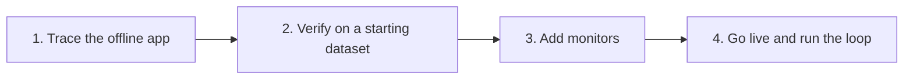

import { BlogHeader } from "@/components/blog/BlogHeader";

<BlogHeader
  title="How Teams in Regulated Industries Get AI Agents into Production"
  description="A four-stage path from an offline prototype to a live agent, for teams in financial services and healthcare that need evidence, compliance checks, and human sign-off before launch."
  date="October 22, 2026"
  authors={["annabellschafer"]}
/>

In banking, insurance, and healthcare, you cannot ship an agent and fix it later. Before the first customer talks to it, you need to know where the data goes, what gets redacted, which rules the agent must follow, and who signs off on the release.

Karthic Rao, CTO of the wealth management firm Perpetual, said it plainly at AI Engineer NYC in October 2026: "in a highly regulated industry, a policy violation isn't a bug report." ([transcript](https://ai.engineer/reading/nyc-2026/transcripts/karthic-rao-reliable-smart-workflows.md))

Regulators expect the same. FINRA's 2026 oversight report asks firms "where to have 'human in the loop' agent oversight protocols or practices" and "how to track agent actions and decisions" ([FINRA](https://www.finra.org/rules-guidance/guidance/reports/2026-finra-annual-regulatory-oversight-report/gen-ai)). Article 14 of the EU AI Act requires that high-risk systems "can be effectively overseen by natural persons" ([Article 14](https://artificialintelligenceact.eu/article/14/)).

This post walks through how regulated teams get from a prototype to a live agent in four stages. Financial services is the main example. Healthcare follows the same path, with clinicians as the domain experts and a HIPAA business associate agreement before any patient data is processed.

## The AI engineering loop still applies [#the-loop]

The [AI engineering loop](/academy/ai-engineering-loop) has five steps: trace, monitor, build datasets, experiment, and evaluate. Regulated teams run the same loop, and they usually enter it before launch.

They start offline. They trace the prototype, test it on a dataset, and go live once the base case works the way their domain experts expect. The Academy describes this entry point: "you want to gain confidence in the quality before shipping to production. Your customers might even require this because they are in regulated environments with high quality bars."

Banks already work this way for other models. In our work with one of the five largest banks, the model risk process "already required evidence before anything reached production: test results, review sign-offs, documentation." ([Building deployment gates for LLMs and AI agents in financial services](/blog/2026-07-15-llm-certification-financial-services))

## Stage 1: Add tracing to the offline application [#trace-offline]

Add [tracing](/docs/observability/get-started) before anyone outside the team uses the agent. Every later stage depends on it. Datasets are built from traces, evaluators score traces, and reviewers need traces as evidence.

Instrument the prototype the same way you will instrument production, recording the prompt version, model, tool calls, and retrieved context on every run. Then offline tests, shadow runs, and production traces can be compared directly.

This is also how DKB, one of Germany's largest direct banks, runs its assistant. [The DKB story](/users/dkb) puts it in four words: "It starts with tracing." For DKB, where the traces live mattered as much as what they contain. David Hinrichs, a senior machine learning scientist at DKB, explains why the bank self-hosts Langfuse: "There would have been no way to send an unknown company all the data from our customers," he says. Walid Mehanna at [Merck Group](/users/merckgroup) makes the same point for life sciences: "Generative AI will only earn enterprise trust when we can see what's happening under the hood."

A trace is the decision log reviewers ask for. Michele Grant, who spoke about trust in finance agents at AI Engineer NYC, wants each decision to record "the raw data ingested, the tool calls executed, the prompt and the model versions" along with the human sign-off ([transcript](https://ai.engineer/reading/nyc-2026/transcripts/oct14-michele-grant-trust.md)). Evan Kormos, who builds policy workflows at Coinbase, checks each step of an agent with a short question: "Can we trace it?" ([transcript](https://ai.engineer/reading/nyc-2026/transcripts/oct14-evan-kormos-policy-workflows.md))

## Stage 2: Verify with a starting dataset [#starting-dataset]

Next, build a starting [dataset](/docs/evaluation/experiments/datasets) together with your domain expert. In a bank, that might be a compliance officer or a senior support agent. In a hospital, it is a clinician. The dataset should show that the agent handles the common cases correctly before anyone relies on it.

You rarely need to invent these cases. Two sources work well in regulated settings.

**Historical data.** Run the agent on cases your team already decided, such as resolved tickets or reviewed claims, and compare. Qualified Health describes this as the first step of every clinical rollout: "Each deployment follows a staged approach that includes retrospective back-testing on historical data, automated evaluations, structured physician review, and controlled rollouts prior to broader use with partners." ([Qualified Health](https://claude.com/customers/qualified-health))

**Shadow runs.** Let the agent work on live cases next to the current process, without acting on anything, and compare its output with what the team did. Grant puts this first in her rollout plan: "Stage one is shadow mode." Healthcare calls it silent evaluation. The Coalition for Health AI defines it this way: "A silent evaluation involves generating AI system output using production data, but not displaying that output to personnel who would take action as part of the system workflow." ([CHAI Responsible AI Guide, PDF](https://assets.ctfassets.net/7s4afyr9pmov/6e7PrdrsNTQ5FjZ4uyRjTW/c4070131c523d4e1db26105aa51f087d/CHAI_Responsible-AI-Guide.pdf))

### Check the labels, too [#check-the-labels]

One expert's label is a starting point. Experts disagree more often than you might expect, and each disagreement points to a rule nobody wrote down. Tejas Kumar from IBM said in a workshop at AI Engineer World's Fair 2026: "When we don't agree, it's just usually because there's a knowledge gap." ([talk](https://www.youtube.com/watch?v=NdrSPm6NCdk)) Anthropic's guide to agent evals gives a simple test: "A good task is one where two domain experts would independently reach the same pass/fail verdict." ([Anthropic](https://www.anthropic.com/engineering/demystifying-evals-for-ai-agents))

In practice, ask a second expert to label a sample of the dataset. Where the two disagree, talk it through, write the missing rule into your guidelines, and update the label. [Generating ground truth](/academy/datasets/generating-ground-truth#making-labels-trustworthy) in the Langfuse Academy covers this in more detail. [Annotation queues](/docs/evaluation/evaluation-methods/annotation-queues) give experts a place to do the labeling without touching code.

### Define the no-gos and test the guardrails [#guardrails]

Before launch, agree with compliance on what the agent must never do. For a bank, that might be giving investment advice, quoting a rate that is not on the price list, or sending a message without approval. Rao's team at Perpetual has a hard rule for one such case: "Nothing leaves the firm until a person approves that exact email."

Then build a guardrail for each no-go and test it like any other component. Add dataset cases that should trigger it and normal cases that should pass. A guardrail that fires too often gets ignored.

Run the full dataset as an [experiment](/docs/evaluation/experiments/experiments-via-sdk) each time you change a prompt, model, or tool. Record the results as your baseline. Grant is strict about this: "Every single metric requires a pre-deployment baseline." The deployment gates post sums up what reviewers expect at this point: "documented testing before deployment, complete logs, documented human review, and monitoring that continues after release."

## Stage 3: Add compliance and user-signal monitors [#monitors]

Set up monitors before launch, and turn them on during the shadow runs so you know what normal looks like.

**Compliance monitors come first.** They check every trace against your no-gos. An [LLM-as-a-judge](/docs/evaluation/evaluation-methods/llm-as-a-judge) evaluator can flag a response that sounds like investment advice. A code check can flag a missing disclaimer. DKB screens every answer its assistant gives this way and sends flagged conversations to experts in annotation queues sorted "by service area (for example, brokerage or credit)." "If I disabled the screening tomorrow," says David Hinrichs, "we would have to stop all our agent activity."

Compliance also decides what may be screened at all. DKB is not allowed to auto-review conversations of its own employees or of customers under 18, so it runs a separate Langfuse instance that keeps those conversations out of automated screening.

**User-signal monitors** matter for chat agents. Track [explicit feedback](/docs/observability/features/user-feedback), and score conversations for signs of trouble, such as a user asking for a person, repeating a question, or correcting the agent. The Academy page on [capturing signals](/academy/monitoring/capturing-signals) lists the common ones.

At launch, let the agent escalate a little too often. A reply like "I can't help with that, I'll connect you to a person" costs a few minutes of staff time. A wrong answer in a regulated setting can cost much more. The AWS Well-Architected Agentic AI Lens lists when to hand off: "Agent-to-human escalation happens when confidence drops below a threshold, the stakes are high, or the retry budget has been exhausted." ([AWS](https://docs.aws.amazon.com/wellarchitected/latest/agentic-ai-lens/agentops01-bp02.html))

## Stage 4: Go live and run the loop [#go-live]

Once the dataset passes, the shadow runs match what your experts expect, and the monitors are in place, go live. From here you run the normal loop: trace production, watch the monitors, and turn interesting traces into new dataset items.

### Keep humans on a subset [#humans-on-a-subset]

People stay in the process after launch. What they review shrinks step by step as the evidence grows. At Coinbase, Kormos said, "So day one, we start supervised." Reviewers check every output at first. Once measured confidence passes a threshold set by policy, they move to checking a sample. Later they mainly handle exceptions, while still helping to improve the datasets. He also warned that "the loop is really only as trustworthy as the check." ([transcript](https://ai.engineer/reading/nyc-2026/transcripts/oct14-evan-kormos-policy-workflows.md))

Healthcare teams keep this even tighter. Justin Norden, co-founder of Qualified Health, said: "There are no fully automated clinical decisions being made." The Joint Commission and CHAI suggest matching review frequency to risk: "Tools that inform or drive clinical decisions should be checked more often; tools that simply help with administrative or documentation tasks can be checked periodically." ([guidance, PDF](https://assets.ctfassets.net/7s4afyr9pmov/5RX4XUbRg0l1JG0gwXGkTM/bea3c1949d6d8cdd8ec2ae2f82f737ad/JC-CHAI_RUAIH_Guidance.pdf))

### Automate the slices that work [#automate-slices]

Asking a person to approve everything does not scale, and it wears reviewers down. John Feminella from Two Sigma described the result: "you succumb to review fatigue where you just see yes, yes, yes, yes, yes." His advice is to automate what is clearly routine: "If you're saying yes, 99.99999% of the time, then that's probably just a rule that the agent should follow." ([transcript](https://ai.engineer/reading/nyc-2026/transcripts/john-feminella-agent-safety.md))

In practice, classify incoming requests. Let the agent handle categories that score well in your dataset and in production, such as a password reset, and send the rest to a person. The Academy's [customer support chatbot example](/academy/examples/customer-support-chatbot) suggests the same: "you could also automate only the request categories that cleared the phase 2 gate, while the rest keeps going through the support team for a little longer."

Automated slices still need a sample review. Grant names the risk: "once humans only look at exceptions, your biggest vulnerability is what the agent failed to flag." Keep reviewing a small random share of each automated category, so you notice when quality drifts.

Klarna learned this the hard way. After moving much of its customer service to AI, CEO Sebastian Siemiatkowski said: "what you end up having is lower quality." Klarna now offers customers a human option, while its chatbot still handles two-thirds of inquiries ([CX Dive](https://www.customerexperiencedive.com/news/klarna-reinvests-human-talent-customer-service-AI-chatbot/747586/)).

Finally, treat every change as a new release. Grant's team revalidates after "any updates to our prompt, base model, or source API" before the agent runs in production again. Rerun the stage 2 dataset and compare against the baseline.

## What this looks like in Langfuse [#in-langfuse]

| Stage               | What you do                                                      | Langfuse features                                                                                                                                                                                                         |
| ------------------- | ---------------------------------------------------------------- | ------------------------------------------------------------------------------------------------------------------------------------------------------------------------------------------------------------------------- |
| 1. Trace offline    | Record every step of offline and shadow runs                     | [Tracing](/docs/observability/get-started), [masking](/docs/observability/features/masking)                                                                                                                               |
| 2. Starting dataset | Build cases with experts, check labels, test guardrails          | [Datasets](/docs/evaluation/experiments/datasets), [experiments](/docs/evaluation/experiments/experiments-via-sdk), [annotation queues](/docs/evaluation/evaluation-methods/annotation-queues)                            |
| 3. Monitors         | Score compliance and user signals, alert on thresholds           | [LLM-as-a-judge](/docs/evaluation/evaluation-methods/llm-as-a-judge), [online evaluation](/docs/evaluation/get-started/online), [scores](/docs/evaluation/scores/overview), [alerts](/docs/observability/features/alerts) |
| 4. Live loop        | Review a sample, add failures to datasets, rerun before releases | Annotation queues, datasets, experiments                                                                                                                                                                                  |

DKB runs the full loop in Langfuse today. Laurenz Hemmen, a machine learning scientist at DKB, describes it: "We screen conversations, review flagged sessions, turn clusters of unwanted behavior into datasets, and run those evals as regression tests before every release."

**Data protection.** Redact sensitive data before it is stored. The SDKs support [masking](/docs/observability/features/masking) on the client, and the [Langfuse for financial services](/financial-services) page describes "Multiple layers of data redaction. Client-side and server-side PII protections before anything is stored."

**Deployment.** Pick the setup that matches where your data is allowed to live. Healthcare teams can use the [HIPAA-ready cloud region](/security/hipaa) and should sign a business associate agreement first: "Customers with HIPAA requirements should complete the BAA via Ironclad before processing Protected Health Information (PHI) in Langfuse." Teams that need everything in their own infrastructure can [self-host Langfuse](/self-hosting), as DKB does.

For a hands-on example of stage 2, read [Building deployment gates for LLMs and AI agents in financial services](/blog/2026-07-15-llm-certification-financial-services). It shows how to turn datasets and evaluators into pass or fail checks that a review board can inspect. It also states the limit that applies to every stage in this post: "Regulatory approval, independent validation, legal review, and accountable human sign-off stay with people."
