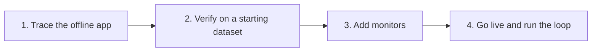

import { BlogHeader } from "@/components/blog/BlogHeader";
import { CustomerQuote } from "@/components/customers/CustomerQuote";

<BlogHeader
  title="How Teams in Regulated Industries Get AI Agents into Production"
  description="How banks, insurers, and healthcare teams take an AI agent from an offline prototype to production, with evidence, compliance checks, and human oversight at every step."
  date="October 22, 2026"
  authors={["annabellschafer"]}
/>

Most teams building AI agents ship early and improve in production. In banking, insurance, and healthcare, that approach rarely gets past the first review. A wrong answer can be a compliance incident, customer data cannot go to just any vendor, and someone has to sign off before the agent talks to a customer.

A common way to start is human in the loop: the agent proposes an answer or action, and a person approves it before anything reaches the customer. Regulators recommend this kind of oversight, and it is a sensible first step. For it to work, the agent's proposals need to be good from the start. If reviewers have to rewrite most drafts, the agent saves no time and people stop trusting it. The bigger payoff comes later, when a reliable share of cases can run without review and the team can measure and trust that autonomy rate.

This post describes how teams in regulated industries get there, from the first prototype to an agent that handles part of the work on its own.

## What makes regulated industries different [#the-challenge]

AI and development teams in regulated industries usually face three requirements for their projects.

**Evidence before launch.** Banks already run model risk processes that ask for test results, review sign-offs, and documentation before a model reaches production ([deployment gates for LLMs in financial services](/blog/2026-07-15-llm-certification-financial-services)). AI agents go through the same process, and the review board will want to see how the agent behaves on realistic cases.

**Oversight after launch.** Regulators expect people to stay in control. FINRA's [2026 oversight report](https://www.finra.org/rules-guidance/guidance/reports/2026-finra-annual-regulatory-oversight-report/gen-ai) asks firms to define where humans review agent actions and how they track agent decisions. [Article 14 of the EU AI Act](https://artificialintelligenceact.eu/article/14/) requires that people can effectively oversee high-risk AI systems.

**Control over data.** Conversations contain account details, transactions, and health information. Teams need to know where that data is stored, what gets redacted, and who can see it. In healthcare, a [business associate agreement](/security/hipaa) has to be in place before any protected health information is processed.

Teams still ship agents under these rules. They just do the steps in a different order.

## The approach: start the loop offline [#the-approach]

The [AI engineering loop](/academy/ai-engineering-loop) describes how teams improve AI applications: trace, monitor, build datasets, run experiments, and evaluate. Teams with a live product usually start by adding tracing to production. Regulated teams start one step earlier. They trace the prototype, test it on a dataset with their domain experts, add monitors, and only then go live.

Each stage produces evidence that the next stage, and the review board, can use.

## Stage 1: Trace the offline application [#trace-offline]

Add [tracing](/docs/observability/get-started) before anyone outside the team uses the agent. Every later stage depends on it: datasets are built from traces, evaluators score traces, and reviewers use traces as evidence of what the agent did.

Instrument the prototype the same way you will instrument production. Record the prompt version, model, tool calls, retrieved context, and any human approval on every run. Then traces from offline tests, shadow runs, and production can be compared directly, and each trace doubles as the decision log a reviewer will ask for.

Decide early where the traces will live. Many banks and healthcare providers [self-host Langfuse](/self-hosting) so that trace data never leaves their infrastructure. [DKB](/users/dkb), one of Germany's largest direct banks, made self-hosting a requirement before any production data could be touched.

<CustomerQuote
  quote="There would have been no way to send an unknown company all the data from our customers."
  name="David Hinrichs"
  role="Senior Machine Learning Scientist"
  company="DKB"
/>

[Trade Republic](/users/trade-republic), a fully licensed bank with over 10 million customers, went the same way. Its Ops Tools team runs self-hosted Langfuse and rolled it out across teams while meeting the bank's compliance requirements.

<CustomerQuote
  quote="We're using the open-source self-hosted version of Langfuse and we don't see any limitations there."
  name="Paolo Tamagnini"
  role="Senior Data Scientist"
  company="Trade Republic"
/>

Also mask sensitive fields before they are stored. The SDKs support [client-side masking](/docs/observability/features/masking), so account numbers or patient identifiers can be redacted at the source.

## Stage 2: Verify with a starting dataset [#starting-dataset]

Next, build a starting [dataset](/docs/evaluation/experiments/datasets) together with your domain experts. In a bank, that might be a compliance officer or a senior support agent. In a hospital, it is a clinician. The goal is to show that the agent handles the common cases the way your experts would.

### Where the cases come from [#where-cases-come-from]

Regulated teams rarely need to invent test cases. Two sources work well:

- **Historical data.** Run the agent on cases your team has already decided, such as resolved support tickets or reviewed claims, and compare the agent's output with the human decision. Clinical teams call this retrospective back-testing, and [Qualified Health](https://claude.com/customers/qualified-health) uses it as the first step of every deployment.
- **Shadow runs.** Let the agent process live cases next to the current workflow without acting on anything, and compare its output with what the team did. Healthcare calls this silent evaluation, and the [Coalition for Health AI](https://assets.ctfassets.net/7s4afyr9pmov/6e7PrdrsNTQ5FjZ4uyRjTW/c4070131c523d4e1db26105aa51f087d/CHAI_Responsible-AI-Guide.pdf) recommends it before any AI output reaches clinical staff.

Because both run through the same tracing as production, you can add any interesting trace to the dataset straight from the trace view.

### Check the labels [#check-the-labels]

One expert's label is a good start. Experts disagree more often than teams expect. Each disagreement usually points to a rule nobody wrote down. Ask a second expert to label a sample of the dataset. Where the two disagree, discuss the case, add the missing rule to your guidelines, and update the label. [Generating ground truth](/academy/datasets/generating-ground-truth#making-labels-trustworthy) in the Langfuse Academy covers this process in detail.

[Annotation queues](/docs/evaluation/evaluation-methods/annotation-queues) give experts a place to label traces without touching code. At DKB, customer service specialists work in Langfuse directly and add typical examples to datasets that engineers then use to adjust prompts.

<CustomerQuote
  quote="We have the AI expertise, but we don't necessarily have the banking customer service expertise. There's a lot of regulation, a lot of very specific things you need to get right. Langfuse really is a place where we bring the two halves together."
  name="Laurenz Hemmen"
  role="Machine Learning Scientist"
  company="DKB"
/>

### Define the no-gos and test the guardrails [#guardrails]

Before launch, agree with compliance on what the agent must never do. For a bank, that could be giving investment advice, quoting a rate that is not on the price list, or sending a customer message without approval.

Build a guardrail for each no-go and test it like any other component. Add dataset cases that should trigger the guardrail and normal cases that should pass through. A guardrail that fires too often gets ignored, so measure both.

Then run the full dataset as an [experiment](/docs/evaluation/experiments/experiments-via-sdk) and record the results as your baseline. Rerun it every time you change a prompt, model, or tool. Trade Republic takes this a step further when migrating live workflows to new agent architectures. The team iterates on one dataset and keeps a second, held-out dataset as a final exam, and only ships when the new agent passes both.

## Stage 3: Add compliance and user-signal monitors [#monitors]

Set up monitors before launch, and turn them on during the shadow runs so you know what normal looks like.

**Compliance monitors come first.** They check every trace against your no-gos. An [LLM-as-a-judge](/docs/evaluation/evaluation-methods/llm-as-a-judge) evaluator can flag a response that sounds like investment advice. A code check can flag a missing disclaimer. Route flagged traces to the right experts, and set [alerts](/docs/observability/features/alerts) when the share of flagged traces rises.

DKB screens every answer its assistant gives and sends flagged conversations to annotation queues sorted by service area, such as brokerage or credit. Specialists rank each case by severity and handle the critical ones first. For DKB, this screening is part of its license to operate.

<CustomerQuote
  quote="If I disabled the screening tomorrow, we would have to stop all our agent activity."
  name="David Hinrichs"
  role="Senior Machine Learning Scientist"
  company="DKB"
/>

Compliance also decides what may be screened at all. DKB is not allowed to auto-review conversations of its own employees or of customers under 18, so it keeps those conversations in a separate Langfuse instance outside automated screening. Check rules like these with your compliance team before you set up evaluators.

**User-signal monitors** matter for chat agents. Track [explicit feedback](/docs/observability/features/user-feedback), and score conversations for signs of trouble, such as a user asking for a person, repeating a question, or correcting the agent. The Academy page on [capturing signals](/academy/monitoring/capturing-signals) lists the most useful ones.

At launch, let the agent escalate a little too often. A reply like "I can't help with that, I'll connect you to a person" costs a few minutes of staff time. A wrong answer in a regulated setting can cost much more. The [AWS Well-Architected Agentic AI Lens](https://docs.aws.amazon.com/wellarchitected/latest/agentic-ai-lens/agentops01-bp02.html) suggests three triggers for a handoff: low confidence, high stakes, and an exhausted retry budget.

## Stage 4: Go live and run the loop [#go-live]

Once the dataset passes, the shadow runs match what your experts expect, and the monitors are in place, go live. From here you run the normal loop: trace production, watch the monitors, and turn interesting traces into new dataset items.

### Keep humans on a subset [#humans-on-a-subset]

People stay in the process after launch, and the amount they review shrinks as the evidence grows. A common pattern, described by [Coinbase at AI Engineer NYC](https://ai.engineer/reading/nyc-2026/transcripts/oct14-evan-kormos-policy-workflows.md), has three steps:

1. **Supervised.** Reviewers check every output.
2. **Sampled.** Once measured quality passes a threshold set by policy, reviewers check a sample.
3. **Exceptions.** Reviewers mainly handle flagged cases and keep improving the datasets.

Match the review rate to the risk. Guidance from the [Joint Commission and CHAI](https://assets.ctfassets.net/7s4afyr9pmov/5RX4XUbRg0l1JG0gwXGkTM/bea3c1949d6d8cdd8ec2ae2f82f737ad/JC-CHAI_RUAIH_Guidance.pdf) recommends checking tools that inform clinical decisions more often than tools that help with administrative tasks. The same logic applies in a bank: a credit decision deserves more review than a branch-hours question.

### Automate the slices that work [#automate-slices]

Asking a person to approve everything does not scale, and reviewers who approve hundreds of routine cases a day stop looking closely. The fix is to automate what is clearly routine.

In practice, classify incoming requests by category. Let the agent handle categories that score well in your dataset and in production, such as a password reset, and keep sending the rest to a person. The Academy's [customer support chatbot example](/academy/examples/customer-support-chatbot) walks through this approach, automating only the request categories that cleared the quality gate.

Keep a small random sample of each automated category in an annotation queue. Once humans only see exceptions, the biggest risk is the case the agent failed to flag, and sampling is how you catch quality drift.

Finally, treat every change to a prompt, model, or tool as a new release. Rerun the stage 2 dataset, compare it against the baseline, and only then deploy. DKB runs this full loop in Langfuse today.

<CustomerQuote
  quote="The whole pipeline to improve our chat agent happens entirely in Langfuse. We screen conversations, review flagged sessions, turn clusters of unwanted behavior into datasets, and run those evals as regression tests before every release."
  name="Laurenz Hemmen"
  role="Machine Learning Scientist"
  company="DKB"
/>

## How Langfuse supports each stage [#in-langfuse]

| Stage               | What you do                                                      | Langfuse features                                                                                                                                                                                                         |
| ------------------- | ---------------------------------------------------------------- | ------------------------------------------------------------------------------------------------------------------------------------------------------------------------------------------------------------------------- |
| 1. Trace offline    | Record every step of offline and shadow runs                     | [Tracing](/docs/observability/get-started), [masking](/docs/observability/features/masking)                                                                                                                               |
| 2. Starting dataset | Build cases with experts, check labels, test guardrails          | [Datasets](/docs/evaluation/experiments/datasets), [experiments](/docs/evaluation/experiments/experiments-via-sdk), [annotation queues](/docs/evaluation/evaluation-methods/annotation-queues)                            |
| 3. Monitors         | Score compliance and user signals, alert on thresholds           | [LLM-as-a-judge](/docs/evaluation/evaluation-methods/llm-as-a-judge), [online evaluation](/docs/evaluation/get-started/online), [scores](/docs/evaluation/scores/overview), [alerts](/docs/observability/features/alerts) |
| 4. Live loop        | Review a sample, add failures to datasets, rerun before releases | Annotation queues, datasets, experiments                                                                                                                                                                                  |

On the infrastructure side, regulated teams usually choose between two setups:

- **Self-hosted.** Run Langfuse in your own infrastructure with the [self-hosting guide](/self-hosting). This is what DKB and Trade Republic do.
- **Langfuse Cloud.** Healthcare teams can use the [HIPAA-ready cloud region](/security/hipaa) after signing a business associate agreement.

The same need for visibility applies in life sciences. [Merck](/users/merckgroup) serves more than 80 AI project teams on Langfuse and uses it to keep an audit trail of every AI interaction.

<CustomerQuote
  quote="Generative AI will only earn enterprise trust when we can see what's happening under the hood. Langfuse enables us to track every prompt, response, cost, and latency in real time, turning black-box models into auditable, optimizable assets."
  name="Walid Mehanna"
  role="Chief Data & AI Officer"
  company="Merck"
  image="/images/customers/merck/walid.jpeg"
/>

## Further reading [#further-reading]

- [Langfuse for financial services](/financial-services): data protection, deployment options, and compliance documentation for banks and insurers.
- [Building deployment gates for LLMs and AI agents in financial services](/blog/2026-07-15-llm-certification-financial-services): how to turn datasets and evaluators into pass or fail checks that a review board can inspect.
- Customer stories from regulated industries: [DKB](/users/dkb), [Trade Republic](/users/trade-republic), and [Merck](/users/merckgroup).
