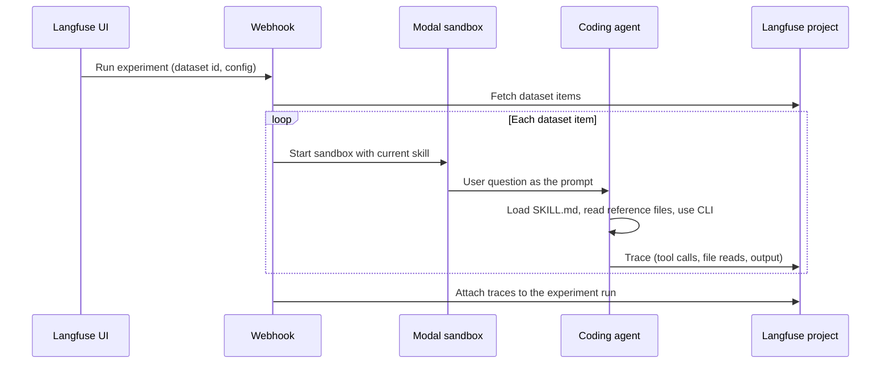

import { BlogHeader } from "@/components/blog/BlogHeader";

<BlogHeader
  title="Engineering the Langfuse skill"
  description="How we improve the Langfuse skill with datasets, experiments on coding agents, and traces from Halo."
  date="October 28, 2026"
  authors={["lotteverheyden"]}
/>

The [Langfuse skill](/docs/api-and-data-platform/features/agent-skill) is a playbook we ship to coding agents. Over the last two weeks, the [skills repository](https://github.com/langfuse/skills) recorded **22,000 unique clones**. That is a lot of agents instrumenting apps, migrating prompts, building datasets, and setting up evals on our behalf.

Almost none of those runs are traced. We still ship improvements to the skill every week.

This post is the [AI engineering loop](/academy/ai-engineering-loop) applied to an external skill: datasets, experiments on coding agents, evaluation of the traces those agents produce, and a deploy step that is publishing a new skill version. [Halo](/docs/api-and-data-platform/features/halo), our in-app assistant, is the production surface we can observe.

## The Langfuse skill [#the-langfuse-skill]

We started building the skill a few months ago as part of making Langfuse usable by coding agents, not only by humans in the UI. The longer version of that work is in [Will you be my CLI?](/blog/2026-02-13-will-you-be-my-cli) and on the [Langfuse for agents](/agents) page. The short version: agents need a playbook, a CLI, and docs they can actually read.

A skill is a folder. `SKILL.md` is the entrypoint. Reference files hold the workflows. The agent loads the frontmatter always, and the rest only when the task needs it.

  <FileTree>
    <FileTree.File name="SKILL.md" />
    <FileTree.Folder name="references" defaultOpen>
      <FileTree.File name="instrumentation.md" />
      <FileTree.File name="prompt-migration.md" />
      <FileTree.File name="create-dataset.md" />
      <FileTree.File name="setting-up-evals.md" />
      <FileTree.File name="error-analysis.md" />
      <FileTree.File name="cost-optimization.md" />
      <FileTree.File name="ci-cd.md" />
      <FileTree.File name="..." />
    </FileTree.Folder>
  </FileTree>

`SKILL.md` is deliberately small. It states when to use Langfuse, how to fetch current docs, how to use the CLI, and **which reference file to read for which job**. The reference files are where the actual opinions live: how to instrument, how to migrate prompts, how to design a dataset, how to calibrate a judge.

That routing step is the whole product. If the agent never opens `instrumentation.md`, it will invent an integration. If it opens `prompt-migration.md` for a tracing question, it will wander. A skill that is not loaded, or loaded as the wrong file, is just a folder on disk.

We have written about pieces of this before: [evaluating the skill](/blog/2026-02-26-evaluate-ai-agent-skills), [using it to improve prompts](/blog/2026-02-16-prompt-improvement-claude-skills), [running autoresearch on it](/blog/2026-03-24-optimizing-ai-skill-with-autoresearch). This post is the loop we now run as a habit, not a one-off experiment.

## Internal vs external skills [#internal-vs-external-skills]

Skills split cleanly into two kinds, and the split is about observability, not about file format.

**Internal skills** live inside a company. The agents that use them are often already traced: a support agent, an internal copilot, Halo. You can see whether the skill was loaded, which files were read, where the agent got stuck, and whether the output was any good. Improving the skill looks like improving any other agent.

**External skills** are distributed. You publish a folder, people install it into Claude Code, Cursor, Codex, Windsurf, and whatever comes next, and the skill runs on machines you do not control, against codebases you have never seen, with no exporter pointed at you. You do not get traces. You do not get scores. You do not get to sample production.

The Langfuse skill is the second kind. 22,000 unique clones over two weeks is a usage number, not a quality number. It tells us the skill is being installed. It tells us nothing about whether those agents then instrumented an app the way we would, or gave up and wrote `curl` commands from memory.

<Callout type="info">
This is the default situation for anyone shipping a public skill. If you cannot see the run, you cannot monitor it. The online half of the AI engineering loop is just not available.
</Callout>

## The AI engineering loop [#ai-engineering-loop]

We describe AI engineering as a loop. Trace what the system does, monitor the traces that matter, turn those into datasets, experiment, evaluate, deploy, repeat. We teach it in the [academy](/academy/ai-engineering-loop). We [argued](/blog/2026-06-09-ai-is-eating-ai-engineering) that you should not hand the whole thing to an agent.

<LoopDiagram />

For an external skill, Trace and Monitor do not exist. There is no production traffic to sample. There are no user signals in the sense of [capturing signals](/academy/monitoring/capturing-signals): no thumbs, no retries you can see, no conversation that lands in your project.

That does not mean you stop. It means you live in the offline half until you find another way to get production signal.

<AnnotatedLoop
  ariaLabel="The AI engineering loop for an external skill: tracing and monitoring are unavailable, deploy means publishing a new skill version"
  deployLabel="Publish"
  deployDimmed={false}
  stations={{
    trace: { dimmed: true, note: "no production traces" },
    monitor: { dimmed: true, note: "external runs are opaque" },
    dataset: { note: "questions we want the skill to handle" },
    change: { note: "skill versions in a sandbox" },
    eval: { note: "read the agent traces" },
  }}
/>

**Deploy, here, is publishing a new skill version.** A git commit to `langfuse/skills`. The agents that already have the skill installed pick it up on the next update; new installs get the new files. There is no prompt label to promote, no model to swap in the UI. The artifact _is_ the skill folder.

The rest of this post is that offline loop in detail, then the online half we got back once the same skill started running inside Halo.

## Evaluation datasets [#evaluation-datasets]

If you cannot observe, you can still measure. You create [datasets](/academy/datasets) that stand in for real use, you [run experiments](/academy/experiments) against them, you [evaluate](/academy/evaluate) the traces, and you ship only when the new version is better.

This is the same move you make before an application is in production. The academy says you do not have to close the full loop on day one, and that starting with datasets is a valid entry point. An external skill is permanently in that situation, unless you later find a production surface you do control.

We keep the datasets in a Langfuse project dedicated to this. Each dataset is a slice of skill behavior, not a dump of every prompt we could think of. Two slices matter most right now: **routing** (did the agent read the right reference file?) and **workflows** (did it then do the job?).

### Routing [#routing]

The skill has a lot of reference files, and `SKILL.md` has to send the agent to the right one. That is a classification problem with a very cheap expected output: a filename.

The routing dataset is user questions in, reference filename out.

| Input                                                                       | Expected output        |
| --------------------------------------------------------------------------- | ---------------------- |
| Add Langfuse tracing to the OpenAI calls in `src/agent.ts`                  | `instrumentation.md`   |
| Migrate the system prompt in `src/agent.ts` to Langfuse prompt management   | `prompt-migration.md`  |
| Create a dataset called edge-cases and add these three failing traces to it | `create-dataset.md`    |
| Set up a CI gate so this prompt cannot regress                              | `ci-cd.md`             |
| This agent is getting expensive, help me bring cost down                    | `cost-optimization.md` |
| I have traces, how do I start evaluating?                                   | `setting-up-evals.md`  |
| Calibrate this LLM-as-a-judge against my labeled examples                   | `judge-calibration.md` |

Some items are obvious. Some are not. "My human annotators found five recurring error cases, help me set up an evaluator for each" should still land on eval setup, not on instrumentation. "The outputs look fine but we are paying too much" should land on cost optimization, not on a generic docs search.

We run the current skill against this dataset. Each run produces a full agent [trace](/academy/tracing): which files it opened, which CLI commands it ran, what it asked. Evaluation is then a check against the expected filename: **did this run read the reference file stored as expected output?** If it read three files and the expected one is among them, that can still be a pass, depending on the item. If it never opened the skill, or opened the wrong file and stayed there, that is a fail.

<Callout type="info">
You do not need an LLM-as-a-judge for this. The expected output is a string you can look up in the trace: a `read` of `references/<file>.md`, or the equivalent in whatever agent produced the run. A code evaluator, or even a pass through the traces, is enough.
</Callout>

Routing is the first dataset we run after any change to `SKILL.md`. A more conceptual description, a new reference file, a tweak to the frontmatter: all of these have, in the past, stopped the skill from being invoked at all. We [wrote about that failure](/blog/2026-02-26-evaluate-ai-agent-skills) when we first evaluated the skill. It is still the cheapest way to catch a broken skill before we talk about whether the workflow itself is any good.

### Workflows [#workflows]

Routing says the agent opened the right file. It does not say the agent then instrumented the app, migrated the prompts, or built a dataset the way we want.

For that we keep workflow datasets. Each one is scoped to a single reference file and a set of user inputs, from very obvious to deliberately under-specified:

- **Obvious:** "Instrument this OpenAI chat app with Langfuse."
- **Less obvious:** "We have a Next.js app that calls an LLM in two places, one through a framework. Make sure we can see both in Langfuse, including cost."
- **Adversarial-ish:** credentials missing, an old SDK already in `package.json`, a prompt that looks like a Langfuse question but is actually "just write me a chatbot."

The expected output here is not a filename. It is a judgment about the trace: did the agent fetch current docs instead of relying on memory? Did it use the CLI rather than inventing HTTP calls? Did it follow the workflow in the reference file, including the boring parts like checking that `LANGFUSE_BASE_URL` is set?

We often **do not start with an evaluator**. We run the experiment, then we read the traces. Sometimes we do that ourselves. Sometimes we point another agent at the experiment run and talk through the traces until the picture is clear: where it skipped the skill, where it looped on `--help`, where it did something we would actually want users to get.

<Callout type="info">
Writing the evaluator too early freezes an incomplete target. [Error analysis](/academy/monitoring/error-analysis) is the better first pass: read, name what broke, then decide which of those things deserve a standing metric. We made the opposite mistake when we [ran autoresearch on the prompt-migration skill](/blog/2026-03-24-optimizing-ai-skill-with-autoresearch). The optimizer climbed the score we gave it, including by deleting the approval gate, because nothing in the harness represented a human.
</Callout>

Once a failure mode repeats, _then_ we add an evaluator. CLI errors per run. Skill invoked or not. Expected reference file read. Docs fetched before the first code edit. Those are cheap, and they keep the next experiment honest. The rest stays as trace review until we know what "good" looks like well enough to encode it.

This is also why we keep looking at traces even when the numbers look fine. The numbers tell you something moved. The trace tells you whether it moved in a direction you would defend.

## Experiment harness [#experiment-harness]

A dataset in Langfuse is inert until something executes each item. For a skill, that something has to be a real coding agent, in a real sandbox, with the skill installed.

We used to do this with a Python script and the Claude Agent SDK, and that version is still public in [langfuse-examples](https://github.com/langfuse/langfuse-examples/tree/main/applications/evaluating-ai-agent-skills). The current harness is the same idea, scaled up:

1. The dataset and the experiment live in Langfuse.
2. A [remote experiment webhook](/docs/evaluation/experiments/experiments-via-sdk#configure-webhook) fires when someone clicks Run in the UI, or when we trigger it from git.
3. The webhook hits a small service that fetches the dataset, then starts **one coding agent per item inside [Modal](https://modal.com)**.
4. Each sandbox gets the current skill, Langfuse credentials for the project the agent is supposed to work in, and a clean copy of a fixture repo when the item needs one.
5. The agent run is traced back into Langfuse and attached to the experiment item.
6. Evaluators run when we have them. The rest of the judgment happens by reading those traces.

A few details that matter in practice:

**The sandbox has to look like a user environment.** If the agent cannot `pip install`, it will switch to `curl`. If there is no human to approve a plan, it will either stall or skip the approval step, and your skill will learn the wrong habit. We got both of those wrong in the autoresearch harness. Modal makes it easier to give each item its own filesystem, its own env, and a time limit, without holding a laptop open overnight.

**The skill under test is an input, not a global.** The sandbox installs a specific checkout of `langfuse/skills`. That is how an experiment on a branch stays comparable to production: same dataset, different skill version, two experiment runs in the same project.

**Triggering from the UI is the point.** Remote experiments exist so a dataset you already look at in Langfuse can start a run that your application code knows how to execute. We do not want a separate "skill eval" product. We want the same experiment view we use for everything else, filled with traces of coding agents.

**Concurrency is a budget.** Each item is a full agent session: many turns, many tool calls, real tokens. Modal lets us run items in parallel, but we still cap concurrency so a routing dataset of a few dozen questions does not turn into a surprise bill, and so the traces stay inspectable instead of arriving as a flood.

After the run, the work is the same as any other experiment. Open the run. Sort by the scores you have. Open the failures. For workflow datasets, open a sample of the passes too. If a change to `SKILL.md` fixed routing and broke instrumentation, you only see that by looking.

## Skill management [#skill-management]

A skill is not one prompt. It is a folder: frontmatter, `SKILL.md`, a growing set of reference files, sometimes scripts. Shipping a change means shipping a consistent set of those files, being able to tell which set a given experiment used, and being able to roll back.

That is [prompt management](/docs/prompt-management/overview), stretched. Teams already [store skill files as prompts](/faq/all/managing-skills-with-prompt-management) to get versioning, labels, and a link from a trace back to the files that produced it. The gaps are real: no native folder grouping, playgrounds that assume one file, no first-class way to say "this experiment ran against skill version 14." We still think the discipline is the same.

For the Langfuse skill specifically:

- The git history of `langfuse/skills` _is_ the version control.
- An experiment records which commit was installed in the sandbox, in the run metadata.
- Publishing is merging to `main` (and, for people who installed via a plugin or `npx skills add`, waiting for that checkout to update).
- We do not silently rewrite a reference file without a routing run. A new file that `SKILL.md` never points to will not get used; a new file that `SKILL.md` points to too vaguely will steal traffic from the others.

<Callout type="info">
Treat the skill folder as the unit you evaluate, not the individual markdown file. Routing tests the index. Workflow tests the chapter. Together they are the version you are willing to publish.
</Callout>

## Skill feedback and GitHub issues [#skill-feedback-and-github-issues]

Before Halo, we did try to get a little production signal out of the external skill.

The skill includes a [feedback workflow](https://github.com/langfuse/skills/blob/main/skills/langfuse/references/skill-feedback.md). It tells the agent to submit feedback about the skill itself: what the user was trying to do, what the skill did, what would have been better. Submission goes through the Langfuse MCP or CLI when those are available, and otherwise through a [GitHub discussion or issue](https://github.com/langfuse/skills/discussions) on the skills repo.

This is the skill equivalent of an [explicit rating](/academy/monitoring/capturing-signals#explicit-ratings). It is unambiguous when it arrives. It almost never arrives.

There is friction at every step. The agent has to notice that the skill was the problem, not the user's app. It has to draft the feedback, show it, wait for permission, and submit. The user has to care enough to approve. Most sessions that would have taught us something just end.

We still want that channel. A well-written issue about a wrong instruction is more useful than a vague thumbs down. We do not pretend it substitutes for traces. **A trace is something the system produces by default. Feedback is something you have to ask for.** The [academy lesson on signals](/academy/monitoring/capturing-signals) is mostly about capturing judgment that is already happening. Here, almost none of it is happening in a place we can see.

So we ran the offline loop, published versions, and treated GitHub as a trickle of extra cases for the datasets. That is a valid way to ship. It is also incomplete.

## Tracing the skill in Halo [#tracing-the-skill-in-halo]

Halo is the assistant inside Langfuse. It uses the same MCP tools, the same docs, and **the same open-source skill** that external coding agents use. We [built it that way on purpose](/blog/2026-10-21-building-the-langfuse-assistant): there is no private Halo playbook. If we fix a workflow in the skill, Halo gets it, and so does everyone else.

The important part for this post is that Halo runs in an environment we do trace. When an organization opts into AI feature telemetry, Halo sessions land in Langfuse as traces. We can see whether the skill was loaded, which reference file was read, which tools were called, where it failed, and what the user did next.

That is the online half.

<AnnotatedLoop
  ariaLabel="The AI engineering loop with Halo providing production traces of the same skill"
  deployLabel="Publish"
  deployDimmed={false}
  stations={{
    trace: { note: "Halo sessions" },
    monitor: { note: "which files the skill actually uses" },
    dataset: { note: "Halo failures become items" },
    change: { note: "skill versions in Modal" },
    eval: { note: "routing and workflow checks" },
  }}
/>

In practice the loop now looks like any other AI engineering loop we would tell a customer to run:

- **Trace.** Halo executions show up as traces. External coding-agent runs still do not, and we do not pretend they do.
- **Monitor.** We read Halo traces the way the academy says to read production: sample them, do not only look at what an evaluator already flags. When Halo struggles with a tool or follows stale guidance, that is a skill bug, an MCP bug, or a docs bug. We have [fixed all three](/blog/2026-10-21-building-the-langfuse-assistant) by looking at those traces.
- **Build datasets.** A Halo failure that routing never covered becomes a new routing item. A workflow that works on our fixture repos but falls apart on a real project becomes a new workflow item. The offline datasets stop being only synthetic.
- **Experiment.** Same Modal harness, same skill checkout, now with cases that came from production.
- **Evaluate.** Routing checks stay cheap. Workflow review stays partly manual on purpose.
- **Publish.** A new skill version. Halo loads it. External agents load it too.

<Callout type="info">
Halo is not a perfect proxy for Cursor or Claude Code. It has UI context, approvals, and a sandbox we designed. A coding agent in someone else's repo has a different harness. We use Halo traces as a source of *cases and failure modes*, then we still re-test those cases in the Modal coding-agent harness before we decide the skill got better.
</Callout>

This is the thing that made skill engineering feel like normal AI engineering again. Offline was always possible. Online was the missing feed. We could not get it from the public skill. We could get it by running the same skill ourselves.

## A setup you can copy [#a-setup-you-can-copy]

If you ship a skill, especially a public one, the setup is:

1. **Write the skill as an index plus reference files**, not as one giant `SKILL.md`. Progressive disclosure is what you will test.
2. **Make a routing dataset on day one.** User question → file that should be read. It is cheap and it catches the worst failures.
3. **Add a workflow dataset per reference file** as soon as that file exists. Start with obvious prompts, then add the ones that are slightly the wrong shape.
4. **Run real agents in real sandboxes.** A string-match against the skill text does not tell you whether an agent will follow it.
5. **Read traces before you write evaluators.** Encode a failure mode once you have seen it twice.
6. **Version the folder**, and record which version an experiment used.
7. **Do not rely on the skill asking for feedback.** Build a production surface you can trace, even if it is only your own agent using the same files.
8. **When you do get production traces, feed them into the same datasets.** That is the loop closing, not a different process.

The Langfuse-specific part is that the skill, the datasets, the experiment runs, the traces, and Halo all sit in the same product we are asking the skill to teach. That is convenient. It is not required. Any tracing backend plus a sandbox plus a folder of markdown would do the offline half. The required part is treating the skill as an agent you are responsible for, even when you cannot see most of the times it runs.

22,000 unique clones is a good problem to have. It is also a reminder that distribution and quality are different numbers. The loop is how we keep them from drifting apart.
