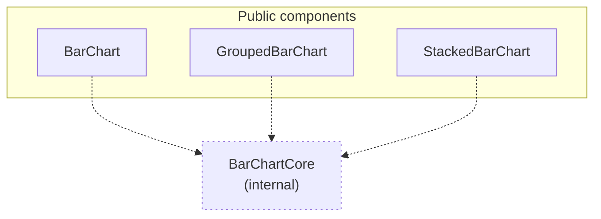

import { BlogHeader } from "@/components/blog/BlogHeader";
import { DesignSystemProgress } from "@/components/blog/DesignSystemProgress";

<BlogHeader
  title="How we’re building Langfuse’s design system"
  description="The API and composition choices behind Langfuse’s design system, including what we restrict, what stays flexible, and what still needs review."
  date="November 20, 2026"
  authors={["benbachem"]}
/>

A few months ago, we set out to redesign Langfuse’s dark mode. But improving the colors and contrast meant changing how we built the UI, not just how it looked. Langfuse never had a rigorous design system, and Trang had only started as the first designer on the team. This meant styling decisions were scattered between shared components and individual features, so even shared changes meant tracking down callers across the product. Much of the code-writing was already AI-assisted, which had contributed to the complexity.

So Trang and I started building a design system to improve the UI and make features easier to build and review. The question is which decisions it should make once, and which should stay with each feature. A feature author should spend their attention on what makes the feature different, not repeatedly settle how common interactions work. Reusing a component should mean reusing decisions we’ve already made together, not just saving some code.

These principles aren’t specific to AI, but agents amplify the consequences of our API choices. An overly permissive API lets each caller introduce variations we never intended to support and with the amount of code growing quickly, keeping an eye on these cases becomes harder.

## Cheap code makes good abstractions more important

Before getting into those boundaries, it’s worth asking why we need shared components at all. If an agent can generate a select in seconds, why maintain a shared one?

The first reason is consistent look and feel. Centralizing styling decisions lets us change them across the product rather than adjust each feature separately. Keyboard navigation, focus handling, and accessibility also need deliberate attention. With good shared primitives, we can do that work once and bring improvements to every feature using them.

You could argue that documentation could enforce these decisions without centralizing the code. The problem is that documentation cannot do this **reliably**, and changing instructions leaves existing code unchanged. Shared code lets us enforce decisions and apply changes to existing consumers.

But shared code alone isn’t enough. A dropdown can provide shared items, icons, and shortcuts while still asking every caller to assemble and style them. If documentation is what tells callers where the shortcut belongs or how far the icon sits from its label, those decisions still need checking at every call site.

We want callers to choose the menu’s actions, not reconstruct its presentation. A typed `items` prop can preserve that distinction: the feature supplies labels, icons, and callbacks; the menu owns their arrangement and interactions.

## Deciding what belongs in a shared component

I initially experimented with automatically cleaning up and migrating existing components.

This didn't go well, many existing component APIs were awkward with props bolted on over time. I believe many of the bolted on props, came from agents making shared-code changes opt-in rather than migrate existing usages to a new default. I understand why: they can finish the feature without touching old code. Two badges might have different capitalization or padding because they serve different purposes, or simply because different people built them months apart. Preserving both through `uppercase={true}` or `padding="dense"` turns accidental history into a choice every future caller has to make.

Should the shared component keep all that functionality, split into several components, or leave an unusual variant as a one-off? I found coding agents would not have good taste in these matters, especially since we had little documentation around it and existing code didn’t follow our larger vision. Therefore, I decided to first manually migrate some components with the intention of automating some of the work once a healthy baseline had been established.

In the following I want to explore the principles we established for our new set of design-system components.

## Start narrow, expand deliberately

We start with small APIs covering known needs. If we expose an option, we should expect people to use it, not tell them in review that they weren’t supposed to. With agents, that option can spread quickly.

Here's an example from our [legacy dropdown](https://github.com/langfuse/langfuse/blob/main/web/src/components/ui/dropdown-menu.stories.tsx) component:

```tsx
<DropdownMenuItem className="text-xs" onSelect={handleCopyTraceId()}>
  <CopyIcon className="mr-2" />
  Copy Trace ID
</DropdownMenuItem>
```

The composite API requires even a copy action to decide on caller-owned text sizing and icon spacing. There's also nothing stopping anyone from putting an element inside the `DropdownMenuItem` that would spill over it's bounds. People have been asking to [restrict JSX composition at the type level for a decade](https://github.com/microsoft/TypeScript/issues/18357). Lint rules can help, but they can be brittle. Where we want to guarantee content structure, we’re replacing compound component APIs with strictly typed props.

With the design-system `DropdownMenu`, callers supply items instead of assembling their markup. This excerpt shows the items API, with the second item and trigger omitted:

```tsx
<DropdownMenu
  ariaLabel="Use skill"
  items={[
    {
      type: "item",
      id: "install",
      title: "Install with CLI",
      icon: Terminal,
      disabled: installDisabled
        ? { reason: "Loading installation options" }
        : undefined,
      onClick: handleInstall,
    },
  ]}
>
  {/* Trigger omitted. */}
</DropdownMenu>
```

The caller still chooses the actions, labels, icons, and trigger. The menu owns how its items are rendered, including icon alignment and spacing.

Now, a strict API can be annoying to use. You have to construct exactly the object it expects instead of just writing some JSX. With coding agents, I’m less concerned about the extra typing. I still need to read and debug the result, but I’d rather review an explicit list of actions than check whether someone put the shortcut in the right place again. I’m happy to make the call site more cumbersome if that’s what it takes to get those menus right.

We still need to be very intentional with what props we expose. Our `ControlledDropdownMenu` briefly exposed a `selected` property on all menu items even though it was only needed for special options in our Organization and Project switchers. Selection behavior quickly appeared elsewhere. We should have used a discriminated union separating entity rows from ordinary items and restricted `selected` to the former from the beginning.

We also separate public components, available to feature code, from internal implementation components. “Public” doesn’t mean published as a separate package.

For example, [`BarChart`](https://github.com/langfuse/langfuse/blob/main/web/src/components/design-system/charts/BarChart/BarChart.tsx), [`GroupedBarChart`](https://github.com/langfuse/langfuse/blob/main/web/src/components/design-system/charts/GroupedBarChart/GroupedBarChart.tsx), and [`StackedBarChart`](https://github.com/langfuse/langfuse/blob/main/web/src/components/design-system/charts/StackedBarChart/StackedBarChart.tsx) share an internal [`BarChartCore`](https://github.com/langfuse/langfuse/blob/main/web/src/components/design-system/internal/charts/BarChartCore.tsx):



The core supports several layouts, but callers choose a named component rather than configure those through flags. If I need a stacked chart, I can find `StackedBarChart` in autocomplete instead of looking through a general-purpose chart’s props to figure out how to configure one. Its props only cover relevant options, and I can tell which chart is being used later without checking a combination of flags. We share the implementation without exposing all of it.

Starting narrow lets us learn before committing to a general abstraction. A focused one-off can show us what a feature needs without immediately turning that need into a promise to every other feature. With agents, adding a supported capability and updating callers later is cheaper, at least as long as components have good boundaries, but more on that later..

## Don’t expose className or style

If an input accepts arbitrary classes, how do I know what it looks like across the product without checking every call site? This was part of what made our initial styling changes difficult.

Caller-supplied styles can conflict with the component’s own styles. This is why I believe using a library like [`tailwind-merge`](https://github.com/dcastil/tailwind-merge) or shadcn's [`cn`](https://github.com/shadcn-ui/cn) is an antipattern. It resolves conflicts by letting later conflicting classes win, but that makes overriding the component’s decisions an expected part of using it.

A `className` prop accepts any string; `variant` and `size` give us finite choices we can test and review. They also let a component coordinate changes: `size="small"` can reduce padding, text size, icon size, and gap together. Overriding the height through `className` leaves the caller responsible for adjusting everything else.

This isn’t limited to the design system. Our [`no-style-props` lint rule](https://github.com/langfuse/langfuse/blob/main/packages/eslint-plugin/src/rules/no-style-props.ts) rejects raw styling related props.

When props aren’t enough, is there a missing shared variant, a parent-layout concern, or genuinely a different component? Agents make local overrides cheap, but they also make implementing a shared variant cheaper. I’d rather fix the boundary than bypass it.

### Let the parent own layout

Without style props, how do we position and size components? What has worked well for me is making them generally fill the available width, constrained by a wrapper. Padding, height variants, borders, and focus treatment stay internal. Our [`no-margin-on-root-elements` lint rule](https://github.com/langfuse/langfuse/blob/main/packages/eslint-plugin/src/rules/no-margin-on-root-elements.ts) prevents components from adding margins to their root elements, keeping them composable. An input shouldn’t bring a bottom margin that suits one form but needs undoing in a toolbar.

The parent sets the gap between the bounding boxes of its children; each component owns the spacing within itself. The parent knows which components it contains, while the input doesn’t need to know which layout it’s in.

We keep ordinary HTML and Tailwind for these parent layouts, where they’re terse and familiar to coding agents. Typed component APIs own the presentation decisions we want to enforce; Tailwind connects those components without overriding them.

### Share styling through internal components

What about sharing styling between components? Exporting classname strings still lets callers combine them with arbitrary classes. I prefer composition: our [`SelectInput`](https://github.com/langfuse/langfuse/blob/main/web/src/components/design-system/SelectInput/SelectInput.tsx) and [`MultiSelectInput`](https://github.com/langfuse/langfuse/blob/main/web/src/components/design-system/MultiSelectInput/MultiSelectInput.tsx) share the internal [`InputControl`](https://github.com/langfuse/langfuse/blob/main/web/src/components/design-system/internal/InputControl/InputControl.tsx), which owns their borders, focus treatment, and error styling.

Our [import restrictions](https://github.com/langfuse/langfuse/blob/main/web/oxlint.config.mts) keep feature code from importing design-system internals. Feature authors use the public inputs, not `InputControl` directly.

All eight components that use `InputControl` directly share that styling:

<Mermaid
  chart={`flowchart LR
    I["Input"] --> C["InputControl"]
    P["PasswordInput"] --> C
    S["SelectInput"] --> C
    M["MultiSelectInput"] --> C
    A["AsyncSelectInput"] --> C
    T["MultiSelectTagInput"] --> C
    D["DateRangeInput"] --> C
    Q["QueryInput"] --> C
    I ~~~ A
    P ~~~ T
    S ~~~ D
    M ~~~ Q
`}
/>

### From icon classes to typed props

We first standardized Lucide sizing with [Tailwind utilities such as `icon-sm` and `icon-base`](https://github.com/langfuse/langfuse/pull/18017), enforced by a lint rule. But those classes could still be applied to non-icons, and aliases or props could hide them from the rule.

We replaced them with an [internal icon package](https://github.com/langfuse/langfuse/pull/19016) that wraps Lucide with typed `size` and semantic `color` props:

```tsx
// Before
<Search className="icon-base text-icon-foreground" />

// After
<Search size="base" color="default" />
```

The package maps props to dimensions and theme tokens. Types reject ordinary `className`, `style`, and size overrides; exceptions require explicit `__rawClassName` or `__rawStyle` escape hatches. We replaced the sizing lint rule with a simpler import restriction preventing direct use of the underlying libraries.

## Lean into composition

Strict APIs shouldn’t mean putting everything in one component. I still want to change a toolbar’s layout without touching its dialogs, or reuse an input without adopting its state management.

### Keep triggers separate from dialogs

Take a toolbar whose buttons open different dialogs. The toolbar owns how those buttons are arranged, but it shouldn’t need to know about the forms or data fetching inside each dialog.

This is where Radix-style trigger APIs can get in the way. Assembling `Dialog.Trigger` and `Dialog.Content` under one root is convenient when everything lives in one component. But as the feature grows, I want to move the button into a toolbar without bringing the dialog’s dependencies with it. The connection between them should be something I can pass through props.

[Floating UI’s interaction hooks](https://floating-ui.com/docs/useInteractions) take an approach I like: they provide refs and prop getters to attach to caller-owned elements. Our `DropdownMenu` follows that pattern with `getTriggerProps`. For dialogs, our [`DialogController`](https://github.com/langfuse/langfuse/blob/main/web/src/components/design-system/DialogController/DialogController.tsx) owns the open state, renders the dialog through `renderDialog`, and gives its children an `openDialog` callback. The feature can pass that callback down to whichever button needs it. We still use Radix underneath; we don’t need to expose its trigger components to get its dialog behavior.

The toolbar gets buttons and callbacks, so we can render it in Storybook without mocking dialog dependencies or change its layout without touching forms.

Keeping ownership separate also matters when a dropdown item opens a dialog. Closing the menu can unmount the item, but it shouldn’t unmount the dialog. A controller above the menu can keep the dialog alive after its trigger disappears.

Our [`DatasetActionButton` refactor](https://github.com/langfuse/langfuse/pull/15531) is a concrete example. One component handled dataset creation, updates, and deletion, including permissions, analytics, dialog state, forms, and text or icon triggers. Adding another place to invoke an operation meant adding another presentation option.

We split it into operation-specific dialog content, controllers, and caller-owned triggers. An update controller checks permissions and exposes `disabled` and `openDialog`; the caller decides whether to connect them to a table’s icon button or a dropdown item. The table can stop click propagation without the controller knowing it lives in a table. The same update form serves both triggers without knowing how it was opened. These controllers stay in the feature: the design system provides the dialog mechanics, not knowledge of datasets.

### Controlled vs uncontrolled components

Instead of supporting controlled and uncontrolled modes through optional `value`, `defaultValue`, and `onChange` props, we can require the value and callback. A wrapper can own state when callers don’t need to.

Our [`AsyncSelectInput`](https://github.com/langfuse/langfuse/blob/main/web/src/components/design-system/AsyncSelectInput/AsyncSelectInput.tsx) requires caller-owned selection and search text, with change callbacks for both. Features can connect selection to form state and search text to remote fetching. Our searchable [`SelectInput`](https://github.com/langfuse/langfuse/blob/main/web/src/components/design-system/SelectInput/SelectInput.tsx) wraps it, owning search text and filtering supplied options locally. Selection remains caller-controlled. Features needing remote search use `AsyncSelectInput` directly, not a different mode of `SelectInput`.

That doesn’t mean lifting every bit of state out of the component. `AsyncSelectInput` still owns whether its popover is open and which option is active during keyboard navigation. Those are interaction details it can handle internally. The boundary is about which state the caller needs to coordinate, not about making components stateless.

Our [`DropdownMenu`](https://github.com/langfuse/langfuse/blob/main/web/src/components/design-system/DropdownMenu/DropdownMenu.tsx) owns `open` and passes it to `ControlledDropdownMenu`. We recommend the uncontrolled wrapper unless callers need to coordinate visibility themselves.

### Headless components

We only reach for headless components when several genuinely different UIs share behavior and owning their presentation in one component would be difficult. Otherwise, I’d rather have the design system own both. Our [`DropzoneController`](https://github.com/langfuse/langfuse/blob/main/web/src/components/design-system/DropzoneController/DropzoneController.tsx) exposes drag state, file-picker actions, and prop getters without rendering the upload UI. `Dropzone` supplies our standard visuals, while features that need a different upload surface can reuse the controller without adding more visual modes to `Dropzone`.

### Don’t make every caller handle the exceptional case

Exceptions don’t always need a headless component. Our [`Tooltip`](https://github.com/langfuse/langfuse/blob/main/web/src/components/design-system/Tooltip/Tooltip.tsx) accepts a label and optional keyboard shortcut, owning their markup and spacing. Underneath, it composes `CustomTooltip`, which accepts richer content while keeping the same behavior.

A feature needing a richer explanation can use `CustomTooltip` directly. We don’t need to add every possible content variation to `Tooltip`, or make every caller use an open-ended content prop just because a few need one. The constrained wrapper is what we want people to reach for first, without ruling out a different approach when there’s a reason.

### Keep loading and loaded states together

Composition doesn’t mean splitting every variation into a separate component. A username cell and its skeleton should share dimensions. With separate components, someone or their agent can change one without updating the other. I’d rather make loading a state of the same component.

In this simplified example, both states share the same outer element:

```tsx
import { Skeleton } from "@/src/components/ui/skeleton";

type UserCellProps =
  | { state: "loading" }
  | { state: "loaded"; name: string };

function UserCell(props: UserCellProps) {
  return (
    <div className="flex h-10 items-center px-3">
      {props.state === "loading" ? (
        <Skeleton className="h-4 w-24" />
      ) : (
        <span className="truncate">{props.name}</span>
      )}
    </div>
  );
}
```

Both states share row height and padding while still composing `Skeleton` internally. Callers don’t have to choose between `UserCell` and a separately maintained `UserCellSkeleton` whose layout needs to stay synchronized.

## Testing components without the application

There’s another reason I care about these separations: I want to check a component without having to run the application. Starting it, logging in, navigating to the right page, and recreating a state is too slow a feedback loop. Storybook lets humans and agents exercise components with fixture props; agents also use its interaction tests to check their changes. The toolbar from earlier only needs callbacks, not working dialogs. I think making verification easy enough that it actually happens matters a lot more than we give it credit for.

Our [Writing good stories guide](https://github.com/langfuse/langfuse/blob/main/web/.storybook/docs/WritingGoodStories.mdx) requires a connected wrapper to handle API access and pass data and callbacks into presentational components. Those can own local state and interactions, but neither they nor their children make API calls. Rendering one in a table won’t unexpectedly introduce a request per row. Stories need no network mocks; API integration is verified separately.

Full-application previews need databases, seeded data, and authentication, so we suspend and eventually shut them down. Storybook previews are static builds, cheap enough to keep available.

Our [preview workflow](https://github.com/langfuse/langfuse/blob/main/.github/workflows/storybook-preview.yml) builds and deploys Storybook for pull requests labeled `storybook`, then posts a link in the PR. Trang and other reviewers can open the stories without setting up data or asking an engineer to walk them through the application.

## Reviewing changes to the system

A story can show that a prop works, not whether we should have added it. Contributions are welcome, but design-system changes require maintainer review, currently primarily mine.

Does this prop add a visual variant we want to support? Does the layout belong to the parent? Can the feature compose existing components instead? I’d rather discuss those questions once here than review an unnecessary option’s usages for months. Sometimes a new feature shows that an earlier decision was wrong. That’s fine too.

If a shared change would hold up a feature, people can ship a one-off and we can decide whether it belongs in the system separately. But shared decisions only reach users when features adopt the components.

## Tracking progress and adoption

Our internal frontend code health dashboard tracks adoption and where features still depend on legacy UI code.

<div className="my-8">
  <DesignSystemProgress />
</div>

Between May 22 and [November 17, 2026](https://github.com/langfuse/langfuse/commit/839b988a7433b0585daac6407743b60607b0f1ce), the design system grew to **77 exported components**, with **1,646 imports across 801 files**. Legacy UI imports peaked at around **3,700** before falling to around **3,000**. We’re migrating while continuing to build features, rather than pausing feature work.

The dashboard helps us find callers to migrate. Agents can handle much of that once the replacement API is established, though some usages reveal missing capabilities or a need for a different abstraction. Imports include internal usage too, so these numbers help us follow adoption, not judge UI quality. That still requires testing and review.

If there’s one thing I’d recommend, it’s looking at what callers still have to get right when using your shared components. If you keep correcting the same things in review, consider whether the API could make those decisions instead.

If you’d enjoy working on these kinds of component APIs, or building features with them, [we’re hiring at Langfuse](/careers).
