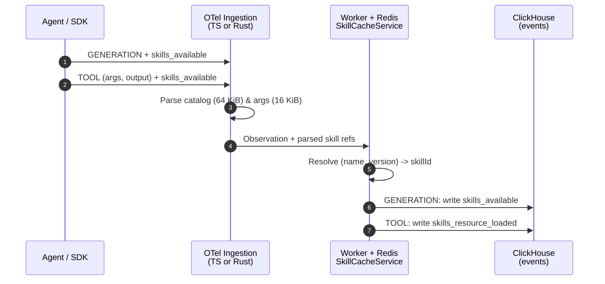

import { BlogHeader } from "@/components/blog/BlogHeader";
import { SkillLifecycleDiagram } from "@/components/blog/SkillLifecycleDiagram";
import { SkillLockfileBridgeDiagram } from "@/components/blog/SkillLockfileBridgeDiagram";

<BlogHeader
  title="How we built skill management and tracing in Langfuse"
  description="Skills are prompts with a filesystem. Here is how we modeled skill lifecycles, handled the gap between intent and actual loads across agent harnesses, and built a hybrid tracing pipeline backed by a CLI lockfile."
  authors={["tobiasklesel"]}
  date="November 23, 2026"
/>

Earlier this month we shipped [Skill Management](/docs/skill-management/overview) in beta: teams can version agent skills alongside prompts, promote versions with labels, install them with the CLI, and link skill usage directly to traces.

Storage and versioning turned out to be the straightforward part. The harder engineering problem was observability. With prompts, tracing is one line of metadata: your code fetches `prompt v4` at the start of a run, injects the entire string into the system message, and attaches that version to the generation. With skills, the model decides at runtime whether to load a skill at all, which supporting files to read, and when. And every coding agent and framework implements that loading mechanism differently.

This post walks through how we designed skill storage, lifecycle modeling, ingestion-side load detection, and CLI distribution, including the tradeoffs we made and the gaps we have not solved yet.

## What a skill is and why tracing it is harder than tracing a prompt [#what-a-skill-is]

Following the open [Agent Skills specification](https://agentskills.io/specification), a skill is a directory with a required `SKILL.md` file (YAML frontmatter containing `name` and `description`, followed by Markdown instructions) and optional supporting files such as `references/`, `scripts/`, and templates.

The defining property of a skill is **progressive disclosure** across three levels:

1. **Metadata at startup:** the agent includes each skill's `name` and `description` in the system prompt or tool listing.
2. **Instructions on demand:** when the model decides a skill applies, it reads `SKILL.md`, and only then do the full instructions enter the context window.
3. **Supporting resources as needed:** reference documents or scripts are opened or executed later, only if the task requires them.

That design saves context tokens, which is why agents use it. It also breaks the prompt-tracing mental model. Knowing that a skill is installed on disk or listed in a system prompt does not tell you whether the model asked for it, whether the file actually loaded, which supporting files were read, or whether an earlier skill was dropped during context compaction.

Before getting into tracing, here is how skills are stored in Langfuse. Each skill version is an immutable row in Postgres (`skills`), matching the same versioning and label model as [prompt management](/docs/prompt-and-skill-management/concepts): `latest` updates automatically, `production` is the default fetch target, and protected labels guard production promotions. Unlike prompt fetches, requesting a missing label over the REST API returns a strict `404` with no fallback so a typo fails loudly rather than serving the wrong instructions. (Our MCP server's `loadSkill` and `loadSkillResource` tools deliberately make an exception and fall back to `latest` when `production` is unset, so agents working with newly created skills are not blocked.)

Files live in `skill_files` and point to `skill_blobs`, which are content-addressed by canonical base64 SHA-256 and deduplicated per project. Langfuse validates paths as normalized relative POSIX paths (up to 512 characters, no traversal) and restricts uploads to an allow-list of about 60 text file extensions, capped at 200 files and 1,000,000 UTF-8 bytes per version by default (configurable on self-hosted deployments). Binary assets allowed by the open spec are not supported yet.

Langfuse acts as the registry, version store, and observability backend, not the runtime skill loader. Your agent harness still decides how to expose and read files.

## What does it mean for a skill to be "loaded"? [#lifecycle-states]

When we sat down to design skill tracing, "was skill X used?" immediately split into five distinct lifecycle states. Collapsing them into one boolean produces misleading analytics, so we mapped each state explicitly:

<SkillLifecycleDiagram />

Only two of these five states are persisted in ClickHouse (`events_full` and `events_core`) as typed `Array(Tuple(...))` columns:

```sql
skills_available Array(Tuple(
  langfuseSkillId Nullable(String),
  skillVersion Nullable(UInt32),
  skillName String
)) DEFAULT [],

skills_resource_loaded Array(Tuple(
  langfuseSkillId Nullable(String),
  skillVersion Nullable(UInt32),
  skillName String,
  filePath String
)) DEFAULT []
```

Notice what each column stores and where it lives:

- **`skills_available` is stored only on `GENERATION` observations.** It records the catalog of skills (name, optional version, and resolved `langfuseSkillId`) that the model could choose from on that call. Unversioned skills are first-class: they are stored by name with a null version and ID.
- **`skills_resource_loaded` is stored only on `TOOL` observations.** It records the skill name, optional version, optional `langfuseSkillId`, and the specific `filePath` (such as `SKILL.md` or `references/eligibility.md`) that entered context.

### Separating model intent from an actual load [#intent-vs-load]

A common trap in agent tracing is treating a model's tool call request as proof that a skill loaded. It is not. A tool call can fail because the file path does not exist, a sandbox permission blocks the read, or a user denies an activation prompt.

Langfuse separates the two signals:

- **Intent (requested):** the trace UI inspects a generation's output `tool_calls` at render time using our shared tool-argument parser and splits the generation's `skills_available` list into **Requested** and **Not requested**, along with the requested file paths. This is computed on the fly and is not persisted or counted in usage analytics.
- **Actual load:** ingestion records `skills_resource_loaded` on the subsequent `TOOL` observation only when four conditions hold: the observation type is `TOOL`, its name matches a recognized skill-loading tool, its level is not `ERROR`, and its output is non-null.

<Frame fullWidth>
  
</Frame>

<Frame fullWidth>
  
</Frame>

In practice, "the loader returned non-error, non-null output" is a practical proxy for "the skill content entered context", not an ironclad guarantee. Earlier in development we tried inspecting plain-text tool outputs for "not found" strings to filter out soft failures, and later removed that heuristic because free-text matching was brittle. As a result, a tool that returns an error message string without marking the observation as `ERROR` will still count as loaded.

### What happens after compaction (and why we do not model it yet) [#compaction]

Long coding-agent sessions hit context limits and trigger compaction or summarization. Once context is compacted, a skill loaded twenty turns earlier may no longer be in the prompt at all, and harnesses handle this in very different ways:

- **Claude Code** re-attaches the most recent invocation of each skill after auto-compaction, keeping up to 5,000 tokens per skill within a 25,000-token combined budget filled most-recent-first; older skills can be dropped entirely. Re-invoking a skill with identical rendered content inserts a short "already loaded" note instead of duplicating the body.
- **Mastra** treats skill loading as stateless: instructions live in the conversation as a tool result, and if compaction removes them, the agent has to call `skill` again.

Langfuse does not model compaction or eviction today. There is no `skills_evicted` column or compaction attribute. Answering "was skill X still in context at generation 14?" accurately would require either harness-specific compaction hooks or scanning each generation's input messages for earlier skill payloads, neither of which we have built yet.

## The core challenge: every harness loads skills differently [#harness-fragmentation]

Even if you ignore compaction, the hardest constraint in skill observability is that there is no standard wire protocol for loading a skill. The Agent Skills spec defines the folder structure on disk, not the tool name, input schema, or message format an agent uses to read it.

Here is how the major coding agents, SDKs, and frameworks load skills today, and what actually appears in a trace. Most expose a skill listing in the system prompt or context window (for example, Claude Code budgets 1% of the context window, Codex budgets 2% with file paths, and OpenCode lists permitted skills per step), then diverge sharply on how a skill gets loaded:

| Harness                     | Load mechanism                                     | Context delivery                                            | Langfuse ingestion today                                 |
| --------------------------- | -------------------------------------------------- | ----------------------------------------------------------- | -------------------------------------------------------- |
| **Claude Code / Agent SDK** | `Skill` (`{skill}`), `Read`, or `/name`            | `isMeta: true` user row (`sourceToolUseID`); short tool ack | `Skill`: yes; `Read`: with catalog; `/name`: no          |
| **Anthropic API**           | `bash: cat .../SKILL.md` in container              | Server-side container tool result                           | No (no client span; `skver_...` IDs)                     |
| **OpenAI Codex**            | Shell `exec_command` (`cat`), or `$skill`          | Tool result, or `<skill>` prompt fragment                   | `cat`: with `service.name=codex` + catalog; `$skill`: no |
| **Cursor**                  | File read or shell tool                            | Tool result                                                 | Not yet (plugin renames to `skill:<name>`, Codex-only)   |
| **Gemini CLI**              | `activate_skill` (`{name}`) + consent prompt       | `<activated_skill>` XML tool result                         | Not yet                                                  |
| **OpenCode**                | `skill` (`{id}` from path) or `@skill-id`          | Tool result                                                 | Not yet (reads `name`/`skill`, not `id`)                 |
| **LangChain Deep Agents**   | `read_file` (`{file_path}`) via `SkillsMiddleware` | Tool result                                                 | Not yet (matches `Read`/`readFile`, not `read_file`)     |
| **Mastra**                  | `skill`, `skill_read`, or `load_skill`             | Tool result                                                 | `skill`, `skill_read`: yes; `load_skill`: not yet        |
| **Vercel AI SDK**           | `HarnessAgent` inline `skills`, or `uploadSkill`   | Depends on harness adapter                                  | Depends on underlying harness spans                      |

Three details in that table immediately complicate any naive tracing design:

1. **Some loads never produce a tool span at all.** Claude Code's `/skill-name` slash invocation, Claude Code subagents with preloaded skills, and Codex's explicit `$skill-name` syntax all inject skill instructions directly into messages without a tool call.
2. **In Claude Code, the tool result is not the skill.** The `Skill` tool returns a brief acknowledgement while the rendered `SKILL.md` arrives in a separate `isMeta: true` user transcript entry referencing the originating call via `sourceToolUseID`. Our public `claude-observability-plugin` links those entries when `CC_LANGFUSE_CAPTURE_SKILL_CONTENT=true` so you can inspect the injected instructions on the tool span, while Langfuse ingestion treats a successful `Skill` tool span as the load signal.
3. **Our own public coding-agent plugins predate the skill tracing model.** The Langfuse observability plugins for Claude Code, Codex, and Cursor currently add `skill:<name>` trace tags and rename spans, but none of them emit the `skills_available` catalog attribute yet. That means Claude Code's `Skill` tool still yields name-only loads in traces, while version-resolved analytics require attaching the catalog.

## The architectural decision: active reporting vs. ingestion-side parsing [#decision-gate]

Faced with that fragmentation, we had to choose where skill tracing lives:

- **Option A: Active reporting everywhere.** Require every SDK, framework integration, and coding-agent plugin to emit structured attributes or events both when skills are offered to the model and whenever a skill file is loaded. That gives exact, version-aware signals for every loader, including non-tool loads like slash commands. The downside is adoption: every harness and custom agent has to wire up load hooks, and any existing OpenTelemetry instrumentation emits nothing until updated. It also duplicates information that is already sitting in tool call spans.
- **Option B: Pure ingestion-side parsing.** Ask nothing from the client and infer everything on the Langfuse server from prompts and tool spans. That is zero-config for users, but it breaks down immediately on two fronts: the server cannot reliably parse what skills were available out of arbitrary system prompts, and it has no way to know _which Langfuse skill version_ was sitting on disk when an agent ran `Read(".agents/skills/refund-policy/SKILL.md")`.

### The hybrid split: catalog in, loads out [#hybrid-approach]

We chose a split architecture: **active reporting for the catalog, passive ingestion-side parsing for loads.**



In this design, the application only ever reports one attribute: `langfuse.observation.skills_available`, a JSON string of `[{ "name": "...", "version": 2 }]` entries. There is no separate `skills_resource_loaded` OpenTelemetry attribute for external clients to emit.

Instead, Langfuse's ingestion pipeline inspects every incoming `TOOL` observation:

1. **Success gate:** if the observation is not a `GENERATION`, ingestion bails unless it is a `TOOL` with `output != null`, a non-`ERROR` level, and a recognized tool name.
2. **Rule-based extraction:** we maintain the extraction rules in TypeScript (`packages/shared/src/features/skills/toolArguments.ts`, shared with the trace UI) and in Rust (`packages/native/src/otel/event_skills/rules.rs`, for our opt-in native OpenTelemetry ingestion path). Both enforce the same safety caps: 64 KiB for the catalog JSON, 16 KiB for tool arguments, 100 skills per observation, and 512 characters per file path.
3. **Version resolution in the worker:** the worker batch-resolves `(name, version)` pairs to `skills.id` through a Redis-backed `SkillCacheService`. For each loaded resource on a `TOOL` span, if **exactly one** entry in that span's catalog matches the skill name, the worker copies its `version` and `langfuseSkillId` onto the load record.
4. **Column routing:** the worker writes `skills_available` only on `GENERATION` rows and drops it on `TOOL` rows after resolution, writing `skills_resource_loaded` on `TOOL` rows.

That last step explains a subtle detail in our [skill tracing docs](/docs/skill-management/tracing): you need to attach `skills_available` to **both** model spans and skill-loading tool spans, even though `skills_available` is only persisted on generations. On a tool span, the catalog serves two jobs before being discarded:

- **Disambiguation and allow-listing for generic file reads.** For `Read`, `readFile`, and Codex shell commands, ingestion splits the path into segments, rejects `..`, checks that the segment before the skill name is `skills`, and requires **exactly one** segment to match a name in the catalog. Without the catalog, Langfuse refuses to guess, which prevents ordinary `Read` calls on application source files from showing up as phantom skill loads.
- **Version linking for analytics.** Named skill tools (`Skill`, `skill`, `loadSkill`, `langfuse_loadSkill`, `skill_read`, `loadSkillResource`, `langfuse_loadSkillResource`) can record name-only loads even without a catalog. However, a skill's **Usage** tab queries ClickHouse by `langfuseSkillId` (the version-row ID), so loads without a catalog-resolved version appear on traces and name filters but do not show up in a skill version's Usage metrics.

Here is the core rule table from our native Rust ingestion path (`packages/native/src/otel/event_skills/rules.rs`), which mirrors the TypeScript rules:

```rust
ToolRule { names: &["skill"], skill_name: CanonicalArgument(&["name", "skill"]), file_path: Literal("SKILL.md") },
ToolRule { names: &["Skill", "loadSkill", "langfuse_loadSkill"], skill_name: Argument(&["name", "skill"]), file_path: Literal("SKILL.md") },
ToolRule { names: &["skill_read"], skill_name: CanonicalArgument(&["skillName"]), file_path: Argument(&["path"]) },
ToolRule { names: &["loadSkillResource", "langfuse_loadSkillResource"], skill_name: Argument(&["name", "skill"]), file_path: Argument(&["path"]) },
ToolRule { names: &["readFile", "Read"], skill_name: FromPath, file_path: Argument(&["path", "file_path"]) },
```

And for Codex, when `resourceAttributes["service.name"] == "codex"` and the tool name is `skill`, `skill:*`, `exec`, or `exec_command`, ingestion runs a non-executing scanner over literal `cat` arguments to extract file paths and match them against catalog names.

### Tradeoffs and honest limits [#tradeoffs]

This hybrid design got us working skill tracing across custom agents, Mastra, Claude Code, and Codex without forcing users to rewrite their tool implementations, but it has real edges we want to be upfront about:

- **Tool and argument drift:** any harness using a tool name or argument key outside the table (`activate_skill`, `read_file`, OpenCode's `{id}`, Mastra's `load_skill`) is currently missed until we add its rule.
- **Shell scanning is heuristic:** scanning literal `cat` arguments never executes shell code, which keeps ingestion safe, but it is a source-like match rather than proof of execution. A command such as `echo 'cat skills/alpha/SKILL.md'` can still trigger a match.
- **Hard 100-skill ceiling:** if an observation reports more than 100 available skills, ingestion drops the entire catalog with a warning rather than truncating silently, so an agent with 101 skills records zero available references.
- **No visibility into non-tool loads:** slash commands, prompt-injected `$skill` blocks, and server-side container executions leave no client-side `TOOL` span for ingestion to parse.

If your harness uses a tool shape we do not recognize yet, [opening an issue](https://github.com/langfuse/langfuse/issues) with the tool name and a sample input/output is currently the fastest way to get it added to the shared parser.

## Distribution: CLI, lockfile, and bridging disk to traces [#distribution-and-lockfile]

Active catalog reporting works cleanly if your application fetches skills over the API at runtime: you already have `skill.name` and `skill.version` in memory.

Coding agents and filesystem-based frameworks do not work that way. They read plain folders on disk (`.agents/skills/<name>/SKILL.md`), and the Agent Skills spec has no Langfuse version field in `SKILL.md` frontmatter. If an application only scans the filesystem, it knows the skill names, not which Langfuse version each folder came from.

We solved this with `@langfuse/cli` (v1.3+) and a lockfile (`langfuse-skills.lock`) modeled on package managers:

<SkillLockfileBridgeDiagram />

Each entry in `langfuse-skills.lock` separates **intent** (`selector`: a label like `production` or a fixed version pin) from the **resolved revision** (`version`):

```json filename="langfuse-skills.lock"
{
  "lockVersion": 1,
  "skills": [
    {
      "path": "refund-policy",
      "name": "refund-policy",
      "selector": { "label": "production" },
      "version": 2
    }
  ]
}
```

That separation drives three workflows:

- **`langfuse skills install` (no arguments)** restores the exact locked `version` numbers across machines and CI, verifying every downloaded file's byte length and SHA-256 against the manifest in a staging directory before atomically renaming it into place.
- **`langfuse skills update`** re-resolves saved label selectors (for example pulling the new version tagged `production`) while leaving exact version pins untouched. Moving a label in Langfuse never mutates files on disk until you run `update`.
- **`langfuse skills push`** uploads Git-tracked and non-ignored files from a local skill folder, reuses the latest version if nothing changed, and also writes the pushed version into `langfuse-skills.lock`, so repositories that author skills get versioned tracing too.

### Connecting the lockfile to OpenTelemetry spans [#sdk-propagation]

On the tracing side, both the JS/TS and Python SDKs provide a local `discoverSkills` / `discover_skills` helper that scans immediate subdirectories containing `SKILL.md`, looks up `langfuse-skills.lock` (in the skills directory first, then the working directory), and returns `{ name, version }` for locked skills and `{ name }` for unlocked ones without making any network requests.

```typescript
import { NodeSDK } from "@opentelemetry/sdk-node";
import { LangfuseSpanProcessor } from "@langfuse/otel";
import { discoverSkills } from "@langfuse/otel/node";
import { propagateAttributes } from "@langfuse/tracing";
import { runAgent } from "./agent";

const skills = await discoverSkills({ dir: ".agents/skills" });

const sdk = new NodeSDK({
  spanProcessors: [
    new LangfuseSpanProcessor({ skills: { available: skills } }),
  ],
});
sdk.start();

try {
  await propagateAttributes({ attachSkills: true }, () => runAgent());
} finally {
  await sdk.shutdown();
}
```

A few deliberate design choices in the SDK layer:

- **Propagation-only, in-process:** we originally prototyped a per-observation `availableSkills` parameter before simplifying to `propagateAttributes` (matching `propagate_attributes` in Python). Skills are explicitly excluded from OpenTelemetry baggage so large catalogs never leak across HTTP service boundaries.
- **Clear precedence:** an explicit `langfuse.observation.skills_available` attribute already on a span overrides propagated attributes, which override the `LangfuseSpanProcessor` default. A nested `propagateAttributes({ skillsAvailable: [...] })` replaces the outer list, and passing `[]` clears it.
- **No content hashing at discovery time:** `discoverSkills` trusts `langfuse-skills.lock` and does not re-hash files on disk to check for local uncommitted edits, keeping startup fast and synchronous in Python.

### Live fetch vs. disk installation [#live-vs-disk]

Not every agent reads skills from disk. For application agents built with frameworks that accept skills in memory, you can fetch directly at run start with `langfuse.api.skills.get("refund-policy", { label: "production", includeContent: true })` and pass `{ name: skill.name, version: skill.version }` into `propagateAttributes`.

Unlike prompt management, our SDKs do not ship a built-in client-side TTL cache for skills yet. Because `skill_blobs` are content-addressed by SHA-256 and `GET /api/public/skills/files/content` accepts batches of up to 50 hashes, applications that want low-latency caching can fetch manifests by label and cache file contents safely by hash. Either way, keep the resolved version fixed for the duration of a single agent run so `SKILL.md` and its supporting references always come from the same revision.

## Dogfooding: how Halo loads and traces managed skills [#dogfooding-halo]

We run this entire pipeline in production for [Halo](/blog/2026-10-21-building-the-langfuse-assistant), our in-app assistant built on Mastra.

Halo's skills live in the public [`langfuse/skills`](https://github.com/langfuse/skills) repository. A GitHub Action publishes them across our Cloud regions using `langfuse skills push --recursive --no-lockfile --label production` and tags them for the in-app agent. At runtime, Halo reads them through a custom Mastra `SkillSource` (`InAppAgentSkillSource`) that merges hosted production skills with bundled fallback skills and caches manifests and file contents per run.

Running Halo exposed a subtle integration problem: Mastra's skill loader reads `SKILL.md` through the `SkillSource` interface, which exposes frontmatter metadata to instrumentation hooks, not Langfuse's API response object. Without carrying the version through Mastra, our tracing instrumentation could see the skill's name, not its Langfuse version.

Our workaround was to inject `langfuseProjectId` and `langfuseSkillVersion` into the `SKILL.md` frontmatter metadata as `InAppAgentSkillSource` serves the file:

```ts
// Pass hosted version metadata through Mastra to the trace linker.
return content.replace(/^---\r?\n[\s\S]*?\r?\n---(?:\r?\n|$)/, () =>
  `---\n${JSON.stringify({
    ...frontmatter,
    metadata: {
      ...frontmatter.metadata,
      langfuseProjectId: skill.projectId,
      langfuseSkillVersion: skill.version,
    },
  })}\n---\n`,
);
```

When Halo's instrumentation reads `workspace.skills.list()`, it recovers `{ name, version }` from that metadata, strips the version if the skill came from a different project (so foreign-project skills remain visible by name without falsely resolving to a local version), and attaches `skills_available` to every `GENERATION` and `TOOL` observation.

## What's next [#whats-next]

Skill Management is in beta today on Langfuse Cloud and self-hosted Langfuse. Every traced skill observation feeds into event filters (`skillNamesAvailable`, `skillsNamesLoaded`, `skillsVersionsLoaded`, `skillFilesLoaded`), custom dashboard metrics dimensions, per-version **Usage** analytics, and skill-version webhooks so you can trigger CI evaluations whenever a new version ships.

There is still plenty of room to tighten the loop:

- Wiring `langfuse-skills.lock` discovery into our first-party Claude Code, Codex, and Cursor observability plugins so coding-agent traces get version-resolved links instead of name-only tags.
- Expanding ingestion rules for additional loaders such as Gemini CLI's `activate_skill`, Deep Agents' `read_file`, OpenCode's `skill` `{id}` input, and Mastra's `load_skill`.
- Exploring whether to persist `skills_requested` for full available-to-requested-to-loaded funnels, and how to handle context compaction and server-side provider skills cleanly.

To try it out, read the [Skill Management docs](/docs/skill-management/overview) and the [skill tracing guide](/docs/skill-management/tracing), or see how we previously used Langfuse datasets and traces to [evaluate AI agent skills](/blog/2026-02-26-evaluate-ai-agent-skills). If your agent framework loads skills in a way we don't parse yet, tell us in [GitHub Issues](https://github.com/langfuse/langfuse/issues) — and if building observability infrastructure for agents sounds like your kind of problem, [we are hiring](/careers).
