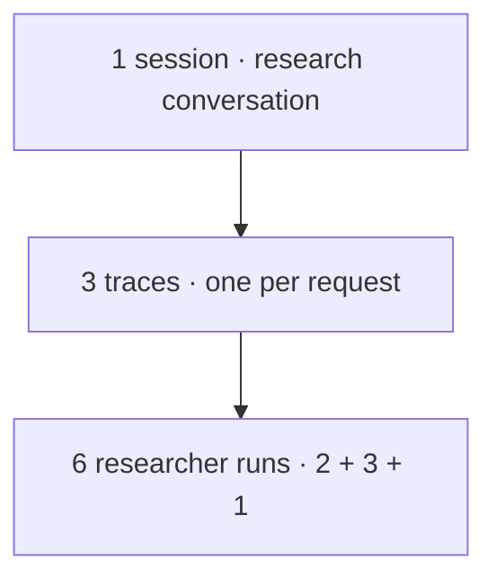

import { V4CutoverDate } from "@/components/V4CutoverDate";

# Agents

<AvailabilityBanner
  availability={{
    hobby: "v4",
    core: "v4",
    pro: "v4",
    enterprise: "v4",
    selfHosted: "v4",
  }}
/>

<Callout type="info">
  Agents is an internal preview for accounts with the personal `agentsView`
  feature flag enabled. It requires Langfuse v4 and is not enabled by default.
</Callout>

Find the agents working across your application in one project. Browse the gallery or switch to the table, choose an environment, and open an agent to compare its activity, cost, and quality before following the work into sessions, traces, and agent runs.

<Frame>
  
</Frame>

## Sessions, traces, and agent runs [#sessions-traces-and-agent-runs]

These are three levels of the same work:

| Level         | Meaning                                                                                                                        |
| ------------- | ------------------------------------------------------------------------------------------------------------------------------ |
| **Session**   | A conversation or task that connects related requests across traces.                                                           |
| **Trace**     | One recorded operation, such as handling a user message. It can contain different agents and repeated calls to the same agent. |
| **Agent run** | One execution of one agent, recorded as an AGENT observation, with its owned model and tool calls.                             |

For example, a research conversation has three user requests, each recorded as its own trace. The researcher executes twice for the first request, three times for the second, and once for the third. That researcher's activity is **1 session, 3 traces, and 6 agent runs**. Other agents can contribute their own runs to the same traces.



Open an agent run to inspect one research attempt, even when several attempts share a trace. A model or tool call inside that run does not count as another agent run. A delegated agent has its own run and owns its own model and tool calls; the trace preserves that nesting.

[Sessions](/docs/observability/features/sessions) group traces through an explicitly recorded session ID. A background job can have a trace and agent runs without a session. The `langfuse.agent.run_id` attribute identifies the owning AGENT observation's span ID; it is separate from the session ID.

<Callout type="info">
  Propagate `sessionId` to all related observations, as shown in the [session
  setup guide](/docs/observability/features/sessions#set-up-sessions). Session
  metrics use recorded session IDs. An ID attached only to a root outside the
  selected period does not assign sessionless children to that conversation.
</Callout>

## Track multiple agents in one project [#track-agents]

Record a stable agent ID and a display name on your agent's observations. For example, a support application can report `support-router`, `policy-researcher`, and `response-writer` to the same Langfuse project. You do not need a separate project for each agent.

An agent ID identifies the same logical agent across its runs. The display name is the latest readable label observed from your application. Two agents can share a display name and still remain distinct when they have different IDs. Keep the ID stable when changing a display name; do not use a trace or run ID as the agent ID.

Use nonempty strings: agent IDs can contain up to 256 characters and display names up to 200.

Agent identity is scoped to the project. Environments separate activity within that project; use the [environment filter](/docs/observability/features/environments#configure-environments) to choose the data you want to inspect.

<Callout type="info">
  When instrumentation supplies a name without an ID, Langfuse groups activity
  by that exact name. Names are case-sensitive. Give your agent a
  stable ID so a display-name change does not create a separate name-based group.
</Callout>

## Record agent identity [#record-agent-identity]

First [configure tracing](/docs/observability/sdk/overview) for your application. Record an **AGENT** observation for each agent run and attach the agent identity to its owned model and tool observations too. Creating or configuring an agent with `gen_ai.operation.name=create_agent` does not count as an agent run.

<Callout type="warning">
  Use the current SDK or [OpenTelemetry
  endpoint](/integrations/native/opentelemetry) for new integrations. On Langfuse
  Cloud, `POST /api/public/ingestion` stops accepting trace and observation events
  on <V4CutoverDate />; score writes remain supported. See the [legacy ingestion
  migration](/faq/all/deprecated-api-migration#ingestion) for older custom writers.
</Callout>

When using raw OpenTelemetry, record these attributes:

| Attribute                     | Value                                                                                   |
| ----------------------------- | --------------------------------------------------------------------------------------- |
| `gen_ai.agent.id`             | Your stable logical agent ID                                                            |
| `gen_ai.agent.name`           | The agent's display name                                                                |
| `gen_ai.operation.name`       | `invoke_agent` on the span for each agent run                                           |
| `langfuse.agent.run_id`       | The owning AGENT observation's span ID on its model, tool, and other owned observations |
| `deployment.environment.name` | The environment for the activity, such as `production`                                  |

Langfuse also accepts `langfuse.agent.id` and `langfuse.agent.name`. When both conventions provide a nonempty string for a field, its `langfuse.agent.*` value takes precedence. You can set the environment through the [Langfuse environment configuration](/docs/observability/features/environments#configure-environments) instead.

If your framework generates a new `gen_ai.agent.id` for every instance or process, set a stable `langfuse.agent.id` on the agent run and its owned observations. Langfuse preserves explicit IDs; it does not merge different IDs just because their display names match. Check this before comparing runs across deployments.

### TypeScript SDK v6 [#typescript-sdk]

After [initializing the TypeScript SDK v6](/docs/observability/sdk/overview), set the identity attributes on the native observation's OpenTelemetry span. Pass the agent's span context when creating its children:

```typescript
import { startObservation } from "@langfuse/tracing";

const agent = startObservation("research-policy", {}, { asType: "agent" });
const ownership = {
  "gen_ai.agent.id": "policy-researcher",
  "gen_ai.agent.name": "Policy researcher",
  "langfuse.agent.run_id": agent.id,
};
agent.otelSpan.setAttributes({
  ...ownership,
  "gen_ai.operation.name": "invoke_agent",
});

try {
  const tool = startObservation(
    "read-policy",
    {},
    { asType: "tool", parentSpanContext: agent.otelSpan.spanContext() },
  );
  tool.otelSpan.setAttributes(ownership);
  try {
    // Run your tool and record its input and result with tool.update().
  } finally {
    tool.end();
  }
} finally {
  agent.end();
}
```

### OpenTelemetry example [#opentelemetry-example]

After configuring your OpenTelemetry exporter for Langfuse, use the AGENT span's own ID to attribute its tool observations. This example shows the identity attributes; add your tool implementation and its input and result through your existing instrumentation.

```typescript
import { trace } from "@opentelemetry/api";

const tracer = trace.getTracer("support-app");
const identity = {
  "gen_ai.agent.id": "policy-researcher",
  "gen_ai.agent.name": "Policy researcher",
  "deployment.environment.name": "production",
};

await tracer.startActiveSpan(
  "research-policy",
  { attributes: { ...identity, "gen_ai.operation.name": "invoke_agent" } },
  async (run) => {
    const ownedAttributes = {
      ...identity,
      "langfuse.agent.run_id": run.spanContext().spanId,
    };

    try {
      await tracer.startActiveSpan(
        "read-policy",
        {
          attributes: {
            ...ownedAttributes,
            "gen_ai.operation.name": "execute_tool",
            "gen_ai.tool.name": "read-policy",
          },
        },
        async (tool) => {
          try {
            // Run your tool and record its input and result here.
          } finally {
            tool.end();
          }
        },
      );
    } finally {
      run.end();
    }
  },
);
```

Attach the same logical identity and owning run ID to each model-call observation. Record model calls with your [model integration](/integrations) or [SDK instrumentation](/docs/observability/sdk/instrumentation), including the model and usage fields when available. Flush your exporter before a short-lived process exits.

For nested agents, record the child agent's identity on its own observations. Its model and tool observations use the child AGENT span's ID as their owning run, including when the same logical agent is invoked again inside a trace. Keep the parent-child span relationships so you can inspect both agent runs in the trace.

<Callout type="warning">
  Within one OpenTelemetry export request, observations can inherit identity and
  run ownership from their nearest AGENT ancestor in the same trace. Exporters
  can split parents and children across requests. Record the identity and
  `langfuse.agent.run_id` explicitly on owned observations to retain attribution
  across batches and asynchronous boundaries. Missing identity or ownership can
  leave model usage unattributed to a run.
</Callout>

### Reuse existing OpenTelemetry instrumentation [#reuse-instrumentation]

**Logfire:** Keep your existing instrumentation and configure an additional or replacement [OTLP exporter](https://pydantic.dev/docs/logfire/guides/alternative-backends/) with the [Langfuse endpoint and authentication](/integrations/native/opentelemetry). Preserve `gen_ai.agent.id`, `gen_ai.agent.name`, `invoke_agent` operations, and the original span relationships. Check that each logical agent has an agent run boundary; an ordinary named span alone does not establish one. Add the explicit ownership fields above when related observations may be exported separately.

**LangSmith:** An existing [registry identifier](https://docs.langchain.com/langsmith/agent-registry) can become your `gen_ai.agent.id`; record its display name as `gen_ai.agent.name` and its environment as `deployment.environment.name`. Add an `invoke_agent` span for each agent run and attach its ownership fields to model and tool observations. LangSmith's [agent-addressing exporter headers](https://docs.langchain.com/langsmith/trace-with-opentelemetry) select a destination for a whole request. They are not per-span identity or environment attributes in Langfuse. Configure Langfuse authentication separately rather than forwarding another service's credentials.

## Explore an agent [#explore-an-agent]

Open [Agents](https://cloud.langfuse.com/project/~/agents) to browse the default **Gallery** or switch to **Table**. Use the shared search bar or filter sidebar: enter `research env:production`, select several environments with `env:(production OR staging)`, or exclude one with `-env:development`. Your search and filters carry between the two views.

Agents are discovered from recorded activity; you do not register them separately. The inventory includes agents seen in the selected period or the immediately preceding period of the same length. An agent that stopped sending data can remain visible with zero current activity. Gallery cards show observation trends, agent runs, own cost per run, duration, and last-seen time.

The date picker sits in the page header and shares your project's selection with Tracing and Sessions. Inside an agent, environment filters carry across tabs; other table filters apply to the current tab.

- **Overview:** Compare agent runs, own cost per run, duration, cache hit rate, error-level runs, and tool or skill activity with the previous period. Choose a recorded score to inspect quality over time and by model, then follow observed relationships into example traces.
- **Sessions:** Find conversations or tasks that include this agent and open them in the existing session view. With the Session Timeline preview enabled, inspect messages and tool activity across traces.
- **Agent runs:** Search individual executions in the native observation table and inspect their inputs, outputs, and traces.
- **Traces:** Use Tracing's search, filters, saved views, column controls, and trace inspection within traces containing this agent. Root and observation views retain the surrounding trace context.
- **Tools:** Inspect tool calls attributed to this agent. Calls owned by another agent in the same trace stay outside this tab.
- **Skills:** Follow recorded loads to managed skill versions and the observations that loaded their files.
- **Info:** Review identity, recorded configuration, usage, and model cost. Expand **Model metric coverage** when you need attribution, usage, or pricing details.

Filters and saved views narrow a table within the agent's scope. Sessions and traces retain the context of other participating agents, with the usual session or observation metrics. The agent's own attributed totals remain available in Overview and Info.

Use the activity pulse above a table to narrow a busy or quiet interval: click a bucket or drag across a range. It follows the table's search and filters; use your browser's Back button to restore the previous period. In Sessions, each bucket counts sessions active during that interval, so a session can appear in several buckets.

<Callout type="info">
  Select a window of up to 30 days. Activity uses observations that started
  within that window. A model call can appear after its owning agent run's
  start, so an agent can have model activity and zero new agent runs in a
  period. Info requires a run in the selected period. Traces without a recorded
  session remain available in Traces. Send a new instrumented run if existing
  activity has no agent identity; identity is not inferred from unrelated spans.
</Callout>

## Compare activity and quality [#compare-activity-and-quality]

Overview compares the selected period with the immediately preceding period of the same length. Dotted lines align the previous period to the selected timeline. Empty average values stay unknown; a measured zero remains zero.

<Frame>
  
</Frame>

The green activity indicator means the agent's latest recorded activity was less than an hour ago. It describes recent telemetry, not health or whether the agent is currently running. An older last-seen time is neutral: there may simply have been no work to do.

Choose an existing numeric or boolean score under **Quality and models**. Only scores attached directly to agent runs contribute. Latest score values are used, including evaluations received after a run completes. Repeated evaluations of the selected score are averaged within each run before averaging across runs, so frequently evaluated runs do not dominate. The scored-run count and model-group coverage show how much evidence supports each average.

Model groups use the names recorded on a run's owned model calls. Runs with several models stay separate from single-model runs; missing model names remain unknown.

<Callout type="info">
  Unscored runs are excluded from score averages. A score on a shared trace or
  session does not establish one agent's quality. A score change alongside a
  model change is a lead to investigate, not evidence that the model caused it.
</Callout>

**Observed relationships** follows parent spans through intermediate observations, including tool calls. Open an example trace to inspect the delegation. The cost shown for a called agent comes from model calls owned by those sampled child runs; it excludes costs owned by other agents.

<Callout type="info">
  Relationships examines up to 200 recent traces and 20,000 observations within
  the selected period. Coverage details show limits and incomplete ancestry.
  Sharing a trace alone does not establish delegation, and sampled costs are
  separate from whole-period totals.
</Callout>

## Read usage, cost, and caching [#usage-and-cost]

Agent usage is calculated from the agent's attributed model-call observations. A parent AGENT observation can contain an aggregate reported by a framework; Langfuse does not add that summary to the same underlying model calls again. Opening an agent run does not change its totals.

Total model spend and average own cost per run answer different questions. The average uses runs that started and ended in the period, with at least one observed model call and known prices for all their observed model calls. The sample count shows how many runs qualify. Average duration includes all runs that started and ended in the period, even when pricing is missing.

When a nested agent makes its own model calls, those calls contribute to that child's attributed usage. Their cost does not also become the parent's direct cost.

**Cache hit rate** is the share of reported input tokens read from cache. It is weighted by token volume, so a large request contributes more than a small one. The chart compares the selected and previous periods alongside the other usage metrics.

<Callout type="info">
  Cache hit rate uses model calls with reliable cache reporting. An explicit
  zero means no input was served from cache; missing cache usage stays unknown
  and is excluded from the rate. Check reporting coverage before comparing two
  periods with different instrumentation.
</Callout>

In **Info → Model metric coverage**, you can check how many calls have usage, pricing, and agent run ownership. Calls without any agent identity are excluded from agent totals. They may belong to this agent or another agent in the same trace. If attribution is incomplete, inspect the trace and add explicit identity and ownership to the missing observations. The same unassigned calls can appear in the coverage details of several agents sharing a trace; do not add those counts together.

<Callout type="info">
  Missing usage or pricing is unknown, rather than a measured zero. Read the
  coverage information alongside the totals: a priced subset does not establish
  the full cost of every call. Agent cost covers attributed model activity;
  external tool-provider fees are outside that total.
</Callout>

## Follow loaded skill versions [#skills-used]

[Configure skill tracing](/docs/skill-management/tracing#skill-loading-tools) to record which managed skills your agent loaded. Attach the available skill list, including its version, to the skill-loading tool observation and record the tool's input and result.

Open **Skills** on the agent to inspect recorded loads and follow the linked skill version. The version's [Usage tab](/docs/skill-management/tracing#skill-usage) shows linked observations and per-file loads.

<Callout type="info">
  Publishing, installing, or declaring a skill available does not count as a
  load. A recorded load requires a successful tool call with a non-null result
  that matches an available skill. A name-only match does not establish which
  managed version was loaded, and a file load does not establish script execution.
</Callout>

## Related documentation [#related-documentation]

- [Observation types](/docs/observability/features/observation-types) for recording agent, model, and tool activity.
- [Environments](/docs/observability/features/environments) for separating deployment activity in one project.
- [Sessions](/docs/observability/features/sessions) for grouping interactions across traces.
- [Skill tracing](/docs/skill-management/tracing) for available skills, successful loads, version links, and file usage.
