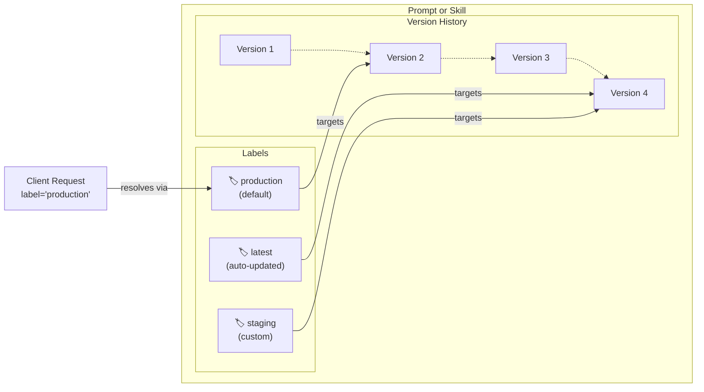

import { VersioningDiagram } from "@/components/VersioningDiagram";

# Concepts

This page discusses prompt and skill management concepts and best practices. If you haven't already, check out the [overview](/docs/prompt-and-skill-management/overview) page to understand when to use prompts and skills.

Ready to start? Check out the guides to create your first [prompt](/docs/prompt-management/get-started) or [skill](/docs/skill-management/get-started).

## Prompts and skills at a glance [#prompts-and-skills-at-a-glance]

Prompts and skills **both provide instructions** to an AI application, but the application uses them differently.

|                          | Prompts                                                        | Skills                                                                                                                                      |
| ------------------------ | -------------------------------------------------------------- | ------------------------------------------------------------------------------------------------------------------------------------------- |
| **Use case**             | Short set of instructions you always want to pass to the agent | Instructions/supporting resources for a task or workflow, not needed in every agent run                                                     |
| **Structure**            | A single file                                                  | A `SKILL.md` file and optional supporting files and folders, following the open [Agent Skills format](https://agentskills.io/specification) |
| **Loading into context** | The entire prompt immediately                                  | Skill metadata at first, further file loading by progressive disclosure when the agent decides it needs them                                |

## Versioning and Labels [#versioning-and-labels]

Understanding how versions and labels work together is essential for managing prompts and skills in production. They serve different but complementary purposes.

### Versions [#versions]

Versions provide an immutable history of every change. An update creates a new version, such as `1`, `2`, and `3`.

A version is always scoped to the entire prompt or skill object. This means that if one file in a skill changes, the entire skill (all its files) gets a new version.

<VersioningDiagram />

### Labels [#labels]

Labels are pointers to specific versions. Your code would typically point to labels. Common labels include:

- `production` - Default label, used by production applications
- `latest` - Always points to the newest version
- `Custom labels` - Create labels for staging, testing, tenants, or A/B tests

Learn more about versioning and labels for [prompts](/docs/prompt-management/features/prompt-version-control) and [skills](/docs/skill-management/version-control).



### Deployment workflow [#deployment-workflow]

Here's a typical workflow for deploying prompt or skill changes:

1. **Create and test**: Create a new prompt or skill version (automatically gets the latest label)
2. **Validate**: Test the new version in your development environment or using the playground
3. **Deploy**: Update the production label to point to the new version
4. **Monitor**: Your production application automatically picks up the new version on the next fetch
5. **Rollback if needed**: Simply reassign the production label back to a previous version

Since your code references the labels, all this happens without changing code.

### Tags [#tags]

Tags such as `support` or `billing` group prompts or skills across their versions. Use them to filter prompt and skill lists. For skills, you can also use tags to install several skills with the CLI. Labels select a version of each prompt or skill.

## How prompts work [#prompt-concepts]

### The prompt object

Langfuse considers a prompt to be a combination of both the instructions for the LLM (this can be a single string or an array of messages) and, optionally, [additional configuration](/docs/prompt-management/features/config) that influences the behavior.

For detailed information about all prompt object fields and methods, see the [SDK reference documentation](https://langfuse-js-git-main-langfuse.vercel.app/interfaces/_langfuse_core.Prompt.Chat.html).

#### Chat vs. text prompts [#text-vs-chat-prompts]

Langfuse supports two prompt types. The `type` field determines the format and cannot be changed after creation.

**Text prompts** are single strings, ideal for simple use cases or when you only need a system message.

**Chat prompts** are arrays of messages with specific roles (system, user, assistant), useful when you want to manage complete conversation structures, include example exchanges, or handle chat history.

<div className="grid grid-cols-1 md:grid-cols-2 mt-6 gap-4">

<div className="[&_pre]:break-words [&_pre]:whitespace-pre-wrap">

```json filename="Text prompt example"
{
  "name": "movie-critic",
  "type": "text",
  "prompt": "As a movie critic, do you like Dune 2?",
  "version": 1
}
```

</div>

<div className="[&_pre]:break-words [&_pre]:whitespace-pre-wrap">

```json filename="Chat prompt example"
{
  "name": "movie-critic-chat",
  "type": "chat",
  "prompt": [
    {
      "role": "system",
      "content": "You are a movie critic."
    },
    {
      "role": "user",
      "content": "Do you like Dune 2?"
    }
  ],
  "version": 1
}
```

</div>

</div>

<Callout type="info">
**When to use chat prompts:** Most applications start with a text prompt. As you build more complex logic that requires managing multiple messages, role-based structures, or chat history, it makes sense to switch to chat prompts. This allows you to manage the complete conversation structure in your prompt management system.
</Callout>

#### Dynamic rendering of prompts [#dynamic-rendering-of-prompts]

You can add variables to your prompts that can be dynamically filled out at runtime. There are different types of variables you can use, explained below.

Prompts support three ways to insert dynamic content at runtime:

| Type                                                                          | Use Case                                                                  |
| ----------------------------------------------------------------------------- | ------------------------------------------------------------------------- |
| [Variables](/docs/prompt-management/features/variables)                       | Insert dynamic text into messages                                         |
| [Prompt References](/docs/prompt-management/features/composability)           | Reuse prompts across other prompts, avoid duplicating common instructions |
| [Message Placeholders](/docs/prompt-management/features/message-placeholders) | Insert arrays of messages (e.g., chat history)                            |

### Prompt caching [#prompt-caching]

Langfuse Prompt Management uses cached prompts for 2 main reasons

1. it adds no latency to your application.
2. it removes availability risk.

This means your first few traces after updating a prompt might still be using the old version. If immediate updates are critical for your use case, you can disable caching or configure a shorter TTL (time-to-live).

See the [caching documentation](/docs/prompt-management/features/caching) for details on how caching works and how to configure it.

## How skills work [#skill-concepts]

### Skill structure [#skill-structure]

Every skill has a root `SKILL.md` and can include supporting files and folders.

### Frontmatter and instructions [#frontmatter]

`SKILL.md` starts with YAML frontmatter between `---` lines, followed by Markdown instructions:

```markdown filename="refund-policy/SKILL.md"
---
name: refund-policy
description: Review refund requests and explain eligibility. Use when a customer asks for a refund.
---

# Handle a refund request

1. Find the customer's order and purchase date.
2. Read [the eligibility rules](references/eligibility.md).
3. Explain the outcome and the next step to the customer.
```

The required `name` identifies the skill in your Langfuse project. The required `description` tells an agent what the skill does and when to use it. Langfuse preserves additional frontmatter; your agent framework determines how fields such as `allowed-tools` are interpreted.

### Progressive loading [#progressive-loading]

An agent can load skills in stages:

1. Read skill names and descriptions to find a relevant skill.
2. Read that skill's `SKILL.md` instructions.
3. Open reference files or run scripts as the task requires.

### Manifests and files [#manifests-and-files]

The API returns a **manifest** containing the skill's name, description, version, and file list. Each file has a path and a content hash. A path identifies a file within the skill; a hash identifies its contents. You can fetch only the files you need and reuse content you have already cached. See [API loading](/docs/skill-management/get-started#api-fetch).

Keep the selected version fixed during a run so the instructions and supporting files come from the same revision.
