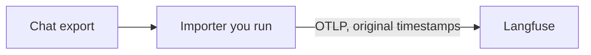

# Import conversations from an external chat export

Some assistants never emit telemetry. A web chat, a vendor you cannot instrument, or a compliance export still has the conversation: who asked, what the assistant answered, which tools ran, and when. This guide is the importer you run yourself. It polls that export and sends the history to Langfuse over the [OTLP endpoint](/integrations/native/opentelemetry#opentelemetry-endpoint), with the original timestamps, so the chats show up as [sessions](/docs/observability/features/sessions) next to anything you already trace.

Teams use it to backfill a Claude Enterprise export, to load a support tool's history into the project that already receives live traces, and to recover web-hosted chats that have no hook or OpenTelemetry export.



<Callout type="info">
  You build and run this importer. Langfuse does not publish a client for Anthropic's Compliance API, and there is no native Claude Enterprise integration. The closest maintained reference is the hook script in the [Claude Code observability plugin](https://github.com/langfuse/claude-observability-plugin): it reads a transcript incrementally, groups turns under one `session_id`, nests tool calls, and backdates each observation. That script depends on Langfuse SDK 4.x internals, so it pins `langfuse>=4.0,<5`. The example on this page uses the public OTLP endpoint instead, which is the supported way to set past timestamps.
</Callout>

## Map a conversation [#mapping]

| In the export                 | In Langfuse                                      |
| ----------------------------- | ------------------------------------------------ |
| Conversation or thread id     | Session id                                       |
| Each turn                     | One trace                                        |
| Prompt and assistant response | Input and output of that turn's root observation |
| Person who chatted            | User id                                          |
| Tool call                     | Child observation on that turn                   |

In Langfuse v4 the root observation holds the turn's input and output. Set `langfuse.observation.input` and `langfuse.observation.output` on that span. The deprecated `langfuse.trace.input` and `langfuse.trace.output` attributes are only a compatibility path. See [Migrate custom ingestion to v4](/integrations/native/opentelemetry/migration-to-v4#move-trace-input-and-output).

Copy `langfuse.session.id`, `langfuse.user.id`, and `langfuse.trace.name` onto **every** span in the turn, including tool spans. v4 filters and aggregates observations, so a user or session that exists only on the root span is missing when you filter the children. See [Propagating trace attributes](/integrations/native/opentelemetry#propagating-attributes).

A session id is a US-ASCII string shorter than 200 characters. Longer values are dropped. See [Sessions](/docs/observability/features/sessions).

## Send one conversation [#example]

Post [OTLP/HTTP JSON](https://api.reference.langfuse.com/#tag/opentelemetry/POST/api/public/otel/v1/traces) to `{LANGFUSE_BASE_URL}/api/public/otel/v1/traces` with Basic auth and the header `x-langfuse-ingestion-version: 4`. The header selects the v4 ingestion path so the data shows up in real time. `LANGFUSE_BASE_URL` is the origin only (`https://cloud.langfuse.com` for the EU region, or your [other region or self-hosted deployment](/security/data-regions)). Self-hosted deployments have served this endpoint since [v3.22.0](https://github.com/langfuse/langfuse/releases/tag/v3.22.0).

Set `startTimeUnixNano` and `endTimeUnixNano` yourself, as decimal strings of unix nanoseconds. Those are the original start and end of the turn or tool call. If one of them is missing, Langfuse copies the other and the observation has zero duration. If both are missing, both become the ingest time and the history lands as if it happened during the import. See [Ingestion transformations](/integrations/native/opentelemetry#ingestion-transformations).

<Callout type="warning">
  Post the finished spans as JSON. A tracer that starts a span on its own clock, and the Python SDK's `start_observation()`, both record the current time. `completion_start_time` on that SDK is time to first token, not the observation start. The `startTimeUnixNano`, `endTimeUnixNano`, `traceId`, and `spanId` in the JSON body are the values Langfuse stores.
</Callout>

The script below sends one conversation with two turns and one tool call. The times are November 1, 2024, the session id is the conversation id `conv_demo_001`, and the user id is `employee_42`. Saving it as `import_chat_export.py` and running it once is enough to see the shape in Langfuse. The standard library is the only dependency.

```python
"""Import an external chat export into Langfuse over OTLP/HTTP JSON."""

from __future__ import annotations

import base64
import hashlib
import json
import os
import urllib.request
from datetime import datetime, timezone
from pathlib import Path

STATE_PATH = Path("chat-export-cursor.json")

# One conversation, two turns, one tool call. Replace this with records
# from your export. Times are the original clock, not the import time.
SAMPLE = {
    "id": "conv_demo_001",
    "user_id": "employee_42",
    "updated_at": "2024-11-01T15:06:04Z",
    "turns": [
        {
            "id": "turn_001",
            "started_at": "2024-11-01T15:04:00Z",
            "ended_at": "2024-11-01T15:04:08Z",
            "prompt": "What's the on-call rotation this week?",
            "response": "Alex is primary. I checked the schedule.",
            "tool_calls": [
                {
                    "id": "tool_001",
                    "name": "lookup_oncall",
                    "started_at": "2024-11-01T15:04:02Z",
                    "ended_at": "2024-11-01T15:04:03Z",
                    "input": {"team": "platform"},
                    "output": {"primary": "Alex"},
                }
            ],
        },
        {
            "id": "turn_002",
            "started_at": "2024-11-01T15:06:00Z",
            "ended_at": "2024-11-01T15:06:04Z",
            "prompt": "Who covers the weekend?",
            "response": "Sam covers Saturday and Sunday.",
            "tool_calls": [],
        },
    ],
}


def unix_nano(iso_timestamp: str) -> str:
    """OTLP timestamps are unix nanoseconds, encoded as decimal strings."""
    instant = datetime.fromisoformat(iso_timestamp.replace("Z", "+00:00"))
    if instant.tzinfo is None:
        instant = instant.replace(tzinfo=timezone.utc)
    return str(int(instant.timestamp() * 1_000_000_000))


def otel_id(source: str, nbytes: int) -> str:
    """Stable W3C id: 16 bytes (trace) or 8 bytes (span), lowercase hex."""
    return hashlib.sha256(source.encode()).hexdigest()[: nbytes * 2]


def payload(value: object) -> str:
    if isinstance(value, str):
        return value
    return json.dumps(value, separators=(",", ":"), sort_keys=True)


def attr(key: str, value: str) -> dict:
    return {"key": key, "value": {"stringValue": value}}


def shared_attributes(record: dict) -> list:
    # Present on every span. v4 filters observations, not a separate trace row.
    return [
        attr("langfuse.trace.name", "chat-turn"),
        attr("langfuse.session.id", record["id"]),
        attr("langfuse.user.id", record["user_id"]),
        attr("langfuse.trace.metadata.source", "external-chat-export"),
    ]


def build_span(
    record: dict,
    turn: dict,
    *,
    name: str,
    key: str,
    parent_key: str | None,
    start: str,
    end: str,
    observation_type: str,
    input_value: object,
    output_value: object,
) -> dict:
    body = {
        "traceId": otel_id(f"{record['id']}:{turn['id']}", 16),
        "spanId": otel_id(key, 8),
        "name": name,
        "startTimeUnixNano": unix_nano(start),
        "endTimeUnixNano": unix_nano(end),
        "attributes": shared_attributes(record)
        + [
            attr("langfuse.observation.type", observation_type),
            attr("langfuse.observation.input", payload(input_value)),
            attr("langfuse.observation.output", payload(output_value)),
        ],
    }
    if parent_key:
        body["parentSpanId"] = otel_id(parent_key, 8)
    return body


def iter_spans(record: dict):
    """Yield (stable key, span) for each turn and its tool calls."""
    for turn in record["turns"]:
        root_key = f"{record['id']}:{turn['id']}"
        yield root_key, build_span(
            record,
            turn,
            name="chat-turn",
            key=root_key,
            parent_key=None,
            start=turn["started_at"],
            end=turn["ended_at"],
            observation_type="agent",
            input_value=turn["prompt"],
            output_value=turn["response"],
        )
        for tool in turn.get("tool_calls", []):
            tool_key = f"{root_key}:{tool['id']}"
            yield tool_key, build_span(
                record,
                turn,
                name=tool["name"],
                key=tool_key,
                parent_key=root_key,
                start=tool["started_at"],
                end=tool["ended_at"],
                observation_type="tool",
                input_value=tool["input"],
                output_value=tool["output"],
            )


def load_state(path: Path) -> dict:
    if not path.exists():
        return {"cursor": None, "ingested": []}
    return json.loads(path.read_text())


def save_state(path: Path, state: dict) -> None:
    path.write_text(json.dumps(state, indent=2) + "\n")


def post_spans(spans: list) -> None:
    if not spans:
        return
    base_url = os.environ["LANGFUSE_BASE_URL"].rstrip("/")
    public_key = os.environ["LANGFUSE_PUBLIC_KEY"]
    secret_key = os.environ["LANGFUSE_SECRET_KEY"]
    token = base64.b64encode(f"{public_key}:{secret_key}".encode()).decode()
    body = json.dumps(
        {
            "resourceSpans": [
                {
                    "scopeSpans": [
                        {
                            "scope": {"name": "chat-export-importer"},
                            "spans": spans,
                        }
                    ]
                }
            ]
        }
    ).encode()
    request = urllib.request.Request(
        f"{base_url}/api/public/otel/v1/traces",
        data=body,
        method="POST",
        headers={
            "Authorization": f"Basic {token}",
            "Content-Type": "application/json",
            "x-langfuse-ingestion-version": "4",
        },
    )
    with urllib.request.urlopen(request) as response:
        response.read()


def import_records(records, state, post, save, next_cursor):
    """Post spans whose keys are not in the checkpoint, then store next_cursor.

    `next_cursor` is whatever you pass back to the export on the next poll:
    an opaque page cursor, or the greatest `updated_at` on a page you have
    fully accepted. It is written only after every record in this batch has
    been posted. Keys of an accepted conversation are written immediately, so
    a later failure in the same batch does not resend conversations that
    already landed.
    """
    ingested = set(state.get("ingested", []))
    cursor = state.get("cursor")
    for record in records:
        pending = [
            (key, built)
            for key, built in iter_spans(record)
            if key not in ingested
        ]
        if pending:
            post([built for _, built in pending])
            ingested.update(key for key, _ in pending)
            save({"cursor": cursor, "ingested": sorted(ingested)})
    finished = {"cursor": next_cursor, "ingested": sorted(ingested)}
    save(finished)
    return finished


def main() -> None:
    state = load_state(STATE_PATH)
    import_records(
        [SAMPLE],
        state,
        post_spans,
        lambda new_state: save_state(STATE_PATH, new_state),
        SAMPLE["updated_at"],
    )


if __name__ == "__main__":
    main()
```

```bash
export LANGFUSE_PUBLIC_KEY="pk-lf-..."
export LANGFUSE_SECRET_KEY="sk-lf-..."
export LANGFUSE_BASE_URL="https://cloud.langfuse.com" # EU. See data regions for other hosts.
python import_chat_export.py
```

Open [Sessions](https://cloud.langfuse.com/project/~/sessions) in the project those keys belong to. The `~` segment resolves to your last-used project and region. You should see session `conv_demo_001` for user `employee_42`: two traces, the first with a child observation named `lookup_oncall`. The start times are November 1, 2024.

Running the script again posts nothing. `chat-export-cursor.json` already lists the three span keys, and `import_records` skips them.

<Callout type="info">
  Imported observations count as new ingestion. See [Billable units](/docs/administration/billable-units).
</Callout>

## Poll the export [#incremental]

A backfill that rereads the whole archive on every run will resend history. Keep two pieces of state:

- **A resume cursor.** When the export has a page cursor, store that opaque value and pass it back on the next poll. When you only have timestamps, store the greatest `updated_at` you have fully accepted and ask for records at or after that instant. Two records can share a timestamp, so a strict greater-than filter drops the rest of a tie.
- **The span keys you have already accepted.** Derive each key from ids that the export keeps stable: `{conversation}:{turn}` for the turn, and `{conversation}:{turn}:{tool}` for a tool call. Hash the turn key into the trace id (32 lowercase hex characters) and put that id on every span in the turn. Hash each span's own key into its span id (16 lowercase hex characters). A rerun then refers to the same Langfuse ids.

A changed conversation usually comes back whole, old turns included. The cursor still moves forward. The key set is what drops the turns you already sent and lets the new turn through.

<Callout type="warning">
  Langfuse treats an accepted observation as immutable. Sending the same span id again creates a second observation. It does not replace the first one, and the duplicate inflates counts and cost. Checkpoint keys only after the POST returns success, and persist that checkpoint before you move on to the next conversation. A crash in the gap between a successful POST and the checkpoint write can still duplicate that one conversation. Reconcile it in the UI before you resend those keys. See [How to update traces and observations](/faq/all/tracing-data-updates#traces-and-observations).
</Callout>

`import_records` is that checkpoint. Your poll loop fetches a page, hands the page and the export's next cursor to it, and repeats until the export is exhausted:

```python
def poll_forever(fetch_page, post, save, load):
    state = load()
    while True:
        records, next_cursor, exhausted = fetch_page(state["cursor"])
        state = import_records(records, state, post, save, next_cursor)
        if exhausted:
            return state
```

`fetch_page` is the only part that knows the export. It returns the records in the normalized shape of `SAMPLE`, the cursor to store once that page is fully accepted, and whether this was the last page. Split a very large page into several `import_records` calls if you want smaller HTTP bodies. One conversation per request is a reasonable default. The function already posts one conversation at a time.

Advance `next_cursor` only for a page you passed in and that `import_records` returned from. If the POST fails, the exception propagates before the page cursor is saved. Keys from conversations that succeeded earlier in the page are already on disk, so the retry skips them.

When the export has no per-tool timestamps, set the tool span's start and end to the assistant message's window. Leave both timestamps empty and Langfuse stamps ingest time.

If a tool result is an error, set `langfuse.observation.level` to `ERROR` on that child span. When the export includes a model name, set `langfuse.observation.model.name` on the turn. Add `langfuse.observation.usage_details` (a JSON string of token counts) only when the export actually contains usage. A model name on its own does not produce a cost.

## Claude Enterprise [#claude-enterprise]

Claude Enterprise organizations can export [claude.ai](https://claude.ai) chats through Anthropic's Compliance API. That export is the worked example for the records above: one chat is one session, each user-and-assistant exchange is one turn, and the chat's user id is the Langfuse user id (the employee). Anthropic documents the API in the [Compliance API overview](https://platform.claude.com/docs/en/manage-claude/compliance-api) and [Retrieve chats, files, and projects](https://platform.claude.com/docs/en/manage-claude/compliance-content-data). Keys, headers, and paths live there.

For the poll, use their chat list sorted by `updated_at` and resume with the previous response's cursor (`after_id`). That walk returns new chats and chats that have since changed. A chat is returned again when it receives a message, moves into or out of a project, or is deleted in claude.ai, so keep the span-key checkpoint. Other edits, such as a rename, are not guaranteed to move the cursor. When `deleted_at` is set, the export no longer includes message content. Skip that chat.

Assistant messages can carry `tool_use` blocks (tool name and JSON input) and `tool_result` blocks (the output, matched by tool-use id). Map each pair to a child `tool` observation. Anthropic marks coverage of these tool calls as beta, and long inputs and results can be shortened in the export. Their docs describe both.

The published chat-message schema includes text, the user, timestamps, a model name when one was stored, and tool blocks. It does not include token counts. This backfill is the conversation. It does not produce measured cost unless you attach usage from somewhere that has it.

<Callout type="info">
  The [Claude Code observability plugin](https://github.com/langfuse/claude-observability-plugin) shows the same session, turn, and tool shape for Claude Code transcripts on a machine. It is not a Compliance API client, and it does not see claude.ai. For new Claude Desktop and Claude Code sessions, trace them as they run with the [AI Gateway](/integrations/developer-tools/claude-code-gateway) or [Claude Code hooks](/integrations/developer-tools/claude-code). Those paths record tokens and cost. This page is for history those paths never saw.
</Callout>

## Check the import [#check-the-import]

In the session, confirm:

- Two traces share `conv_demo_001`, and both are attributed to `employee_42`. User and session filters work because those attributes are on the tool span as well as the roots. See [Users](/docs/observability/features/users).
- The first trace has a child `lookup_oncall` observation whose input is `{"team":"platform"}` and whose output is `{"primary":"Alex"}`.
- Start and end are the November 2024 instants from the sample. If they match the time you ran the script, both timestamps were missing, or a tracer created the span.
- A second run did not add observations. If it did, the checkpoint was not read, or the span keys changed because the source ids changed.

Once the turns are in the project, [evaluators](/docs/evaluation/overview) and [sessions](/docs/observability/features/sessions) apply to them the same way they apply to live traffic.
