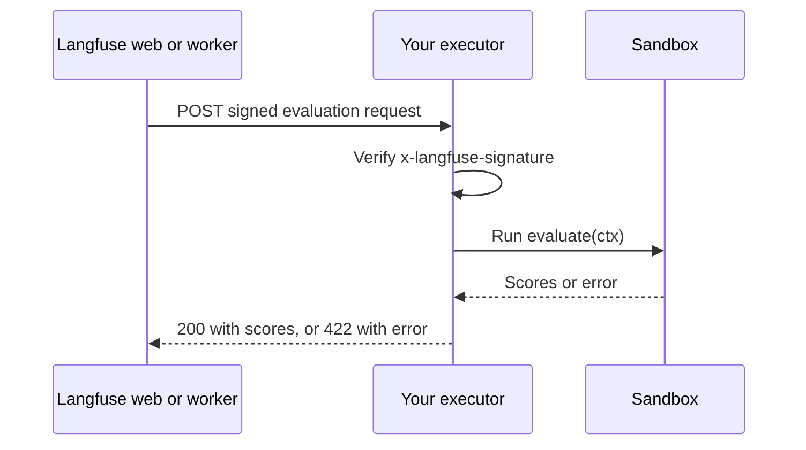

# Code evaluators

This page covers self-hosted infrastructure setup. For an introduction to the feature, see [Code evaluators](/docs/evaluation/evaluation-methods/code-evaluators).

Self-hosted code evaluators are picked up by the Langfuse worker and executed through a dispatcher backend. The dispatcher invokes AWS Lambda, an HTTP executor you operate, or the local insecure runner synchronously. Production self-hosted deployments need a dispatcher for execution.

Code evaluator availability is derived from `LANGFUSE_CODE_EVAL_DISPATCHER`. If this variable is unset, code evaluators are disabled for self-hosted deployments. Set it on the web service so the UI can show the supported code evaluator templates, and on the worker service so executions can be dispatched.

<Frame fullWidth>
  
</Frame>

## Available dispatchers

Set `LANGFUSE_CODE_EVAL_DISPATCHER` to one of the available dispatchers:

| Dispatcher     | Value            | Use for                                                                                      | Runtime support                                                                            |
| -------------- | ---------------- | -------------------------------------------------------------------------------------------- | ------------------------------------------------------------------------------------------ |
| AWS Lambda     | `aws-lambda`     | Production self-hosted deployments on AWS                                                    | TypeScript/JavaScript and Python                                                           |
| External HTTP  | `external`       | Production deployments with your own sandboxed executor, e.g. on Kubernetes or another cloud | TypeScript/JavaScript and Python, or the subset in `LANGFUSE_CODE_EVAL_EXTERNAL_LANGUAGES` |
| Local insecure | `insecure-local` | Local development and trusted deployments                                                    | TypeScript/JavaScript only                                                                 |

<Callout type="warning">
  If you do not run Langfuse on AWS, use the [external HTTP
  dispatcher](#external-dispatcher) with a sandboxed executor. Use the
  `insecure-local` dispatcher only when all evaluator code is fully trusted.
</Callout>

## AWS Lambda dispatcher

Use the AWS Lambda dispatcher for production self-hosted deployments:

```bash
LANGFUSE_CODE_EVAL_DISPATCHER=aws-lambda
QUEUE_CONSUMER_CODE_EVAL_EXECUTION_QUEUE_IS_ENABLED=true
```

The AWS Lambda dispatcher enables TypeScript/JavaScript and Python code evaluators.

By default, Langfuse dispatches TypeScript/JavaScript and Python evaluators to these Lambda functions:

```bash
LANGFUSE_CODE_EVAL_AWS_LAMBDA_NODE_FUNCTION_NAME=code-based-eval-executor-node
LANGFUSE_CODE_EVAL_AWS_LAMBDA_PYTHON_FUNCTION_NAME=code-based-eval-executor-python
```

Set these variables if your Lambda functions use different names.

### Lambda runners

The [Langfuse Terraform module for AWS](https://github.com/langfuse/langfuse-terraform-aws) can create both tenant-isolated Lambda runners in a VPC without network egress. Set `enable_code_based_eval_executors = true`.

If you do not use the module, create one Lambda runner per supported runtime. The runner source code is available on `main`:

| Runtime    | Default function name             | AWS runtime  | Handler         | Bundle file | Runner source                                                                                                                                                               |
| ---------- | --------------------------------- | ------------ | --------------- | ----------- | --------------------------------------------------------------------------------------------------------------------------------------------------------------------------- |
| Python     | `code-based-eval-executor-python` | `python3.14` | `index.handler` | `index.py`  | [`scripts/code-eval-runners/python/code_based_eval_handler.py`](https://github.com/langfuse/langfuse/blob/main/scripts/code-eval-runners/python/code_based_eval_handler.py) |
| JavaScript | `code-based-eval-executor-node`   | `nodejs24.x` | `index.handler` | `index.mjs` | [`scripts/code-eval-runners/node/code-based-eval-handler.mjs`](https://github.com/langfuse/langfuse/blob/main/scripts/code-eval-runners/node/code-based-eval-handler.mjs)   |

Configure each Lambda with [tenant isolation](https://docs.aws.amazon.com/lambda/latest/dg/tenant-isolation.html) enabled:

```hcl
tenancy_config {
  tenant_isolation_mode = "PER_TENANT"
}
```

Tenant isolation mode is supported in all commercial Regions except Asia Pacific (New Zealand).

Use short timeouts and bounded concurrency so evaluator execution cannot consume unbounded Lambda capacity. Langfuse Cloud currently uses 128 MB memory, a 2 second timeout, and reserved concurrency per runtime.

### IAM permissions

Grant the Langfuse worker permission to invoke only the code evaluator runner functions:

```json
{
  "Version": "2012-10-17",
  "Statement": [
    {
      "Effect": "Allow",
      "Action": "lambda:InvokeFunction",
      "Resource": [
        "arn:aws:lambda:<region>:<account-id>:function:code-based-eval-executor-node",
        "arn:aws:lambda:<region>:<account-id>:function:code-based-eval-executor-python"
      ]
    }
  ]
}
```

The Lambda execution role should be minimal: trust `lambda.amazonaws.com`, allow writing to the runner CloudWatch log groups, and avoid application, database, secret, or storage permissions. User-provided evaluator code runs inside these functions, so the runner role should not have access to Langfuse infrastructure beyond what the Lambda platform itself requires.

For local AWS-compatible endpoints, set a custom Lambda endpoint:

```bash
LANGFUSE_CODE_EVAL_AWS_LAMBDA_ENDPOINT=http://localhost:4566
```

<Callout type="warning">
  Self-hosters deploying Lambda runners are responsible for isolating evaluator
  execution, including no-network-egress isolation.
</Callout>

## External HTTP dispatcher [#external-dispatcher]

Use the external dispatcher to run code evaluators on an executor you operate, for example a sandboxed service on Kubernetes, another cloud, or on premises. Langfuse sends each evaluation as a signed HTTP `POST` to your endpoint and reads the scores from the response. Langfuse provides the dispatcher; you build and run the executor against the contract on this page.



<Callout type="warning">
  Your executor runs code written by project members. Run every evaluation in
  a sandbox with no network egress, no route to Langfuse infrastructure, no
  credentials, and bounded CPU, memory, and runtime.
</Callout>

### Enable the dispatcher [#external-dispatcher-enable]

Set these variables on both the web and the worker containers. The worker calls the executor for evaluator executions, and web calls it for test runs in the evaluator editor, so both need network access to the endpoint.

```bash
LANGFUSE_CODE_EVAL_DISPATCHER=external
LANGFUSE_CODE_EVAL_EXTERNAL_ENDPOINT=http://code-eval-executor.langfuse.svc:8080/evaluate
LANGFUSE_CODE_EVAL_EXTERNAL_SIGNING_SECRET=<at least 32 characters>
# Worker only
QUEUE_CONSUMER_CODE_EVAL_EXECUTION_QUEUE_IS_ENABLED=true
```

### Configuration [#external-dispatcher-configuration]

| Variable                                         | Default             | Description                                                                                                                                                                                                                                |
| ------------------------------------------------ | ------------------- | ------------------------------------------------------------------------------------------------------------------------------------------------------------------------------------------------------------------------------------------ |
| `LANGFUSE_CODE_EVAL_EXTERNAL_ENDPOINT`           | Required            | URL that Langfuse sends evaluations to. Must use `http` or `https` and must not contain credentials. Any port is allowed, and private or in-cluster hosts work because Langfuse allowlists exactly this host.                              |
| `LANGFUSE_CODE_EVAL_EXTERNAL_SIGNING_SECRET`     | Required            | Secret for the `x-langfuse-signature` HMAC. At least 32 characters.                                                                                                                                                                        |
| `LANGFUSE_CODE_EVAL_EXTERNAL_HEADERS`            |                     | Extra request headers as a JSON object of strings, e.g. `{"Authorization":"Bearer <token>"}` for an API gateway. Cannot override `content-type`, `user-agent`, or `x-langfuse-signature`.                                                  |
| `LANGFUSE_CODE_EVAL_EXTERNAL_TIMEOUT_MS`         | `10000`             | Timeout per attempt in milliseconds, from connecting until the response body is read. Range: `1000`–`15000`.                                                                                                                               |
| `LANGFUSE_CODE_EVAL_EXTERNAL_CONNECT_TIMEOUT_MS` | `3000`              | Timeout per attempt in milliseconds for establishing the connection, including TLS. Range: `100`–`15000`.                                                                                                                                  |
| `LANGFUSE_CODE_EVAL_EXTERNAL_MAX_ATTEMPTS`       | `3`                 | Attempts per job for retryable failures before the job goes back to the queue. Range: `1`–`10`.                                                                                                                                            |
| `LANGFUSE_CODE_EVAL_EXTERNAL_LANGUAGES`          | `PYTHON,TYPESCRIPT` | Languages your executor supports: `PYTHON`, `TYPESCRIPT`, or both, comma-separated. The UI only offers evaluator templates in these languages, and the worker rejects other languages with `UNSUPPORTED_RUNTIME` before sending a request. |

### Request [#external-dispatcher-request]

Langfuse sends one `POST` per attempt with these headers:

```http
POST /evaluate HTTP/1.1
content-type: application/json
user-agent: Langfuse/1.0
x-langfuse-signature: t=1762770000,v1=5257a869e7ecebeda32affa62cdca3fa51cad7e77a0e56ff536d0ce8e108d8bd
```

Headers from `LANGFUSE_CODE_EVAL_EXTERNAL_HEADERS`, if set, are added to these. The body looks like this:

```json
{
  "apiVersion": "v1",
  "scope": {
    "organizationId": "org-id",
    "projectId": "project-id",
    "evaluatorId": "evaluator-id"
  },
  "runtime": { "language": "PYTHON" },
  "execution": { "jobExecutionId": "job-execution-id" },
  "code": {
    "source": "def evaluate(ctx):\n    return EvaluationResult(scores=[...])"
  },
  "payload": {
    "observation": {
      "input": "What is the capital of France?",
      "output": "Paris",
      "metadata": {},
      "toolCalls": [
        {
          "id": "call_1",
          "name": "search",
          "arguments": { "query": "capital of France" },
          "type": "function",
          "index": 0
        }
      ]
    },
    "experiment": {
      "itemExpectedOutput": "Paris",
      "itemMetadata": {}
    }
  }
}
```

| Field                      | Description                                                                                                                                                                                                                                                                    |
| -------------------------- | ------------------------------------------------------------------------------------------------------------------------------------------------------------------------------------------------------------------------------------------------------------------------------ |
| `apiVersion`               | Contract version, currently `v1`. Like the [prompt webhook payloads](/docs/prompt-management/features/webhooks-slack-integrations), the version is only in the body. New optional fields keep the version, so ignore unknown fields. Breaking changes get a new version.       |
| `scope`                    | Organization, project, and evaluator IDs, e.g. for logging, quotas, or routing.                                                                                                                                                                                                |
| `runtime.language`         | `PYTHON` or `TYPESCRIPT`.                                                                                                                                                                                                                                                      |
| `execution.jobExecutionId` | Identifies the evaluation and stays the same across retries. Use it as an idempotency key.                                                                                                                                                                                     |
| `code.source`              | Evaluator source code that defines `evaluate`.                                                                                                                                                                                                                                 |
| `payload`                  | Data for the `ctx` argument of `evaluate`, in camelCase. `experiment` is only present when the evaluator runs on an experiment. See the [function contract](/docs/evaluation/evaluation-methods/code-evaluators#function-contract) for how `ctx` is exposed to evaluator code. |

The request body is at most 5.5 MB, including evaluator source code of at most 256 KB.

### Verify the signature [#external-dispatcher-signature]

`x-langfuse-signature` uses the same scheme as [prompt webhooks](/docs/prompt-management/features/webhooks-slack-integrations): `t=<unix seconds>,v1=<hex HMAC-SHA256 of "<t>.<raw body>">`, keyed with `LANGFUSE_CODE_EVAL_EXTERNAL_SIGNING_SECRET`. Langfuse signs every attempt again, so retries carry a fresh timestamp.

Verify the signature over the raw request bytes before parsing the JSON, compare in constant time, and reject old timestamps to block replayed requests:

<LangTabs items={["Python", "TypeScript"]}>
<Tab>

```python
import hashlib
import hmac
import time

TOLERANCE_SECONDS = 300


def verify_signature(raw_body: bytes, header: str, secret: str) -> bool:
    parts = dict(part.split("=", 1) for part in header.split(",") if "=" in part)
    timestamp, signature = parts.get("t", ""), parts.get("v1", "")
    if not (timestamp.isascii() and timestamp.isdecimal()):
        return False
    if abs(time.time() - int(timestamp)) > TOLERANCE_SECONDS:
        return False

    signed_payload = timestamp.encode() + b"." + raw_body
    expected = hmac.new(secret.encode(), signed_payload, hashlib.sha256).hexdigest()
    return hmac.compare_digest(expected.encode(), signature.encode())
```

</Tab>
<Tab>

```ts
import { createHmac, timingSafeEqual } from "node:crypto";

const TOLERANCE_SECONDS = 300;

export function verifySignature(
  rawBody: Buffer,
  header: string,
  secret: string,
): boolean {
  const parts = new URLSearchParams(header.replaceAll(",", "&"));
  const timestamp = parts.get("t") ?? "";
  const ageSeconds = Math.abs(Date.now() / 1000 - Number(timestamp));
  if (!/^\d+$/.test(timestamp) || ageSeconds > TOLERANCE_SECONDS) return false;

  const expected = createHmac("sha256", secret)
    .update(`${timestamp}.`)
    .update(rawBody)
    .digest();
  const received = Buffer.from(parts.get("v1") ?? "", "hex");
  return (
    received.length === expected.length && timingSafeEqual(received, expected)
  );
}
```

</Tab>
</LangTabs>

### Response [#external-dispatcher-response]

On success, return a 2xx status with a JSON body of at least one score. Scores use the fields from the [function contract](/docs/evaluation/evaluation-methods/code-evaluators#function-contract), in camelCase:

```json
{
  "scores": [
    {
      "name": "Exact match",
      "value": true,
      "dataType": "BOOLEAN",
      "comment": "Output exactly matches the expected output."
    }
  ]
}
```

When the evaluator code fails, return `422` (or a 2xx) with an error envelope. Use `USER_CODE_ERROR`, `INVALID_SOURCE`, `INVALID_RESULT`, `TIMEOUT`, `OUT_OF_MEMORY`, or `UNSUPPORTED_RUNTIME` as the code. The message is shown to the user on the failed execution.

```json
{
  "error": {
    "code": "USER_CODE_ERROR",
    "message": "ValueError: boom (line 2)"
  }
}
```

Langfuse handles responses like this:

| Response                                                                                               | Error code                     | Retried |
| ------------------------------------------------------------------------------------------------------ | ------------------------------ | ------- |
| 2xx with valid `scores`                                                                                | None, the scores are stored    | –       |
| `422` or 2xx with an error envelope                                                                    | The code from the envelope     | No      |
| 2xx with JSON that is neither valid scores nor an error envelope                                       | `INVALID_RESULT`               | No      |
| 2xx or `422` with a body larger than 256 KB                                                            | `RESULT_TOO_LARGE`             | No      |
| `413`                                                                                                  | `PAYLOAD_TOO_LARGE`            | No      |
| `408`, `425`, `429`, 5xx, network or DNS errors, connect or request timeouts                           | `EXTERNAL_INVOCATION_ERROR`    | Yes     |
| 3xx, any other 4xx such as `401` or `404`, a body that is not JSON, or `422` without an error envelope | `EXTERNAL_CONFIGURATION_ERROR` | No      |

A response with valid scores is accepted even if it also contains an `error` field. Users see a generic internal error for `EXTERNAL_INVOCATION_ERROR` and `EXTERNAL_CONFIGURATION_ERROR`; the details are in the Langfuse logs.

<Callout type="warning">
  Enforce your own runtime limit per evaluation, below
  `LANGFUSE_CODE_EVAL_EXTERNAL_TIMEOUT_MS`, and report it as a `TIMEOUT` error
  envelope. When the Langfuse timeout fires first, Langfuse treats it as an
  executor outage and retries, which runs the evaluator code again.
</Callout>

### Retries, timeouts, and redirects [#external-dispatcher-retries]

- **Attempts.** Langfuse retries retryable failures up to `LANGFUSE_CODE_EVAL_EXTERNAL_MAX_ATTEMPTS` times, with exponential backoff and full jitter, starting at 100 ms and capped at 2 seconds. Each attempt has its own timeouts and a fresh signature.
- **Queue retries.** When all attempts of a worker execution fail, the code evaluator queue retries the job up to two more times, about 30 and 60 seconds later. Test runs from the evaluator editor are not queued. With the defaults, one evaluation can reach your executor up to nine times, so deduplicate on `execution.jobExecutionId`.
- **Redirects.** Langfuse never follows redirects and treats any 3xx as a configuration error. Point `LANGFUSE_CODE_EVAL_EXTERNAL_ENDPOINT` at the final URL.

## Local insecure dispatcher

For local development and trusted production environments, you can run code evaluators in the worker process:

```bash
LANGFUSE_CODE_EVAL_DISPATCHER=insecure-local
QUEUE_CONSUMER_CODE_EVAL_EXECUTION_QUEUE_IS_ENABLED=true
```

`insecure-local` runs user-provided code inside the Langfuse worker process. It is only appropriate when all evaluator code is trusted, including in production. It is not a sandbox boundary for untrusted code. It currently supports TypeScript/JavaScript only.

## Queue and runtime knobs

These optional variables tune execution behavior:

| Variable                                          | Description                                                   |
| ------------------------------------------------- | ------------------------------------------------------------- |
| `LANGFUSE_CODE_EVAL_EXECUTION_QUEUE_SHARD_COUNT`  | Number of shards for the code evaluator execution queue.      |
| `LANGFUSE_CODE_EVAL_EXECUTION_WORKER_CONCURRENCY` | Worker concurrency for code evaluator execution.              |
| `LANGFUSE_CODE_EVAL_LOCAL_TIMEOUT_MS`             | Timeout in milliseconds for locally executed code evaluators. |
