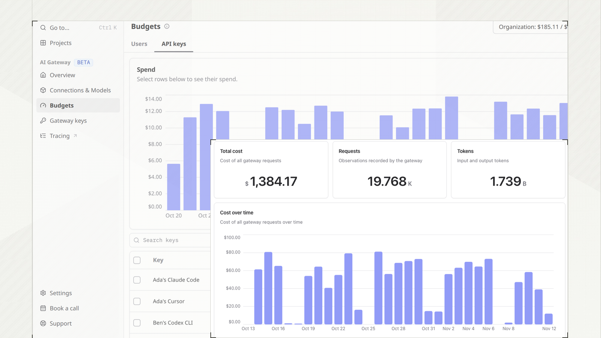
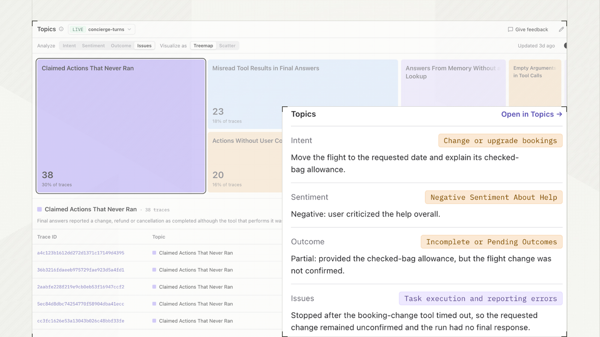
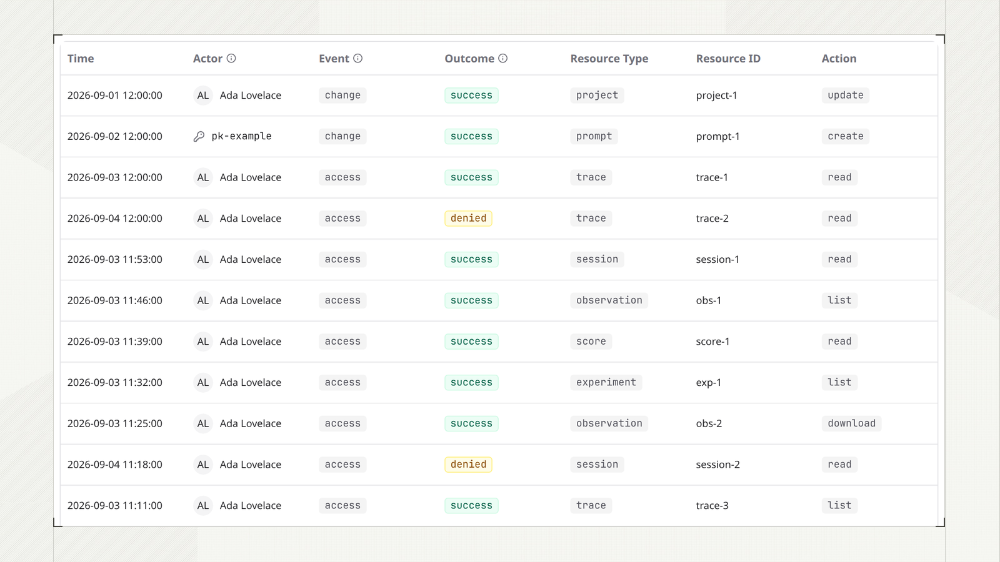
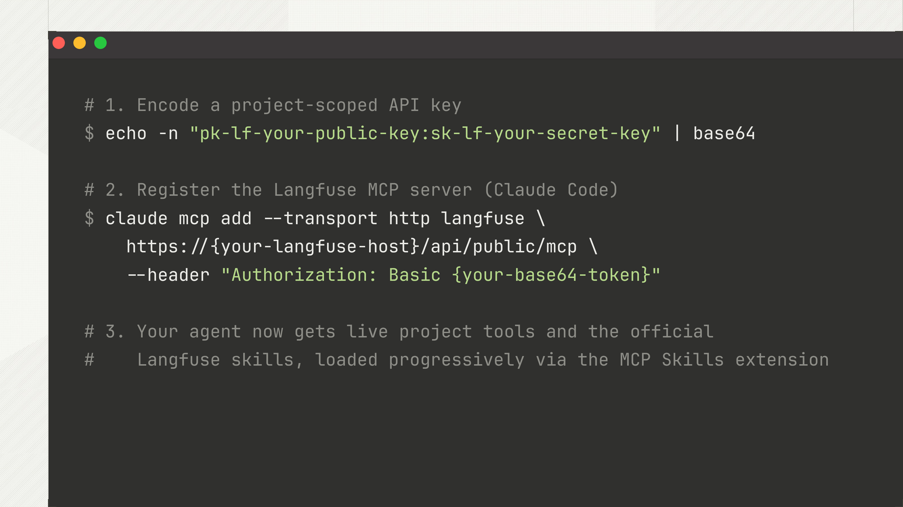

Hi {firstName},

November was launch month. The AI Gateway and Topics both went into public beta, the trace view got a redesign, and audit logs now cover reads. Here's what's new:

- **AI Gateway public beta:** one entry point for your apps and coding agents, now with nine providers, budgets, and per-key model restrictions.
- **Topics public beta:** your production traces clustered by intent, sentiment, outcome, and issues.
- **Redesigned trace view:** large agent traces are easier to read, in the full page, the side peek, and on small screens.
- **Read-access audit logs:** record who read traces, scores, sessions, and experiments, not only who changed them.
- **Langfuse skills via MCP:** one MCP connection gives your agent live project tools and the official Langfuse playbooks.
- **Organization-level model definitions:** define model prices once for every project.

## Langfuse AI Gateway public beta

Point your app or coding agent at Langfuse instead of the provider: change the base URL and the API key, nothing else. Every teammate gets their own gateway key, the provider key stays in Langfuse, and every call is recorded as a trace with cost per user, key, and model.

Since the launch we added [1] Amazon Bedrock, OpenRouter, Vercel AI Gateway, xAI, Microsoft Azure, Google AI Studio, and Google Vertex AI as providers, [2] budgets per key, per user, and for the whole organization, with email warnings at 85% and 95%, [3] model restrictions per gateway key, and [4] the OpenAI Embeddings and Decisions APIs.

→ Read more (https://langfuse.com/docs/gateway/overview?utm_source=langfuse&utm_medium=email&utm_campaign=product_update_2026_11&utm_content=ai_gateway)

→ Connect Claude Code, Codex, GitHub Copilot, OpenCode, or pi (https://langfuse.com/changelog/2026-11-04-ai-gateway-public-beta?utm_source=langfuse&utm_medium=email&utm_campaign=product_update_2026_11&utm_content=ai_gateway#coding-agents)

## Topics public beta

Topics clusters your production traces into named topics, so you see what users ask, how they felt, how it went, and what went wrong without reading every trace. Each trace is summarized from four angles (Intent, Sentiment, Outcome, Issues) and clustered per angle, so a failure spread across many user requests still lands in one Issues topic. On Halo, our in-app assistant, it surfaced users writing homework, a group pen-testing it, and a silent bug where the answer ended up inside the reasoning tokens.

Topics runs on your own LLM connections, and the first topics appear about five minutes after setup. Live maps keep adding new traces as they arrive; snapshots analyze one time window or slice, such as last week's gold-tier customers.

→ Read the launch post (https://langfuse.com/blog/introducing-topics?utm_source=langfuse&utm_medium=email&utm_campaign=product_update_2026_11&utm_content=topics)

→ Set up Topics in your project (https://cloud.langfuse.com/project/~/topics)

## Redesigned trace view

We rebuilt the trace view in many small steps over the past months, so you may not have noticed each one. Side by side, the difference is large: the Timeline and graph view show the shape of a big agent trace at a glance, the observation you are debugging gets the space, and the layout is the same in the full page, the side peek, and on small screens.

→ Watch the before and after (https://langfuse.com/changelog/2026-11-20-redesigned-trace-view?utm_source=langfuse&utm_medium=email&utm_campaign=product_update_2026_11&utm_content=trace_view)

→ Read how we approached the redesign (https://langfuse.com/blog/2026-11-19-comfortable-with-being-uncomfortable?utm_source=langfuse&utm_medium=email&utm_campaign=product_update_2026_11&utm_content=trace_view)

## Read-access audit logs

Audit logs can now record who read your data, not only who changed it. With read-access logging on, every open, list, search, export, or download of traces, observations, scores, sessions, and experiments is recorded with the actor, the route, the returned row IDs, the outcome, and the client IP. It covers the UI, the public API, and MCP tools, and access events appear next to change events in the audit log viewer and export.

Also new: organization admins can turn off public share links for traces and sessions, and self-hosted instances can turn them off for every organization.

→ Read more (https://langfuse.com/changelog/2026-11-17-read-access-audit-logs?utm_source=langfuse&utm_medium=email&utm_campaign=product_update_2026_11&utm_content=audit_logs)

→ Disable public sharing (https://langfuse.com/changelog/2026-11-19-disable-public-sharing?utm_source=langfuse&utm_medium=email&utm_campaign=product_update_2026_11&utm_content=audit_logs)

## Langfuse skills via MCP

The Langfuse MCP server now bundles the official Langfuse agent skills through the MCP Skills extension. Connect the server once and your agent gets live tools for your project plus the playbooks to use them well, with no `npx skills add` and no cloned repositories. Langfuse Cloud serves the latest skills, self-hosted deployments serve the skills matching their version, and skills load progressively so your context window stays clean until you work on a Langfuse task.

The MCP server also gained tools to set a project's default evaluation model and run batch evaluations over existing observations, so an agent can switch judge models and re-score last week's traffic in one go.

→ Read more (https://langfuse.com/changelog/2026-11-26-mcp-bundled-skills?utm_source=langfuse&utm_medium=email&utm_campaign=product_update_2026_11&utm_content=mcp_skills)

→ Batch evaluation via MCP (https://langfuse.com/changelog/2026-11-11-default-evaluation-model-and-batch-evaluation-via-mcp?utm_source=langfuse&utm_medium=email&utm_campaign=product_update_2026_11&utm_content=mcp_skills)

## New Integrations

- PagerDuty: page your on-call team from Langfuse alerts, project notifications, and prompt changes (https://langfuse.com/integrations/other/pagerduty?utm_source=langfuse&utm_medium=email&utm_campaign=product_update_2026_11&utm_content=new_integrations)
- Sarvam AI: trace chat, speech-to-text, and text-to-speech calls from Vercel AI SDK apps and LiveKit voice agents (https://langfuse.com/integrations/model-providers/sarvam?utm_source=langfuse&utm_medium=email&utm_campaign=product_update_2026_11&utm_content=new_integrations)
- Claude Code, Codex, GitHub Copilot, OpenCode, and pi through the AI Gateway: change the base URL and key, no plugin or hook needed (https://langfuse.com/changelog/2026-11-04-ai-gateway-public-beta?utm_source=langfuse&utm_medium=email&utm_campaign=product_update_2026_11&utm_content=new_integrations#coding-agents)

## Fixes & Improvements

- Cost: Define model prices once at the organization level; matching goes project, then organization, then Langfuse defaults (https://langfuse.com/changelog/2026-11-27-organization-model-definitions?utm_source=langfuse&utm_medium=email&utm_campaign=product_update_2026_11&utm_content=fixes_improvements)
- Cost: Automatic tokenization is retired; generations with missing usage now say so in the header and link to the fix (https://langfuse.com/changelog/2026-11-06-retiring-tokenization?utm_source=langfuse&utm_medium=email&utm_campaign=product_update_2026_11&utm_content=fixes_improvements)
- Evals: Decision-model evaluators run on Google's gemini-decision-1 (https://langfuse.com/changelog/2026-11-13-gemini-decision-model-evaluators?utm_source=langfuse&utm_medium=email&utm_campaign=product_update_2026_11&utm_content=fixes_improvements) and can be managed through the stable evaluators API (https://langfuse.com/changelog/2026-11-25-decision-model-evaluators-api?utm_source=langfuse&utm_medium=email&utm_campaign=product_update_2026_11&utm_content=fixes_improvements)
- Evals: Self-hosted deployments can run code evaluators on an HTTP executor you operate, without AWS Lambda (https://langfuse.com/changelog/2026-11-10-code-evaluators-on-your-own-executor?utm_source=langfuse&utm_medium=email&utm_campaign=product_update_2026_11&utm_content=fixes_improvements)
- Filters: Compare metadata values as numbers with >, <, >=, and <= in the observations table, dashboards, alerts, the API, and MCP (https://langfuse.com/changelog/2026-11-26-numeric-metadata-filters?utm_source=langfuse&utm_medium=email&utm_campaign=product_update_2026_11&utm_content=fixes_improvements)
- Filters: The filter search bar suggests field values while you type (https://github.com/langfuse/langfuse/releases/tag/v4.84.0)
- API: Observations API pages can return a continuation cursor so expensive queries make progress across requests; keep paging until meta.cursor is absent (https://langfuse.com/changelog/2026-11-03-observations-api-continuation?utm_source=langfuse&utm_medium=email&utm_campaign=product_update_2026_11&utm_content=fixes_improvements)
- API keys: New Developer preset, and the Ingestion preset is now called Application (https://github.com/langfuse/langfuse/releases/tag/v4.82.0)
- Sessions: Chronological session list view and a session tab in the trace peek (https://github.com/langfuse/langfuse/releases/tag/v4.76.0)
- Datasets: Filter dataset items by status (https://github.com/langfuse/langfuse/releases/tag/v4.81.0)
- Annotation queues: Navigate between items from the single-item view and see all scores on an item (https://github.com/langfuse/langfuse/releases/tag/v4.83.0)
- MCP: Batch tools for scores and annotation queue items, and charts render inline as an interactive MCP App (https://github.com/langfuse/langfuse/releases/tag/v4.86.0)
- Skills: Skill management is out of beta, with version automations and Halo entry points to create and improve skills (https://github.com/langfuse/langfuse/releases/tag/v4.85.0)
- Self-hosting: Blob storage exports, External Media Storage, and Bedrock LLM connections can assume an IAM role instead of storing AWS keys (https://langfuse.com/changelog/2026-11-18-bedrock-iam-role-auth?utm_source=langfuse&utm_medium=email&utm_campaign=product_update_2026_11&utm_content=fixes_improvements)
- Self-hosting: JWT authentication for ClickHouse Cloud (https://github.com/langfuse/langfuse/releases/tag/v4.88.0)
- and many more!

## Customer Story: Criteo

Criteo, the commerce intelligence platform, built a shared evaluation framework on Langfuse so that AI agents written in both Python and C# keep performing as expected, across 20 teams.

"At Criteo, we make decisions based on data. Evaluation through Langfuse is key to that."

–– Clément Charnay, Senior Software Development Engineer at Criteo

→ Read the whole story (https://langfuse.com/users/criteo?utm_source=langfuse&utm_medium=email&utm_campaign=product_update_2026_11&utm_content=customer_story)

## Blog

- Designing the Langfuse AI Gateway: why the runtime matters for this workload, why we picked Rust, and why we pass provider APIs through without translating them (https://langfuse.com/blog/2026-11-11-building-the-langfuse-ai-gateway?utm_source=langfuse&utm_medium=email&utm_campaign=product_update_2026_11&utm_content=blog)
- Evaluating proactive agents: trace the decision to act, measure it like a classifier, and build a dataset of moments to evaluate it (https://langfuse.com/blog/2026-11-19-evaluating-proactive-agents?utm_source=langfuse&utm_medium=email&utm_campaign=product_update_2026_11&utm_content=blog)
- How teams in regulated industries get AI agents into production: evidence, compliance checks, and human oversight at every step (https://langfuse.com/blog/2026-11-04-regulated-industries-ai-agents-production?utm_source=langfuse&utm_medium=email&utm_campaign=product_update_2026_11&utm_content=blog)

## Town Hall Q4 recording

Missed the Community Town Hall on November 12? The recording covers the AI Gateway launch, a demo of everything shipped since the last Town Hall, and the updated roadmap.

→ Watch the recording (https://www.youtube.com/watch?v=1PxJrd6NFck)

## Contribute Full-Time

Our team is growing (we now hire remote in US-East!). If you're passionate about building open source AI dev tools, we'd love to hear from you.

- Senior Product Engineer (US-East) (https://clickhouse.com/company/careers?search=langfuse)
- Senior Backend Engineer (US-East) (https://clickhouse.com/company/careers?search=langfuse)
- Product Manager (https://clickhouse.com/company/careers?search=langfuse)
- Senior Product Engineer, Integrations (https://clickhouse.com/company/careers?search=langfuse)
- Senior Product Engineer (https://jobs.ashbyhq.com/clickhouse/0087feaa-a275-427d-bf4a-14a508708687)
- Senior Backend Engineer (https://jobs.ashbyhq.com/clickhouse/31500bec-b690-4795-b4d6-0dce06a4c180)
- Senior Cloud Infrastructure Engineer (https://jobs.ashbyhq.com/clickhouse/cf36e6db-3939-4ff0-8bcf-a3bb200d9e46)
- Senior Software Engineer, SDK (https://jobs.ashbyhq.com/clickhouse/2344ae13-045c-4513-ad01-94189029c46e)
- Developer Relations Engineer, Events & Community, EMEA (https://jobs.ashbyhq.com/clickhouse/49953f5a-271a-492f-a8be-50b8f028fbd7)
- Developer Relations Engineer, Events & Community, AMER (https://jobs.ashbyhq.com/clickhouse/7b0174fe-f124-4db2-923f-7028f39d6be9)
- Head of Marketing (https://clickhouse.com/company/careers?search=langfuse)

→ See all open roles (https://clickhouse.com/company/careers?search=langfuse) ($5,000 for successful referrals!)

Any feedback, questions, or ideas? Just hit reply; we read and respond to every message.

Best,

Marc

—

Co-founder & CEO, langfuse.com (https://langfuse.com?utm_source=langfuse&utm_medium=email&utm_campaign=product_update_2026_11&utm_content=signature)

🐧 @marcklingen (https://x.com/marcklingen)

⭐️ github.com/langfuse/langfuse (https://github.com/langfuse/langfuse/)
